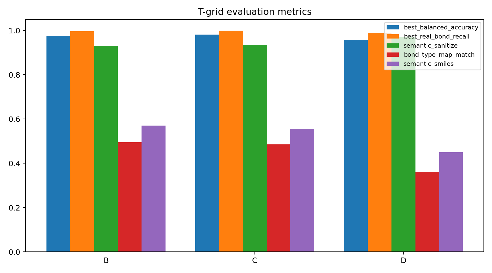

# Edge Denoiser Ablation Summary 20260603

本汇总加入新补跑的 GPU 版 C 组：`diffgui + pos_noise_std=0.05 + focal_gamma=2.0`。早先误跑的 CPU 版 C 组保留在原目录，但不纳入本结论。

## Shared Setup

- 数据：`analysis/edge_data_chain_20260602_n1000/train_edge.npz` + `analysis/edge_semantic_bundle_20260602_n1000/train_edge_semantic.npz`
- split：1000 molecules，train/val = 800/200，split_seed=0，seed=0
- 模型：`node_edge`，hidden_dim=64，num_layers=3，distance_basis_dim=16
- 训练：80 epochs，batch_size=16，reconstruction_every=10，t=500，limit=100
- t-grid 评估：val split 200 molecules，timesteps=0,50,100,250,500,750,950,999，reconstruct_timestep=500，limit=200

## Train Final Epoch

| run | device | weight | noise | focal | real F1 | double F1 | aromatic F1 | semantic sanitize | bond type map | semantic SMILES | best BA epoch | best BA |
|---|---|---|---:|---:|---:|---:|---:|---:|---:|---:|---:|---:|
| A_inverse_clean | cuda | inverse_sqrt | 0.0 | 1.0 | 0.9307 | 0.7859 | 0.9457 | 0.7900 | 0.4000 | 0.5400 | 60 | 0.9627 |
| B_diffgui_noise005 | cuda | diffgui | 0.05 | 1.0 | 0.9417 | 0.8093 | 0.9550 | 0.9100 | 0.4400 | 0.5200 | 77 | 0.9457 |
| C_diffgui_noise005_focal2 | cuda | diffgui | 0.05 | 2.0 | 0.9389 | 0.7906 | 0.9560 | 0.9100 | 0.4000 | 0.4700 | 35 | 0.9444 |
| D_diffgui_noise010 | cuda | diffgui | 0.1 | 1.0 | 0.9314 | 0.7613 | 0.9503 | 0.9200 | 0.3700 | 0.4500 | 65 | 0.9323 |

## T-grid Evaluation

A 组 t-grid 评估本轮仍未补跑；本表只比较已有同口径 final evaluator 的 B/C/D。

| run | device | best t | best BA | best real recall | semantic sanitize | bond type map | semantic SMILES | bad bond frac | bad bond count |
|---|---|---:|---:|---:|---:|---:|---:|---:|---:|
| B_diffgui_noise005 | cuda | 0 | 0.9751 | 0.9960 | 0.9300 | 0.4950 | 0.5700 | 0.000000 | 0 |
| C_diffgui_noise005_focal2 | cuda | 0 | 0.9811 | 0.9988 | 0.9350 | 0.4850 | 0.5550 | 0.000000 | 0 |
| D_diffgui_noise010 | cuda | 0 | 0.9568 | 0.9879 | 0.9700 | 0.3600 | 0.4500 | 0.000000 | 0 |

## Interpretation

- C 组补跑后，t-grid best BA = 0.9811，是 B/C/D 中最高；说明 focal_gamma=2 对分类层面的困难样本有帮助。
- 但 C 的 semantic SMILES = 0.5550，略低于 B 的 0.5700；bond type map = 0.4850，也略低于 B 的 0.4950。
- D 组 semantic sanitize = 0.9700 仍最高，但 bond type map 和 semantic SMILES 明显弱，说明 0.10 A 噪声更偏向保守可 sanitize，而不是精确还原键型。
- 当前推荐：如果目标是后续接 DiffSBDD 点云并尽量稳，B 仍是最均衡默认；C 可以作为少数键类别/高召回版本并行保留。

## Files

- [train_final_summary.csv](train_final_summary.csv)
- [tgrid_eval_summary.csv](tgrid_eval_summary.csv)
- [train_final_key_metrics.png](train_final_key_metrics.png)
- [tgrid_eval_available_metrics.png](tgrid_eval_available_metrics.png)
