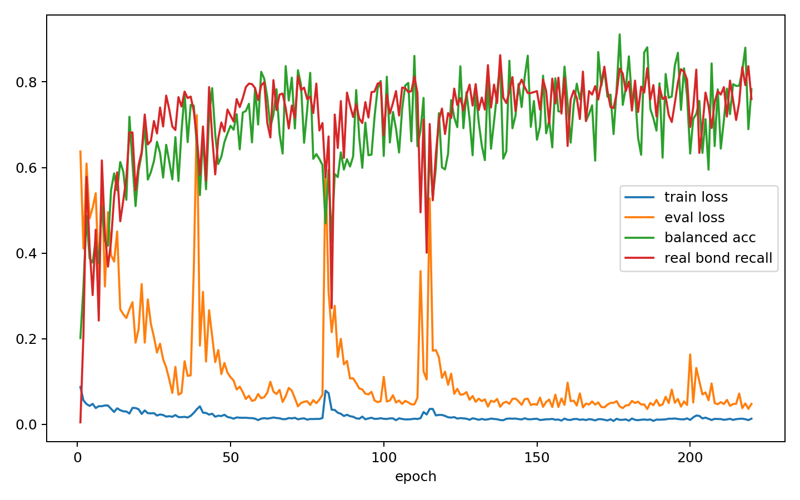

# Edge Denoiser Overfit Report

- edge_npz: `analysis/edge_data_chain_20260602_n1000/train_edge.npz`
- semantic_npz: `analysis/edge_semantic_bundle_20260602_n1000/train_edge_semantic.npz`
- device: `cuda`
- max_molecules: 32
- epochs: 220
- batch_size: 8
- focal_gamma: 1.0

## Class Counts And Weights

| bond type | count | weight |
|---|---:|---:|
| no_bond | 9717 | 0.069043 |
| single | 478 | 0.310986 |
| double | 66 | 0.831516 |
| triple | 3 | 3.403127 |
| aromatic | 311 | 0.385328 |

## Final Metrics

| metric | value |
|---|---:|
| train_loss | 0.013177 |
| eval_loss | 0.047813 |
| accuracy | 0.979953 |
| balanced_accuracy | 0.782925 |
| real_bond_recall | 0.759907 |
| no_bond_recall | 0.999382 |
| recall_single | 0.705021 |
| recall_double | 0.681818 |
| recall_triple | 0.666667 |
| recall_aromatic | 0.861736 |

## Best Balanced Accuracy Epoch

- epoch: 177
- balanced_accuracy: 0.910997
- real_bond_recall: 0.831002

## Files

- [edge_denoiser_overfit_metrics.csv](edge_denoiser_overfit_metrics.csv)
- [edge_denoiser_overfit_summary.json](edge_denoiser_overfit_summary.json)
- [edge_denoiser_overfit.pt](edge_denoiser_overfit.pt)

