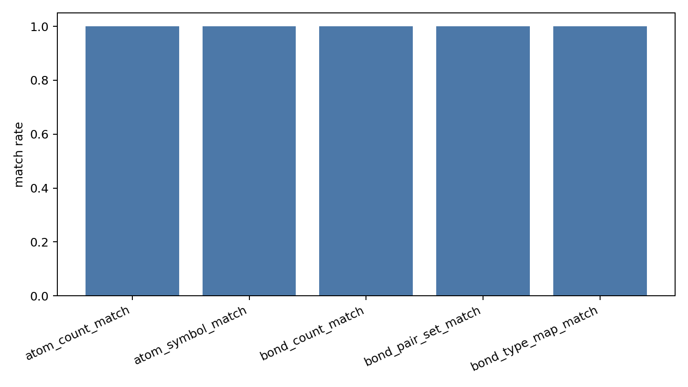
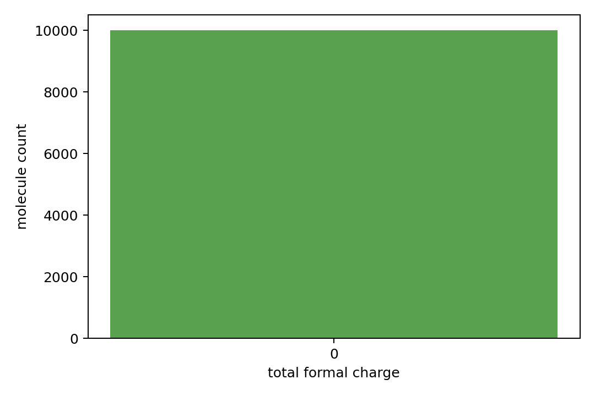

# Edge Semantic Bundle Report

- semantic_npz: `train_edge_semantic.npz`
- source_npz: `data/crossdocked_raw/processed_edge_noH_full/train.npz`
- raw_ligand_root: `data/crossdocked_raw/crossdocked_pocket10`
- dataset: `crossdock_full`
- samples: 10000

## Original SDF Load Status

| status | count |
|---|---:|
| success | 10000 |

## Semantic Match Rates

| metric | count | denominator | rate |
|---|---:|---:|---:|
| atom_count_match | 9999 | 10000 | 0.99990000 |
| atom_symbol_match | 9999 | 10000 | 0.99990000 |
| bond_count_match | 9999 | 10000 | 0.99990000 |
| bond_pair_set_match | 9999 | 10000 | 0.99990000 |
| bond_type_map_match | 9999 | 10000 | 0.99990000 |

## Total Formal Charge Counts

| total charge | count |
|---|---:|
| 0 | 10000 |

## Bond Type Counts

| bond type | processed | original SDF |
|---|---:|---:|
| aromatic | 99048 | 99048 |
| double | 21075 | 21075 |
| single | 132947 | 132948 |
| triple | 519 | 519 |

## Files

- [train_edge_semantic.npz](train_edge_semantic.npz)
- [edge_semantic_molecule_summary.csv](edge_semantic_molecule_summary.csv)
- [edge_semantic_manifest.json](edge_semantic_manifest.json)

