# Generated Reconstruction Benchmark Report

- checkpoint: `DiffSBDD/checkpoints/crossdocked_fullatom_cond.ckpt`
- pdbfile: `data/8GJL.pdb`
- ref_ligand: `C:1101`
- resi_list: `None`
- samples: `500`
- timesteps: `100`
- length_tolerance: `0.25`
- methods: `openbabel edm edge_denoiser_b edge_denoiser_c`
- local_bond_checkpoint: `analysis/local_bond_predictor_v0_20260602_small/best_model.pt`
- local_bond_device: `cpu`
- edge_denoiser_b_checkpoint: `analysis/edge_denoiser_ablation_20260603_B_diffgui_noise005/edge_denoiser_overfit.pt`
- edge_denoiser_c_checkpoint: `analysis/edge_denoiser_ablation_20260603_C_diffgui_noise005_focal2_gpu/edge_denoiser_overfit.pt`
- edge_denoiser_device: `cuda`
- edge_denoiser_timestep: `999`
- edge_denoiser_init_mode: `uniform_random`
- edge_denoiser_seed: `260603`

| method | sanitize | bad_bond_length | fragments | largest_frag | aromatic | benzene6 | bad_arom | QED | SA | TPSA | sec/mol |
|---|---:|---:|---:|---:|---:|---:|---:|---:|---:|---:|---:|
| openbabel | 0.654 | 0.047 | 1.118 | 0.978 | 0.484 | 0.336 | 0.234 | 0.402 | 0.418 | 39.651 | 0.0020 |
| edm | 0.482 | 0.004 | 2.776 | 0.805 | 0.012 | 0.002 | 0.002 | 0.239 | 0.278 | 32.383 | 0.0019 |
| edge_denoiser_b | 0.260 | 0.047 | 1.076 | 0.985 | 0.348 | 0.202 | 0.118 | 0.162 | 0.189 | 14.622 | 0.0046 |
| edge_denoiser_c | 0.264 | 0.045 | 1.078 | 0.984 | 0.356 | 0.202 | 0.112 | 0.166 | 0.190 | 14.959 | 0.0047 |

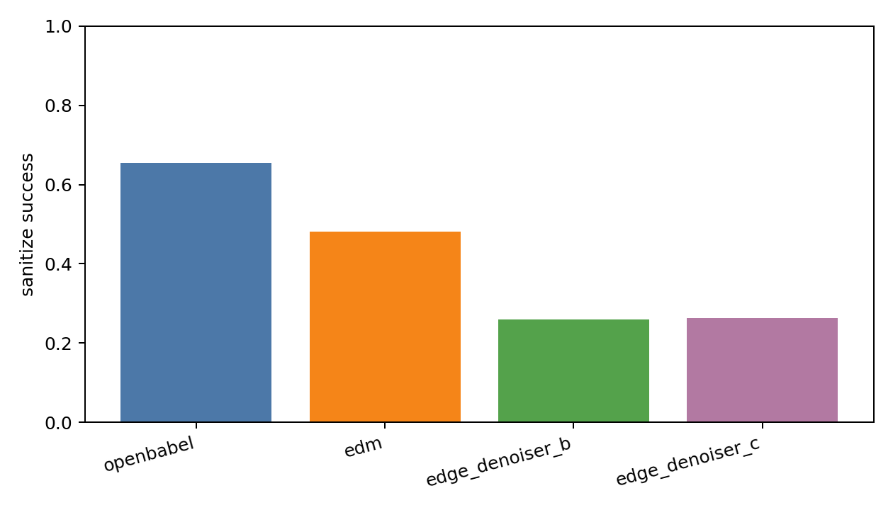

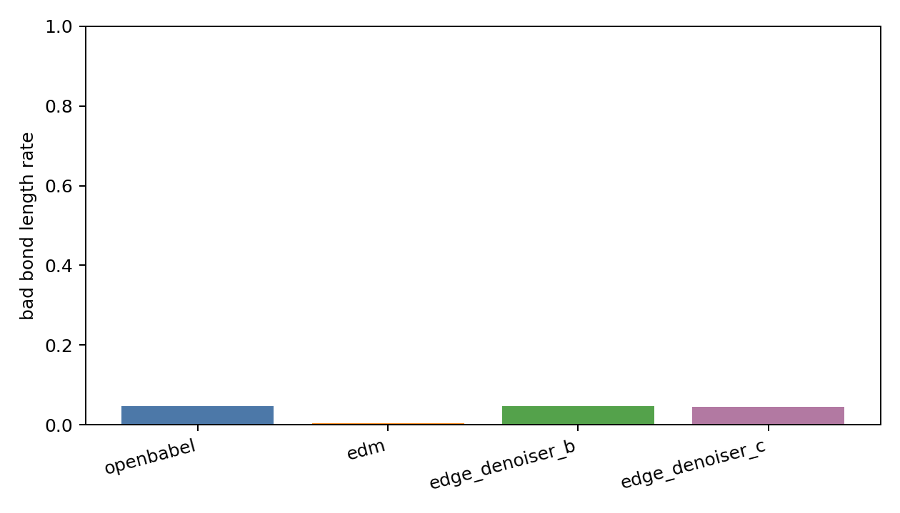

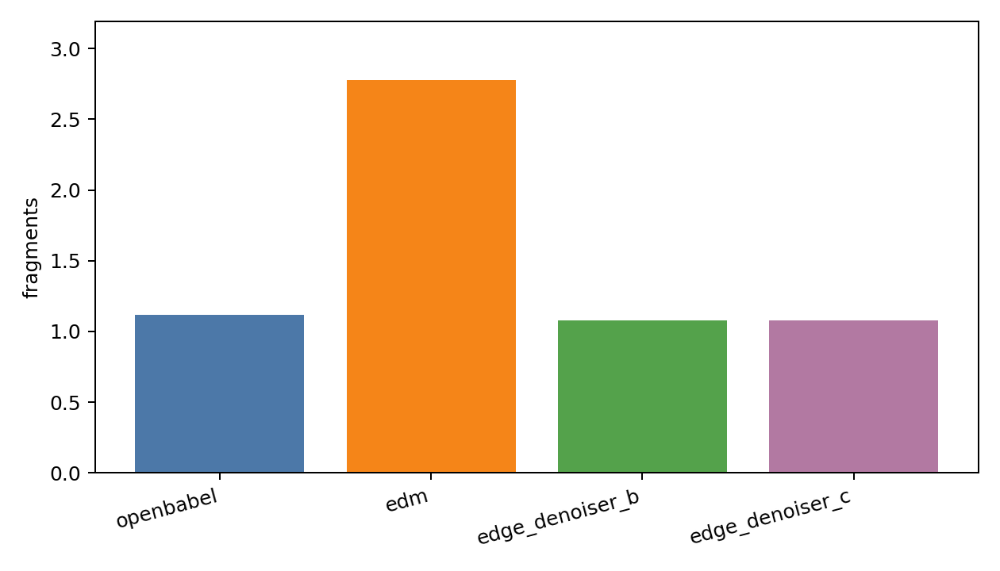

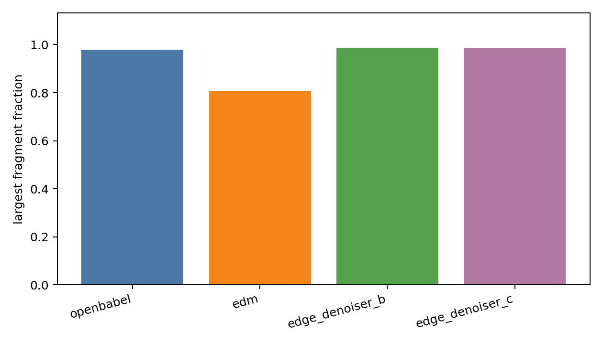

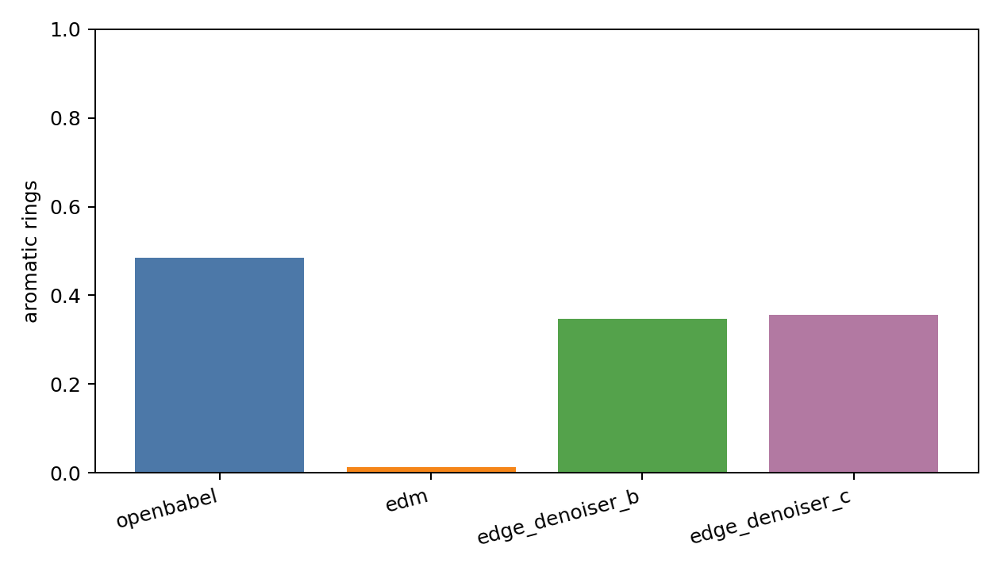

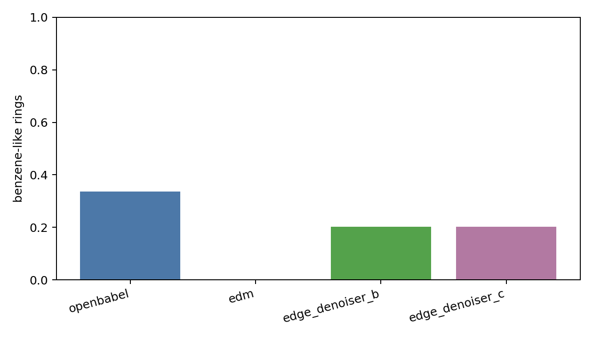

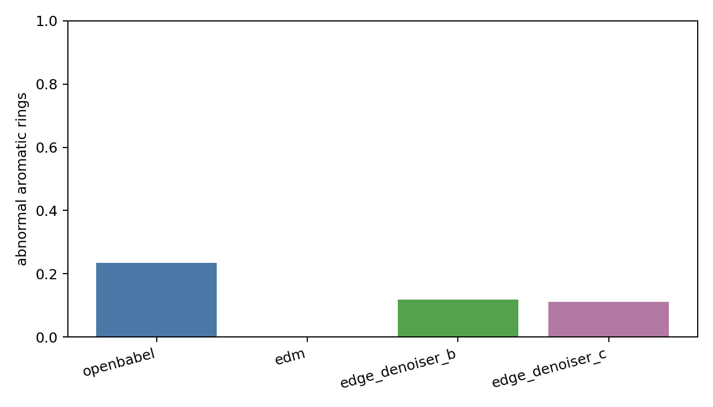

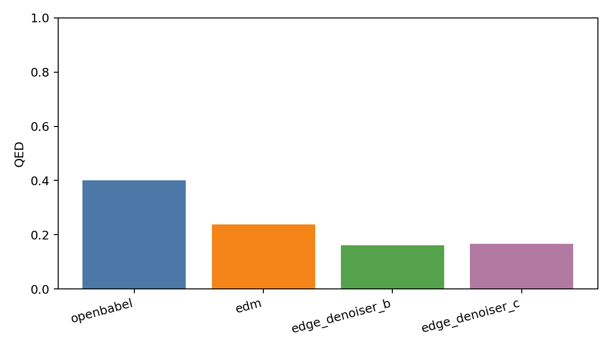

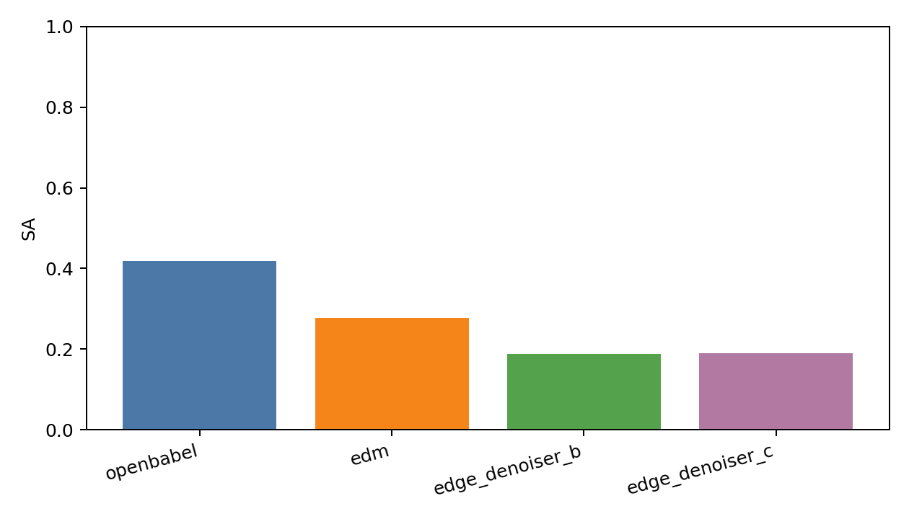

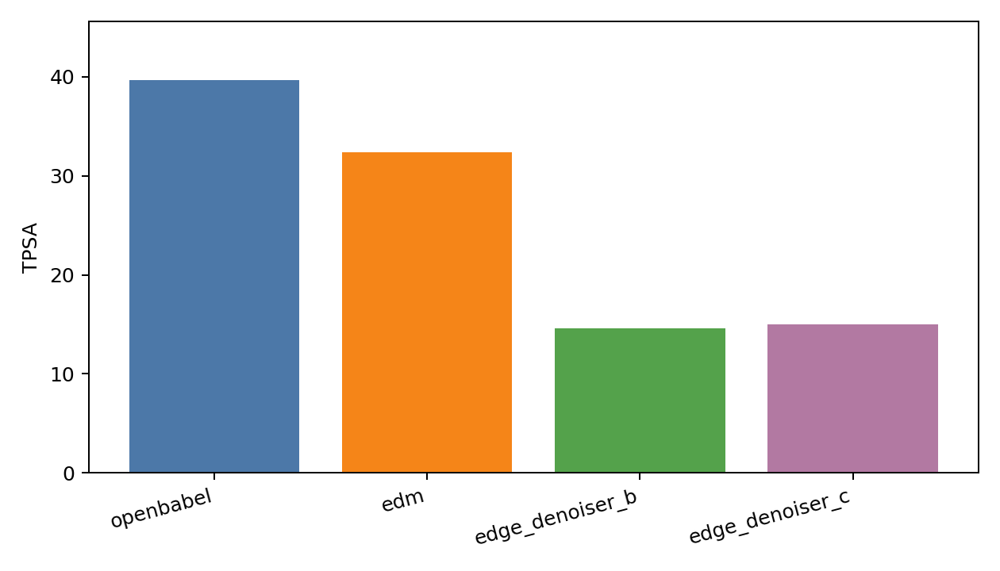

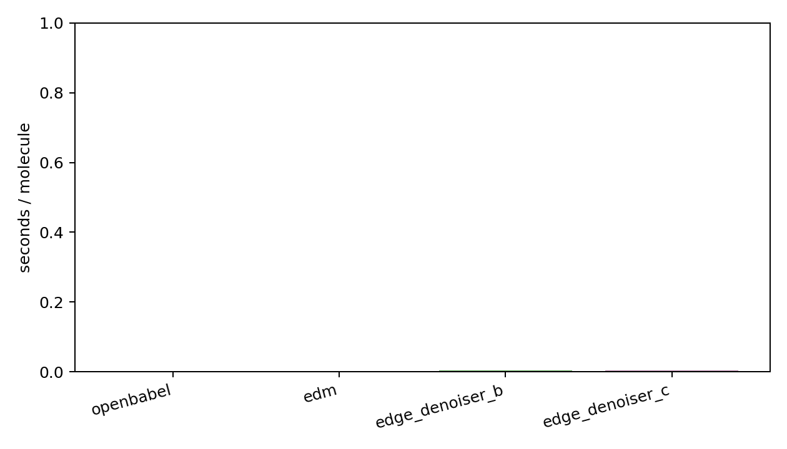
