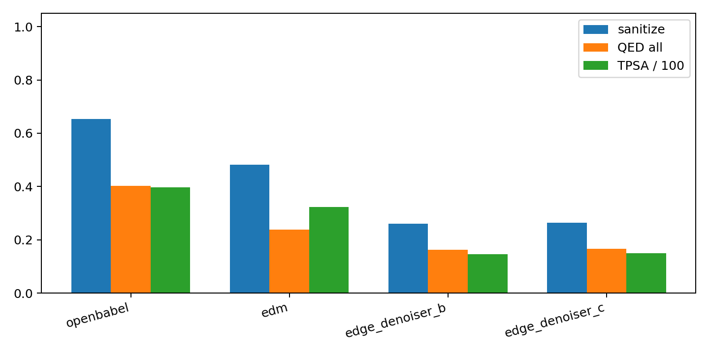
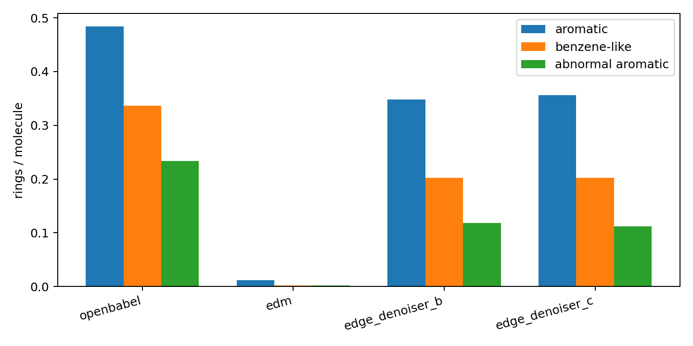
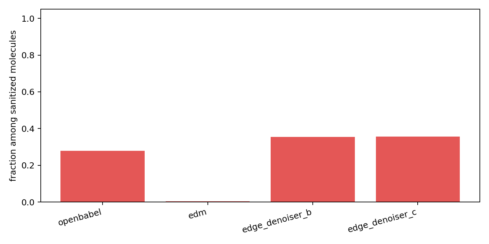

# Generated Point Cloud Edge-Denoiser Off-Manifold Analysis

本分析使用 500 个 DiffSBDD generated point clouds，100 步扩散；edge denoiser 不使用真键 noising，而是 `uniform_random` 初始 edge，`t=999`。

## Key Takeaway

- 在 generated point cloud 上，B/C edge denoiser 的 sanitize 只有约 0.26，明显低于 OpenBabel 的 0.654。
- 这说明 clean CrossDocked 上训练出的 edge denoiser 直接接 DiffSBDD 点云会明显 off-manifold 掉点。
- 苯环方面，OpenBabel 的 benzene-like rings 更多，但 abnormal aromatic rings 也更多；B/C 生成的 benzene-like rings 更少，异常芳香环也少一些，主要问题是整体 sanitize 太低。

## Overall Summary

| method | sanitize | bad bond | fragments | aromatic | benzene6 | abnormal arom | 3-rings | QED all | TPSA all | sec/mol |
|---|---:|---:|---:|---:|---:|---:|---:|---:|---:|---:|
| openbabel | 0.654 | 0.047 | 1.118 | 0.484 | 0.336 | 0.234 | 0.274 | 0.402 | 39.651 | 0.0020 |
| edm | 0.482 | 0.004 | 2.776 | 0.012 | 0.002 | 0.002 | 0.066 | 0.239 | 32.383 | 0.0019 |
| edge_denoiser_b | 0.260 | 0.047 | 1.076 | 0.348 | 0.202 | 0.118 | 0.088 | 0.162 | 14.622 | 0.0046 |
| edge_denoiser_c | 0.264 | 0.045 | 1.078 | 0.356 | 0.202 | 0.112 | 0.094 | 0.166 | 14.959 | 0.0047 |

## Sanitized Molecules Only

| method | sanitized | QED | TPSA | aromatic | benzene6 | any benzene frac | abnormal arom | any abnormal frac | 3-rings |
|---|---:|---:|---:|---:|---:|---:|---:|---:|---:|
| openbabel | 327 | 0.614 | 60.628 | 0.740 | 0.514 | 0.434 | 0.358 | 0.278 | 0.419 |
| edm | 241 | 0.496 | 67.185 | 0.025 | 0.004 | 0.004 | 0.004 | 0.004 | 0.137 |
| edge_denoiser_b | 130 | 0.623 | 56.240 | 1.338 | 0.777 | 0.623 | 0.454 | 0.354 | 0.338 |
| edge_denoiser_c | 132 | 0.630 | 56.663 | 1.348 | 0.765 | 0.606 | 0.424 | 0.356 | 0.356 |

## Error Counts

| method | error | count | fraction |
|---|---|---:|---:|
| openbabel | success | 327 | 0.654 |
| openbabel | AtomValenceException | 173 | 0.346 |
| edm | AtomValenceException | 259 | 0.518 |
| edm | success | 241 | 0.482 |
| edge_denoiser_b | KekulizeException | 266 | 0.532 |
| edge_denoiser_b | success | 130 | 0.260 |
| edge_denoiser_b | AtomValenceException | 74 | 0.148 |
| edge_denoiser_b | AtomKekulizeException | 30 | 0.060 |
| edge_denoiser_c | KekulizeException | 247 | 0.494 |
| edge_denoiser_c | success | 132 | 0.264 |
| edge_denoiser_c | AtomValenceException | 83 | 0.166 |
| edge_denoiser_c | AtomKekulizeException | 38 | 0.076 |

## Interpretation

- OpenBabel: sanitize=0.654，benzene-like=0.336/mol，abnormal aromatic=0.234/mol。
- Edge B: sanitize=0.260，benzene-like=0.202/mol，abnormal aromatic=0.118/mol。
- Edge C: sanitize=0.264，benzene-like=0.202/mol，abnormal aromatic=0.112/mol。
- 在 sanitize 成功子集中，OpenBabel any abnormal aromatic fraction=0.278；B=0.354；C=0.356。

结论：B/C edge denoiser 不是苯环特别异常，而是生成点云上整体化学闭合失败较多。OpenBabel 虽然 sanitize 更高、苯环更多，但 abnormal aromatic 也更多，说明 OpenBabel 的芳香处理也不完全干净。

## Files

- [focused_method_summary.csv](focused_method_summary.csv)
- [focused_sanitized_subset_summary.csv](focused_sanitized_subset_summary.csv)
- [focused_error_counts.csv](focused_error_counts.csv)
- [generated_reconstruction_per_molecule.csv](generated_reconstruction_per_molecule.csv)
- [generated_reconstruction_summary.csv](generated_reconstruction_summary.csv)
- [aromatic_benzene_examples.csv](aromatic_benzene_examples.csv)
- [aromatic_benzene_diagnostic_examples.sdf](aromatic_benzene_diagnostic_examples.sdf)
