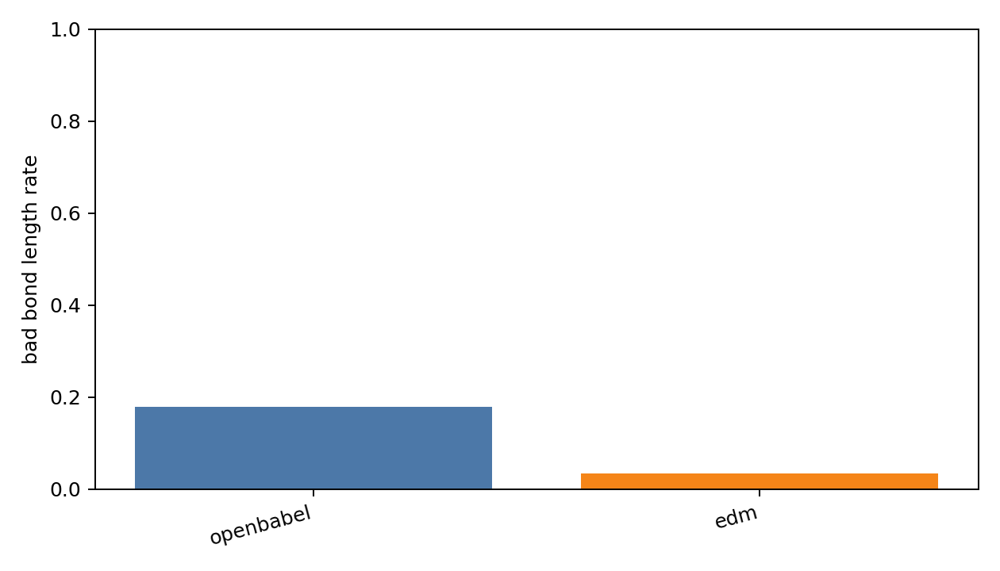
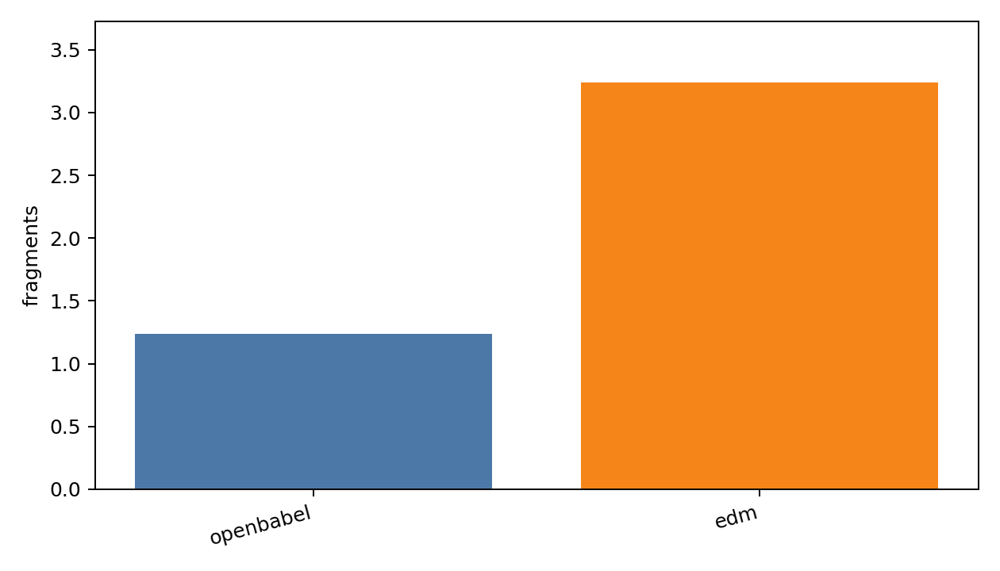

# Generated Reconstruction Ablation Report

- checkpoint: `DiffSBDD/checkpoints/crossdocked_fullatom_cond.ckpt`
- pdbfile: `data/8GJL.pdb`
- ref_ligand: `C:1101`
- resi_list: `None`
- samples: 50
- timesteps: 10
- length_tolerance: 0.25

| method | sanitize | bad_bond_length | fragments | aromatic_rings | seconds/mol |
|---|---:|---:|---:|---:|---:|
| openbabel | 0.840 | 0.179 | 1.240 | 0.340 | 0.0031 |
| edm | 0.140 | 0.035 | 3.240 | 0.020 | 0.0017 |

