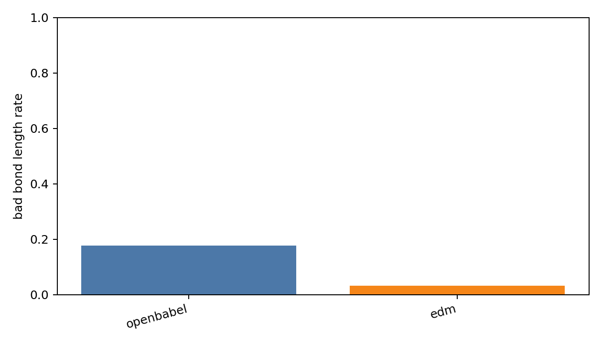
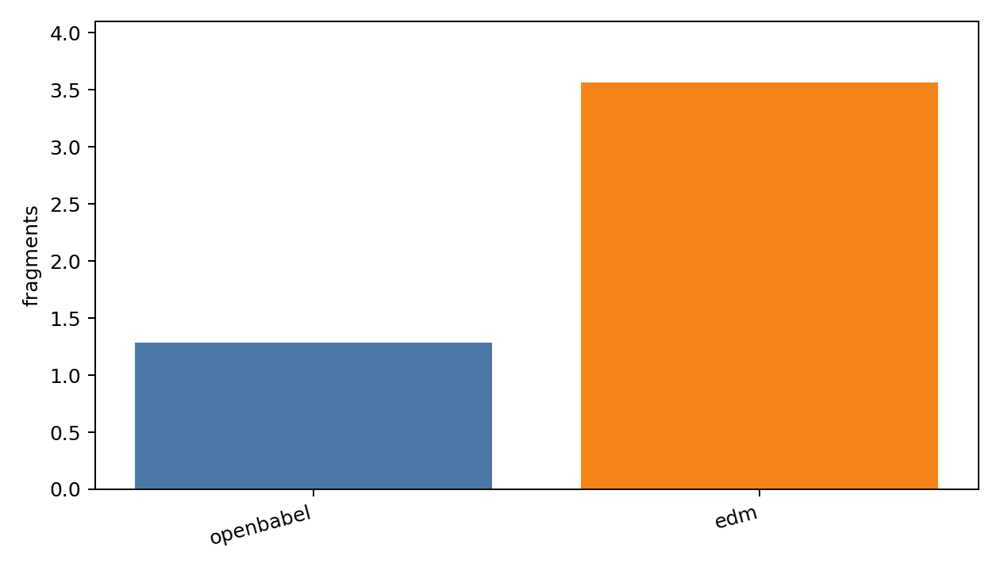

# Generated Reconstruction Ablation Report

- checkpoint: `DiffSBDD/checkpoints/crossdocked_fullatom_cond.ckpt`
- pdbfile: `data/8GJL.pdb`
- ref_ligand: `C:1101`
- resi_list: `None`
- samples: 500
- timesteps: 10
- length_tolerance: 0.25

| method | sanitize | bad_bond_length | fragments | aromatic_rings | seconds/mol |
|---|---:|---:|---:|---:|---:|
| openbabel | 0.746 | 0.177 | 1.288 | 0.284 | 0.0024 |
| edm | 0.162 | 0.033 | 3.564 | 0.010 | 0.0016 |

