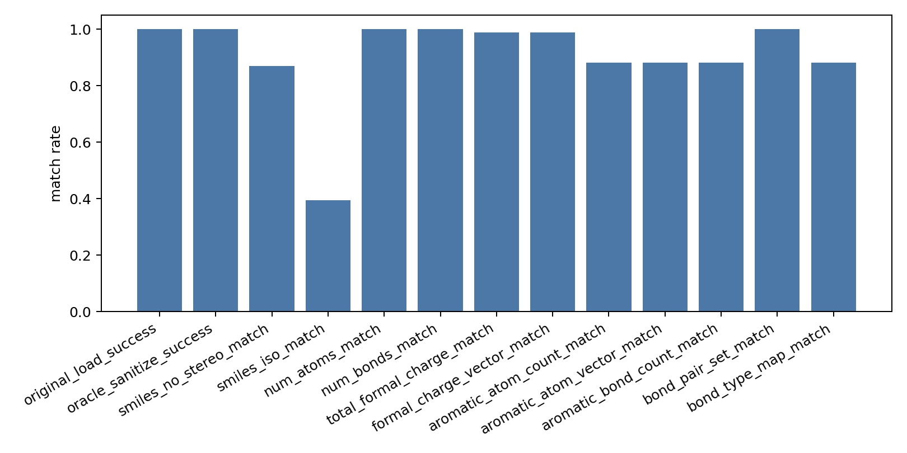

# Oracle Original SDF Audit Report

- npz_path: `data/crossdocked_raw/processed_edge_noH_full/train.npz`
- raw_ligand_root: `data/crossdocked_raw/crossdocked_pocket10`
- dataset: `crossdock_full`
- samples: 1000

## Global Match Rates

| metric | count | denominator | rate |
|---|---:|---:|---:|
| original_load_success | 1000 | 1000 | 1.00000000 |
| oracle_sanitize_success | 1000 | 1000 | 1.00000000 |
| smiles_no_stereo_match | 870 | 1000 | 0.87000000 |
| smiles_iso_match | 394 | 1000 | 0.39400000 |
| num_atoms_match | 1000 | 1000 | 1.00000000 |
| num_bonds_match | 1000 | 1000 | 1.00000000 |
| total_formal_charge_match | 989 | 1000 | 0.98900000 |
| formal_charge_vector_match | 989 | 1000 | 0.98900000 |
| aromatic_atom_count_match | 881 | 1000 | 0.88100000 |
| aromatic_atom_vector_match | 881 | 1000 | 0.88100000 |
| aromatic_bond_count_match | 881 | 1000 | 0.88100000 |
| bond_pair_set_match | 1000 | 1000 | 1.00000000 |
| bond_type_map_match | 881 | 1000 | 0.88100000 |

## By Repair Strategy

| repair_strategy | count | no-stereo SMILES | iso SMILES | charge vector | aromatic atom vector | bond type map |
|---|---:|---:|---:|---:|---:|---:|
| fix_aromatic | 3 | 0.00000000 | 0.00000000 | 1.00000000 | 0.00000000 | 0.00000000 |
| fix_valence | 127 | 0.00000000 | 0.00000000 | 0.91338583 | 0.08661417 | 0.08661417 |
| none | 870 | 1.00000000 | 0.45287356 | 1.00000000 | 1.00000000 | 1.00000000 |

## Interpretation

- Atom counts, bond counts, and bond pair sets matching at 100% means the processed halfedge connectivity is aligned with the original SDF atom order.
- No-stereo SMILES is not fully preserved. The repaired oracle decoder should not be treated as chemically faithful for all molecules.
- Bond type/aromaticity mismatch indicates that some RDKit repair paths sanitize the molecule by changing aromatic/bond semantics.
- Formal charge mismatch indicates that charges should be read from original SDF metadata rather than inferred only during repair.
- Next engineering step: store original formal charges/aromatic atom flags or reuse original SDF-derived molecule semantics in the edge bundle before training a faithful edge decoder.

## Files

- [oracle_original_sdf_audit.csv](oracle_original_sdf_audit.csv)
- [oracle_original_sdf_smiles_mismatches.csv](oracle_original_sdf_smiles_mismatches.csv)
- [oracle_original_sdf_by_repair_strategy.csv](oracle_original_sdf_by_repair_strategy.csv)
- [oracle_original_sdf_audit_summary.csv](oracle_original_sdf_audit_summary.csv)
- [oracle_original_sdf_audit_summary.json](oracle_original_sdf_audit_summary.json)
