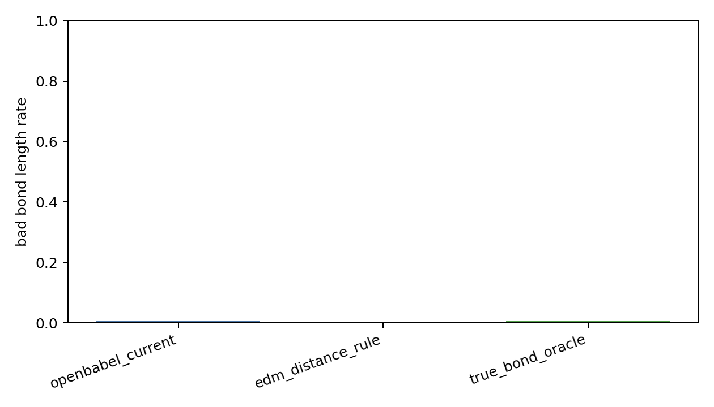
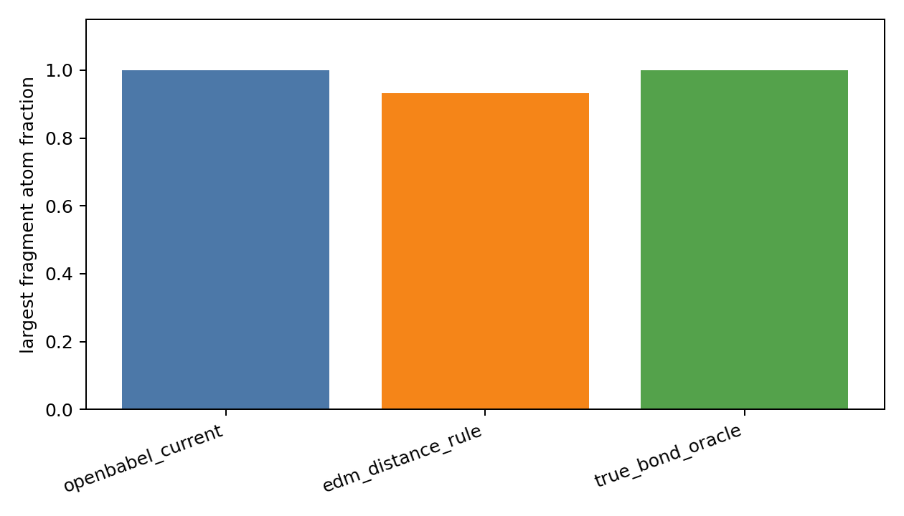

# Reconstruction Ablation Report

- npz_path: `data/crossdocked_raw/processed_edge_noH_full/train.npz`
- dataset: `crossdock_full`
- samples: 5000
- length_tolerance: 0.25

| method | sanitize | edge_f1 | bad_bond_length | fragments | extra | missed |
|---|---:|---:|---:|---:|---:|---:|
| openbabel_current | 0.677 | 1.000 | 0.005 | 1.000 | 0.000 | 0.000 |
| edm_distance_rule | 0.917 | 0.984 | 0.001 | 1.521 | 0.007 | 0.707 |
| true_bond_oracle | 0.867 | 1.000 | 0.008 | 1.000 | 0.000 | 0.000 |

