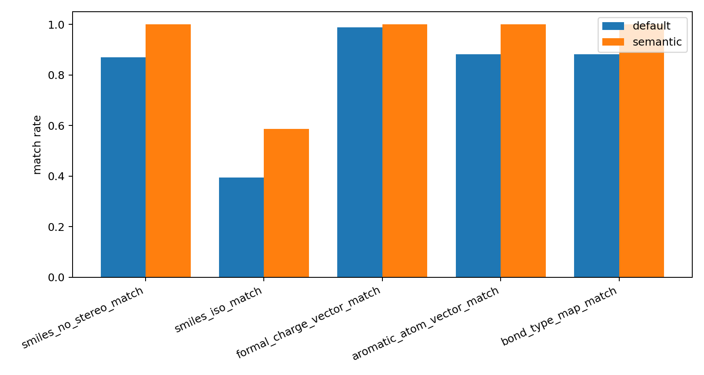

# Semantic Oracle Reconstruction Audit

- npz_path: `data/crossdocked_raw/processed_edge_noH_full/train.npz`
- semantic_npz: `analysis/edge_semantic_bundle_20260602_n1000/train_edge_semantic.npz`
- raw_ligand_root: `data/crossdocked_raw/crossdocked_pocket10`
- dataset: `crossdock_full`
- samples: 1000
- name_mismatch_count: 0
- smiles_no_stereo_improvements: 130
- smiles_no_stereo_regressions: 0

## Match Rates

| metric | default count | semantic count | denominator | default rate | semantic rate | delta |
|---|---:|---:|---:|---:|---:|---:|
| smiles_no_stereo_match | 870 | 1000 | 1000 | 0.87000000 | 1.00000000 | 130 |
| smiles_iso_match | 394 | 586 | 1000 | 0.39400000 | 0.58600000 | 192 |
| formal_charge_vector_match | 989 | 1000 | 1000 | 0.98900000 | 1.00000000 | 11 |
| aromatic_atom_vector_match | 881 | 1000 | 1000 | 0.88100000 | 1.00000000 | 119 |
| bond_type_map_match | 881 | 1000 | 1000 | 0.88100000 | 1.00000000 | 119 |

## Default Repair Strategies

| strategy | count |
|---|---:|
| fix_aromatic | 3 |
| fix_valence | 127 |
| none | 870 |

## Semantic-Aware Repair Strategies

| strategy | count |
|---|---:|
| none | 1000 |

## Files

- [semantic_oracle_reconstruction_audit.csv](semantic_oracle_reconstruction_audit.csv)
- [semantic_oracle_smiles_improvements.csv](semantic_oracle_smiles_improvements.csv)
- [semantic_oracle_smiles_regressions.csv](semantic_oracle_smiles_regressions.csv)
- [semantic_oracle_reconstruction_summary.csv](semantic_oracle_reconstruction_summary.csv)
- [semantic_oracle_reconstruction_summary.json](semantic_oracle_reconstruction_summary.json)

