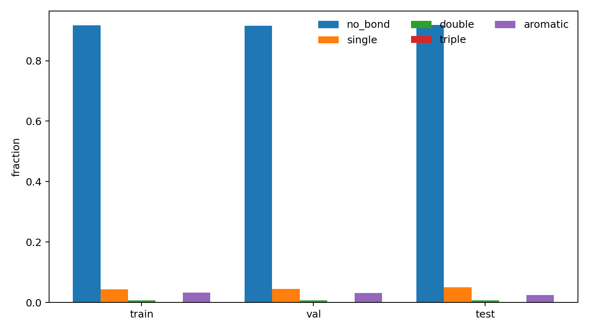
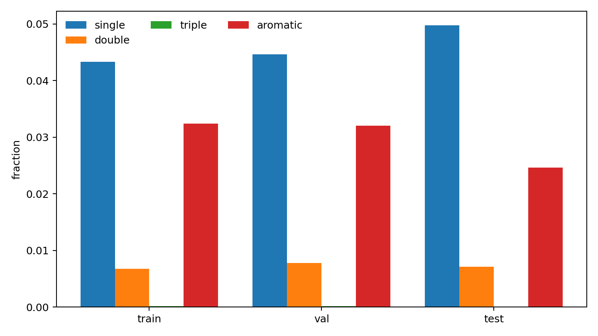
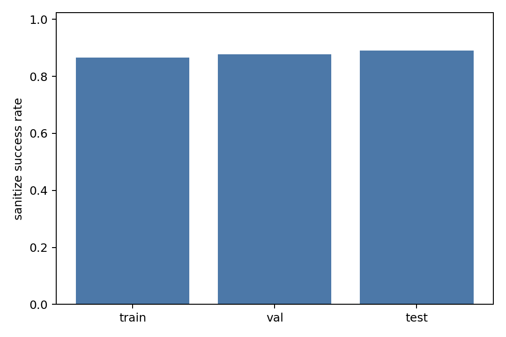
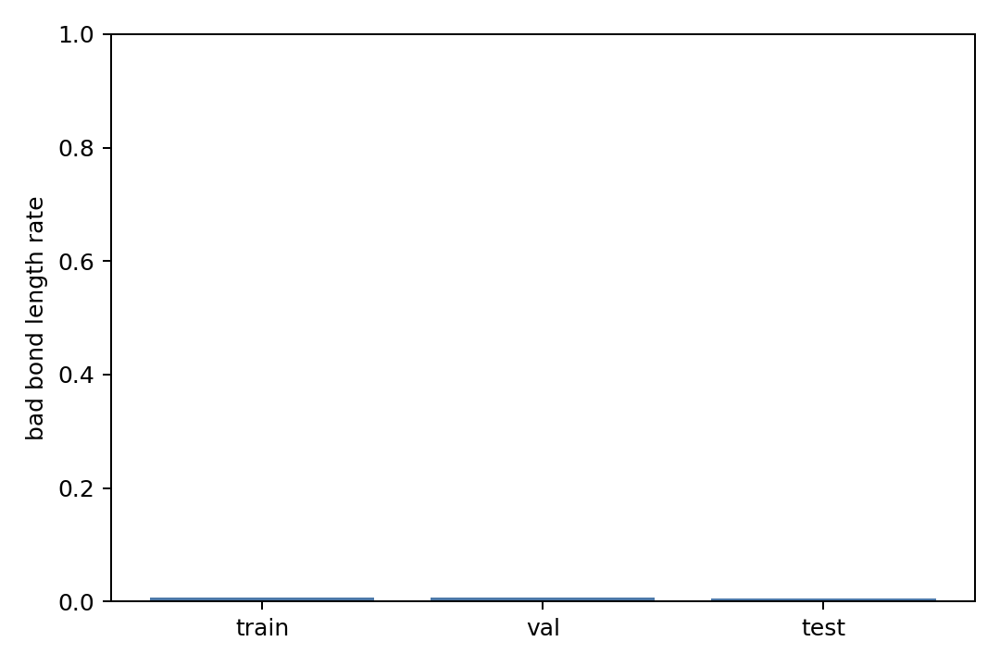

# 260601-19 本地成键预测数据链验证

## 一、动机/背景

DiffSBDD 当前只生成 `x,h` 点云，后处理成键主要依赖 OpenBabel / EDM 距离规则。前面对同一批生成点云的对比显示，外部 DiffGui / MolSnapper 预训练 bond predictor 零样本接入不能稳定救回 DiffSBDD 点云，所以需要先建立本地 `local_bond_predictor` 的训练数据链。

本次任务只验证 CrossDocked 真键和 DiffGui-style halfedge 标签是否可靠，不训练模型、不改训练主线。

## 二、已有相关代码和数据

| 项 | 路径 | 作用 |
|---|---|---|
| CrossDocked edge 数据 | `data/crossdocked_raw/processed_edge_noH_full/` | 已处理 train/val/test `.npz`，含 `lig_bond_index` / `lig_bond_type` / `num_lig_bonds` |
| halfedge 工具 | `DiffSBDD/edge_utils.py` | 把有向真键转成 `ligand_halfedge_index` / `ligand_halfedge_type` |
| 数据集加载器 | `DiffSBDD/dataset.py` | 读取 `.npz` 后动态生成 halfedge 标签 |
| oracle 报告旧脚本 | `DiffSBDD/analysis/edge_data_oracle_report.py` | 已能对单 split 做 oracle reconstruction |

已有 train 抽样 5000 的旧结果：oracle sanitize `4334/5000`，bad bond length `0.007135`，说明真键坐标基本可用，但缺少 train/val/test 统一报告。

## 三、做了什么

新增：

| 文件 | 作用 |
|---|---|
| `DiffSBDD/analysis/local_bond_predictor_data_report.py` | 对 train/val/test 统一验证 halfedge 数据链、oracle reconstruction、bond type 分布、键长分布，并输出 CSV/PNG/Markdown |

输出目录：

| 目录 | 样本设置 |
|---|---|
| `analysis/local_bond_predictor_data_20260601_smoke/` | train/val/test 各 20 个样本 |
| `analysis/local_bond_predictor_data_20260601/` | train 10000，val 300，test 100 |

脚本记录的关键文件：

| 文件 | 内容 |
|---|---|
| [split_summary.csv](../../local_bond_predictor_data_20260601/split_summary.csv) | split 级样本数、sanitize、bad length、halfedge/bond mismatch |
| [bond_type_counts_by_split.csv](../../local_bond_predictor_data_20260601/bond_type_counts_by_split.csv) | no-bond/single/double/triple/aromatic 计数和比例 |
| [bond_length_by_split.csv](../../local_bond_predictor_data_20260601/bond_length_by_split.csv) | 每条真键键长、参考键长、是否异常 |
| [bond_pair_length_summary.csv](../../local_bond_predictor_data_20260601/bond_pair_length_summary.csv) | 原子对-键型级键长统计 |
| [oracle_reconstruction_by_split.csv](../../local_bond_predictor_data_20260601/oracle_reconstruction_by_split.csv) | 每个分子的 oracle reconstruction 结果 |
| [sanitize_errors_by_split.csv](../../local_bond_predictor_data_20260601/sanitize_errors_by_split.csv) | sanitize 失败类型统计 |
| [local_bond_predictor_manifest.json](../../local_bond_predictor_data_20260601/local_bond_predictor_manifest.json) | 数据来源、标签定义、split 摘要 |

## 四、运行命令与结果

语法检查：

```bash
conda run -n dif python -m py_compile DiffSBDD/analysis/local_bond_predictor_data_report.py
```

结果：通过。

小样本 smoke：

```bash
conda run -n dif python DiffSBDD/analysis/local_bond_predictor_data_report.py --processed-dir data/crossdocked_raw/processed_edge_noH_full --outdir analysis/local_bond_predictor_data_20260601_smoke --train-max-samples 20 --val-max-samples 20 --test-max-samples 20 --log-level INFO
```

结果：通过，生成 CSV/PNG/Markdown。

正式报告：

```bash
conda run -n dif python DiffSBDD/analysis/local_bond_predictor_data_report.py --processed-dir data/crossdocked_raw/processed_edge_noH_full --outdir analysis/local_bond_predictor_data_20260601 --train-max-samples 10000 --val-max-samples 300 --test-max-samples 100 --log-level INFO
```

结果：通过，报告路径为 [local_bond_predictor_data_report.md](../../local_bond_predictor_data_20260601/local_bond_predictor_data_report.md)。

## 五、关键数据

### split 汇总

| split | dataset | analyzed | sanitize | bad length | no-bond | halfedge mismatch | bond mismatch | samples/s |
|---|---:|---:|---:|---:|---:|---:|---:|---:|
| train | 99929 | 10000 | 0.86520000 | 0.00725772 | 0.91722093 | 0 | 0 | 390.226 |
| val | 300 | 300 | 0.87666667 | 0.00659222 | 0.91541464 | 0 | 0 | 401.299 |
| test | 100 | 100 | 0.89000000 | 0.00580913 | 0.91837836 | 0 | 0 | 405.999 |

结论：

- `halfedge mismatch = 0`，说明 `num_atoms -> n(n-1)/2 halfedges` 链路正确。
- `bond mismatch = 0`，说明 halfedge 中正类 bond 数量与 `num_lig_bonds` 对齐。
- bad bond length 约 `0.58% - 0.73%`，真键坐标质量可以作为 bond predictor 监督信号。
- no-bond 约 `91.5% - 91.8%`，后续训练必须处理类别不均衡。

### real bond 类型分布

| split | single | double | triple | aromatic |
|---|---:|---:|---:|---:|
| train | 0.52382867 | 0.08212623 | 0.00215603 | 0.39188907 |
| val | 0.52753700 | 0.09174557 | 0.00160021 | 0.37911722 |
| test | 0.60991736 | 0.08760331 | 0.00082645 | 0.30165289 |

结论：

- single/aromatic 是主要正类。
- triple 极少，训练时不能指望模型稳定学到丰富 triple 模式。
- test 的 aromatic 比例低于 train/val，评估时应看 per-class recall，不只看总 accuracy。

### sanitize 错误

| split | AtomValenceException | KekulizeException |
|---|---:|---:|
| train | 158 | 1190 |
| val | 5 | 32 |
| test | 3 | 8 |

结论：

- sanitize 失败主要来自 kekulize，其次是 N valence。
- 这不等价于 halfedge 标签错，因为 halfedge/bond count 和键长指标都正常；更可能来自 no-H、芳香标记、formal charge/valence 表达和 RDKit sanitize 策略。
- 后续 local bond predictor 的第一评价指标不应只看 RDKit sanitize，还要看 bond CE、positive recall、bad bond length、fragment count。

## 六、图表










## 七、下一步

建议下一步训练 `local_bond_predictor` baseline：

| 模块 | 最小方案 |
|---|---|
| 输入 | atom type pair、距离/RBF、可选 pocket context |
| 标签 | `ligand_halfedge_type` 的 0/1/2/3/4 |
| 负类处理 | no-bond 下采样或 weighted CE/focal loss |
| 评价 | bond type macro-F1、positive recall、oracle reconstruction、bad length、fragment count |
| 对照 | OpenBabel、EDM、DiffGui pretrained predictor、MolSnapper pretrained predictor |

剩余风险：

- oracle sanitize 不是 100%，需要在训练和评估里区分“标签可学性”和“RDKit sanitize 成功率”。
- 训练集 99929 个样本本次只抽样 10000 做报告；正式训练可以直接使用全量 `.npz`，但报告无需每次全量 sanitize。
