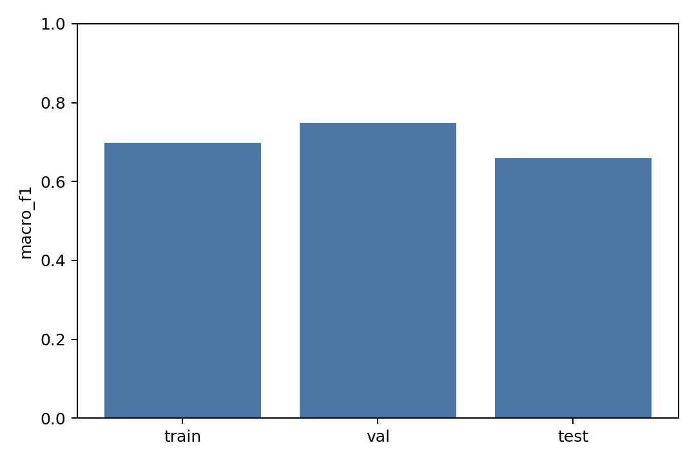

# 260602-01 本地成键预测器 v0 训练基线

## 一、动机/背景

上一阶段已经验证 CrossDocked edge/halfedge 数据链可靠：`halfedge mismatch = 0`，`bond mismatch = 0`，bad bond length 约 `0.58% - 0.73%`。因此本阶段按解耦逻辑继续，不改 DiffSBDD 主模型，先训练一个独立的 `local_bond_predictor` v0，回答“本地监督信号能否学出可用成键模型”。

这个 v0 是 pair-MLP，不是最终 EGNN/edge diffusion。它的任务是快速建立可学性和指标基线。

## 二、已有相关代码和数据

| 项 | 路径 | 作用 |
|---|---|---|
| halfedge 数据报告 | `analysis/local_bond_predictor_data_20260601/` | 证明 CrossDocked 真键和 halfedge 链路可用 |
| 数据集加载器 | `DiffSBDD/dataset.py` | 动态生成 `ligand_halfedge_index/type` |
| halfedge 工具 | `DiffSBDD/edge_utils.py` | 0/1/2/3/4 bond type 定义 |
| 外部先例 | DiffGui / MolSnapper bond predictor | no-bond 权重使用 `0.1`，真实键权重使用 `1.0` |

## 三、做了什么

新增独立模块：

| 文件 | 作用 |
|---|---|
| `DiffSBDD/local_bond_predictor/dataset.py` | 从 molecule-level halfedge 构建 pair features，并支持 no-bond 负采样 |
| `DiffSBDD/local_bond_predictor/model.py` | pair-MLP bond predictor |
| `DiffSBDD/local_bond_predictor/metrics.py` | confusion matrix、macro-F1、positive recall、各键型 recall |
| `DiffSBDD/local_bond_predictor/train.py` | 训练、评估、checkpoint、CSV/PNG/Markdown 报告 |
| `test/test_local_bond_predictor.py` | feature、negative sampling、metrics 单测 |

v0 输入：

```text
atom_i one-hot
atom_j one-hot
distance(i,j)
RBF(distance)
```

v0 输出：

```text
0 = no_bond
1 = single
2 = double
3 = triple
4 = aromatic
```

loss：

```text
CrossEntropyLoss(weight=[0.1, 1.0, 1.0, 1.0, 1.0])
```

## 四、运行命令与结果

语法检查：

```bash
conda run -n dif python -m py_compile DiffSBDD/local_bond_predictor/__init__.py DiffSBDD/local_bond_predictor/dataset.py DiffSBDD/local_bond_predictor/model.py DiffSBDD/local_bond_predictor/metrics.py DiffSBDD/local_bond_predictor/train.py test/test_local_bond_predictor.py
```

结果：通过。

单测：

```bash
conda run -n dif python test/test_local_bond_predictor.py
```

结果：`Ran 3 tests`，`OK`。

GPU 尝试：

```bash
conda run -n dif python DiffSBDD/local_bond_predictor/train.py ... --device cuda:0
```

结果：`RuntimeError: No CUDA GPUs are available`。`nvidia-smi` 能看到 GPU，但该 `conda run` 进程里 torch CUDA 不可用。本次 smoke 和 small baseline 均使用 CPU。

## 五、训练输出

| 目录 | 设置 | 报告 |
|---|---|---|
| `analysis/local_bond_predictor_v0_20260602_smoke/` | train 200，val 50，test 50，1 epoch，10 train steps | [report](../../local_bond_predictor_v0_20260602_smoke/local_bond_predictor_v0_report.md) |
| `analysis/local_bond_predictor_v0_20260602_small/` | train 1000，val 300，test 100，5 epoch | [report](../../local_bond_predictor_v0_20260602_small/local_bond_predictor_v0_report.md) |

small baseline 关键文件：

| 文件 | 内容 |
|---|---|
| [metrics.csv](../../local_bond_predictor_v0_20260602_small/metrics.csv) | train/val/test 分类指标 |
| [training_history.csv](../../local_bond_predictor_v0_20260602_small/training_history.csv) | 每 epoch loss 和 val 指标 |
| [confusion_val.csv](../../local_bond_predictor_v0_20260602_small/confusion_val.csv) | val confusion matrix |
| [confusion_test.csv](../../local_bond_predictor_v0_20260602_small/confusion_test.csv) | test confusion matrix |
| [best_model.pt](../../local_bond_predictor_v0_20260602_small/best_model.pt) | val macro-F1 最优 checkpoint |
| [manifest.json](../../local_bond_predictor_v0_20260602_small/manifest.json) | 训练配置 |

## 六、关键数据

### small baseline 总指标

| split | accuracy | macro-F1 | positive precision | positive recall | positive F1 |
|---|---:|---:|---:|---:|---:|
| train | 0.94512113 | 0.69889431 | 0.99897367 | 0.99996049 | 0.99946684 |
| val | 0.98555089 | 0.74801734 | 0.99986665 | 0.99986665 | 0.99986665 |
| test | 0.98691356 | 0.65896342 | 1.00000000 | 1.00000000 | 1.00000000 |

### small baseline 各键型 recall

| split | no-bond | single | double | triple | aromatic |
|---|---:|---:|---:|---:|---:|
| train | 0.99974185 | 0.74378453 | 0.47265625 | 0.34545455 | 0.76064091 |
| val | 0.99998768 | 0.81673407 | 0.54215116 | 0.25000000 | 0.91874780 |
| test | 1.00000000 | 0.86382114 | 0.48584906 | 0.00000000 | 0.89589041 |

### val confusion matrix

| true | no_bond | single | double | triple | aromatic |
|---|---:|---:|---:|---:|---:|
| no_bond | 81156 | 1 | 0 | 0 | 0 |
| single | 1 | 3231 | 80 | 0 | 644 |
| double | 0 | 138 | 373 | 0 | 177 |
| triple | 0 | 0 | 0 | 3 | 9 |
| aromatic | 0 | 231 | 0 | 0 | 2612 |

## 七、图表





## 八、结论

| 结论 | 证据 |
|---|---|
| v0 数据/训练/评估链路已跑通 | smoke 和 small baseline 均生成 checkpoint、metrics、confusion、图表、报告 |
| pair-MLP 可以学到 no-bond vs real-bond | positive recall 接近 1，no-bond recall 接近 1 |
| single/aromatic 已经可学 | val single recall `0.8167`，aromatic recall `0.9187` |
| double 只能部分学到 | val double recall `0.5422` |
| triple 不稳定 | test triple recall `0.0`，样本极少 |
| v0 还不能作为最终成键器 | macro-F1 val `0.7480`，test `0.6590`，键型细分仍弱 |

## 九、下一步

建议下一步不是立刻上完整 edge diffusion，而是继续解耦：

| 优先级 | 任务 | 目的 |
|---|---|---|
| P0 | 用 v0 checkpoint 接 reconstruction backend | 看它在 DiffSBDD 生成点云上能否优于 OpenBabel/EDM |
| P0 | 和 OpenBabel/EDM/DiffGui/MolSnapper 同点云对比 | 判断“本地 predictor 是否值得继续” |
| P1 | 加 class-balanced sampling / per-class weight sweep | 改善 double/triple |
| P1 | 升级 EGNN/NodeEdgeNet v1 | 引入上下文，提升芳香/双键判断 |
| P2 | 加 generated-point-cloud noise augmentation | 适配 DiffSBDD 坏点云分布 |

本阶段已经能支持下一步“接入可切换 reconstruction backend 并统一对比”。
