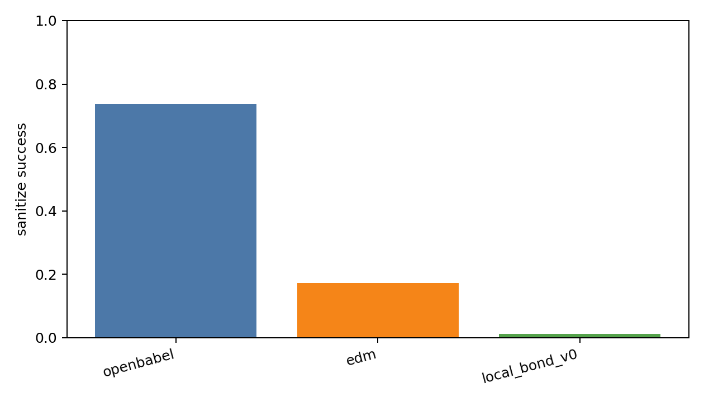
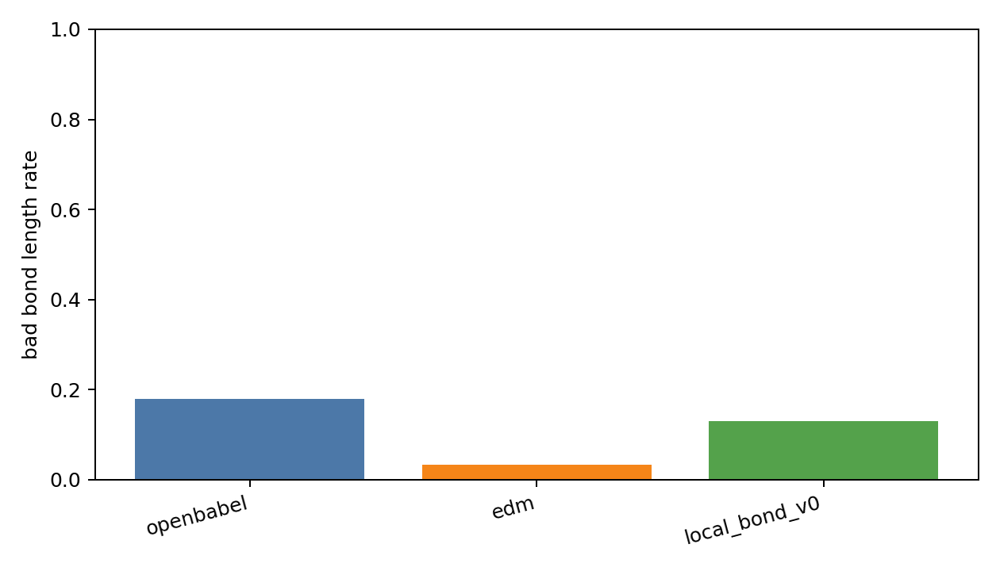
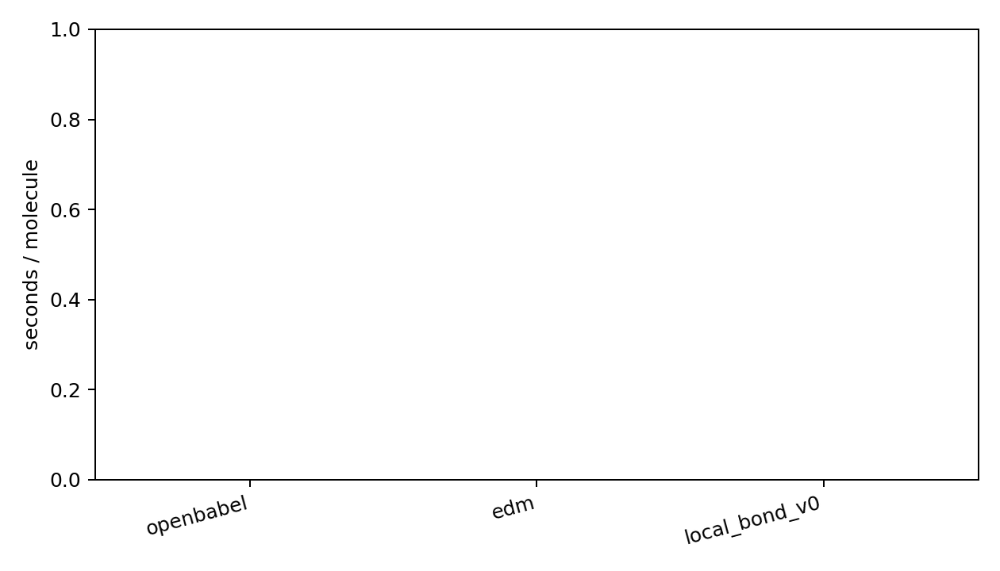

# 260602-02 本地成键预测器接入重建对比

## 一、动机/背景

上一阶段 `local_bond_predictor_v0` 已经在 CrossDocked true halfedge 上证明能学到基本成键信号，但这还不能说明它能改善 DiffSBDD 生成点云。真正要回答的问题是：在同一批 DiffSBDD atom cloud 上，本地 predictor 是否能替代或优于 OpenBabel/EDM，以及是否比 DiffGui/MolSnapper 的零样本 pretrained predictor 更适配。

因此本阶段不改 DiffSBDD 主模型，只把本地 predictor 做成 reconstruction benchmark 的一个可切换 method。

## 二、已有相关代码和数据

| 项 | 路径 | 作用 |
|---|---|---|
| 本地 predictor checkpoint | `analysis/local_bond_predictor_v0_20260602_small/best_model.pt` | v0 pair-MLP，输入 atom pair + distance/RBF，输出 0/1/2/3/4 bond type |
| reconstruction benchmark | `DiffSBDD/analysis/generated_reconstruction_ablation.py` | 统一采样 DiffSBDD 点云，并用多个 reconstruction method 对比 |
| benchmark method registry | `DiffSBDD/analysis/reconstruction_benchmark/methods.py` | OpenBabel/EDM/外部 DiffGui/MolSnapper adapter 已在这里解耦 |
| 评价与报告 | `DiffSBDD/analysis/reconstruction_benchmark/metrics.py`, `reporting.py` | 输出 per-molecule CSV、summary CSV、SDF、PNG、Markdown |

## 三、做了什么

| 文件 | 改动 |
|---|---|
| `DiffSBDD/analysis/reconstruction_benchmark/methods.py` | 新增 `LocalBondPredictorMethod`，从 v0 checkpoint 加载 pair-MLP，对 upper-triangle halfedge 预测 bond type，并构建 RDKit mol |
| `DiffSBDD/analysis/generated_reconstruction_ablation.py` | 新增 `--local-bond-checkpoint` 和 `--local-bond-device`，并在 metadata 中记录 |
| `DiffSBDD/analysis/reconstruction_benchmark/reporting.py` | 扩展绘图 palette，支持 5 个以上 reconstruction method |
| `test/test_local_bond_predictor.py` | 新增 toy checkpoint adapter 单测，验证 checkpoint -> adapter -> RDKit mol 链路 |
| `AGENTS.md`, `.codebuddy/rules/环境.mdc` | 记录 GPU 优先规则：生成、benchmark、推理、训练中 CUDA 可用且更快时优先 GPU |

## 四、GPU/CPU 情况

本次 benchmark 使用 CPU，原因是当前 `dif` 环境里 CUDA 不可见：

```bash
conda run -n dif python -c "import torch; print(torch.cuda.is_available(), torch.cuda.device_count())"
```

结果：

```text
False 0
```

已按用户要求写入规则：以后生成、benchmark、模型推理和训练，如果 `dif` 环境中 CUDA 实际可用且 GPU 预期更快，优先 GPU；只有 CUDA 不可见、显存不足或 CPU-bound 时才退回 CPU，并在报告中说明。

## 五、运行命令与验证

语法检查：

```bash
conda run -n dif python -m py_compile DiffSBDD/analysis/reconstruction_benchmark/methods.py DiffSBDD/analysis/reconstruction_benchmark/reporting.py DiffSBDD/analysis/generated_reconstruction_ablation.py test/test_local_bond_predictor.py
```

结果：通过。

单测：

```bash
conda run -n dif python test/test_local_bond_predictor.py
```

结果：`Ran 4 tests`，`OK`。

benchmark smoke：

```bash
conda run -n dif python DiffSBDD/analysis/generated_reconstruction_ablation.py --outdir analysis/generated_reconstruction_benchmark_20260602_local_bond_v0_smoke_n20 --n-samples 20 --batch-size 5 --timesteps 10 --methods openbabel edm local_bond_v0 --local-bond-checkpoint analysis/local_bond_predictor_v0_20260602_small/best_model.pt --local-bond-device cpu --device cpu --skip-external-probe
```

结果：完成，wall time 约 `32.2s`。

n=100 全方法对比：

```bash
conda run -n dif python DiffSBDD/analysis/generated_reconstruction_ablation.py --outdir analysis/generated_reconstruction_benchmark_20260602_local_bond_v0_external_n100 --n-samples 100 --batch-size 10 --timesteps 10 --methods openbabel edm diffgui_bond molsnapper_bond local_bond_v0 --local-bond-checkpoint analysis/local_bond_predictor_v0_20260602_small/best_model.pt --local-bond-device cpu --external-bond-device cpu --device cpu
```

结果：完成，wall time 约 `244.2s`。

n=500 大样本三方法对比：

```bash
conda run -n dif python DiffSBDD/analysis/generated_reconstruction_ablation.py --outdir analysis/generated_reconstruction_benchmark_20260602_local_bond_v0_n500 --n-samples 500 --batch-size 25 --timesteps 10 --methods openbabel edm local_bond_v0 --local-bond-checkpoint analysis/local_bond_predictor_v0_20260602_small/best_model.pt --local-bond-device cpu --device cpu --skip-external-probe
```

结果：完成，wall time 约 `849.1s`。

注意：下表 `sec/mol` 来自 `generated_reconstruction_summary.csv`，只表示 reconstruction method 的成键/建 mol 时间，不包含 DiffSBDD 点云采样时间。

## 六、关键数据

### n=100：OpenBabel / EDM / DiffGui / MolSnapper / local v0

输出目录：[generated_reconstruction_benchmark_20260602_local_bond_v0_external_n100](../../generated_reconstruction_benchmark_20260602_local_bond_v0_external_n100/)

| method | sanitize | bad bond length | fragments | largest frag | aromatic | QED | SA | TPSA | sec/mol |
|---|---:|---:|---:|---:|---:|---:|---:|---:|---:|
| openbabel | 0.790 | 0.164 | 1.260 | 0.969 | 0.220 | 0.434 | 0.448 | 37.764 | 0.0026 |
| edm | 0.170 | 0.027 | 3.310 | 0.731 | 0.020 | 0.080 | 0.100 | 7.584 | 0.0030 |
| diffgui_bond | 0.700 | 0.216 | 1.010 | 0.996 | 0.010 | 0.437 | 0.376 | 30.145 | 0.7257 |
| molsnapper_bond | 0.250 | 0.197 | 1.010 | 0.999 | 0.310 | 0.158 | 0.168 | 11.101 | 0.0675 |
| local_bond_v0 | 0.030 | 0.122 | 1.050 | 0.989 | 0.060 | 0.018 | 0.024 | 0.909 | 0.0022 |

local v0 失败类型：

| error | count |
|---|---:|
| AtomValenceException | 75 |
| KekulizeException | 20 |
| AtomKekulizeException | 2 |
| sanitize success | 3 |

关键文件：

| 文件 | 内容 |
|---|---|
| [report](../../generated_reconstruction_benchmark_20260602_local_bond_v0_external_n100/generated_reconstruction_benchmark_report.md) | Markdown 总结 |
| [summary CSV](../../generated_reconstruction_benchmark_20260602_local_bond_v0_external_n100/generated_reconstruction_summary.csv) | 方法级均值 |
| [per-molecule CSV](../../generated_reconstruction_benchmark_20260602_local_bond_v0_external_n100/generated_reconstruction_per_molecule.csv) | 单分子明细 |
| [local SDF](../../generated_reconstruction_benchmark_20260602_local_bond_v0_external_n100/local_bond_v0_sanitized.sdf) | local v0 有效分子，仅 3 个 |


### n=500：OpenBabel / EDM / local v0

输出目录：[generated_reconstruction_benchmark_20260602_local_bond_v0_n500](../../generated_reconstruction_benchmark_20260602_local_bond_v0_n500/)

| method | sanitize | bad bond length | fragments | largest frag | aromatic | QED | SA | TPSA | sec/mol |
|---|---:|---:|---:|---:|---:|---:|---:|---:|---:|
| openbabel | 0.738 | 0.179 | 1.306 | 0.952 | 0.270 | 0.413 | 0.419 | 33.813 | 0.0020 |
| edm | 0.172 | 0.033 | 3.444 | 0.707 | 0.004 | 0.076 | 0.103 | 9.028 | 0.0015 |
| local_bond_v0 | 0.012 | 0.130 | 1.084 | 0.981 | 0.008 | 0.008 | 0.008 | 0.546 | 0.0020 |

local v0 失败类型：

| error | count |
|---|---:|
| AtomValenceException | 320 |
| KekulizeException | 150 |
| AtomKekulizeException | 24 |
| sanitize success | 6 |

local v0 单分子统计：

| metric | mean | median | max |
|---|---:|---:|---:|
| num_bonds | 28.814 | 28.000 | 71.000 |
| bad_bond_length_rate | 0.130 | 0.121 | 0.551 |
| chemistry_problem_count | 3.188 | 2.000 | 17.000 |
| valence_problem_count | 2.212 | 1.000 | 16.000 |
| num_fragments | 1.084 | 1.000 | 3.000 |
| largest_fragment_atom_frac | 0.981 | 1.000 | 1.000 |

关键文件：

| 文件 | 内容 |
|---|---|
| [report](../../generated_reconstruction_benchmark_20260602_local_bond_v0_n500/generated_reconstruction_benchmark_report.md) | Markdown 总结 |
| [summary CSV](../../generated_reconstruction_benchmark_20260602_local_bond_v0_n500/generated_reconstruction_summary.csv) | 方法级均值 |
| [per-molecule CSV](../../generated_reconstruction_benchmark_20260602_local_bond_v0_n500/generated_reconstruction_per_molecule.csv) | 单分子明细 |
| [local SDF](../../generated_reconstruction_benchmark_20260602_local_bond_v0_n500/local_bond_v0_sanitized.sdf) | local v0 有效分子，仅 6 个 |







## 七、结论

| 结论 | 证据 | 含义 |
|---|---|---|
| local v0 已成功接入统一 reconstruction benchmark | n20/n100/n500 均跑通，生成 CSV/PNG/SDF/Markdown | 解耦路线成立，后续所有成键器都能在同点云上公平比较 |
| local v0 不能直接替代 OpenBabel | n100 sanitize `0.030`，n500 sanitize `0.012`；OpenBabel 分别 `0.790`/`0.738` | 当前 pair-MLP 没有全局价态/环一致性，直接 argmax 会产生大量无效结构 |
| local v0 的失败不是速度问题 | n500 local `0.0020 sec/mol`，OpenBabel `0.0020 sec/mol` | 速度足够快，瓶颈在化学一致性 |
| local v0 的失败主要是价态和芳香一致性 | n500: `AtomValenceException=320`，`KekulizeException=150`，`AtomKekulizeException=24` | 下一步要加 valence-aware decoding / graph consistency / 更强上下文模型 |
| 外部 DiffGui predictor 零样本仍强于 local v0，但慢很多 | n100 DiffGui sanitize `0.700`，local `0.030`；DiffGui `0.7257 sec/mol`，local `0.0022 sec/mol` | 成熟 predictor 的结构归纳偏置更强，但直接移植速度和适配都不是免费 |
| EDM bond length 好但碎片多、有效率低 | n500 EDM bad bond `0.033`，fragments `3.444`，sanitize `0.172` | 单纯距离规则可以压键长异常，但不能保证连通和价态 |

## 八、下一步建议

| 优先级 | 任务 | 原因 |
|---|---|---|
| P0 | 给 local predictor adapter 加 valence-aware decoding / bond pruning 对照 | 当前失败集中在价态，先用解码层验证是否能把 sanitize 从 1%-3% 拉起来 |
| P0 | 训练 v1：加入 full no-bond 评估 + class-balanced loss sweep + generated-noise augmentation | v0 在真实 CrossDocked 上可学，但迁移到 DiffSBDD 点云崩，说明需要适配生成点云分布 |
| P1 | EGNN/NodeEdgeNet bond predictor | pair-MLP 缺少全图上下文，无法判断环、芳香、价态配平 |
| P1 | x0 geometry loss / bond length auxiliary loss | 当前成键器发现局部距离仍有约 12%-13% bad bond length，说明点云几何也要约束 |
| P2 | t-conditioned bond head | 若采样中间态也要约束成键，需要让 bond head 看到扩散时间；这一步仍属于辅助 head，不是完整 edge diffusion |
| P3 | 完整 x,h,e edge diffusion 小样本 overfit | 只有当前面证明“解码修复 + predictor v1 + geometry loss”仍不够时，再进入完整 edge diffusion，避免一开始把训练/采样/logprob 全部推倒 |

本阶段的核心判断：**DiffSBDD 现有 OpenBabel 成键确实有问题，但一个只看两点距离和元素的 local bond head 也不能治本；下一步应该先做 valence-aware decoding 和更强 graph-context predictor，而不是直接把 v0 接进 RL 作为生产成键器。**
