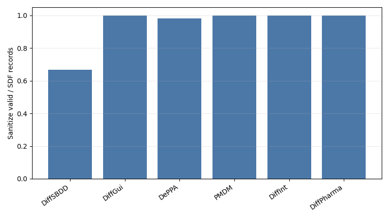

# DiffB110 四条线进展与课题方向请教

> 目的：向计算机方向老师请教课题收敛方式与下一步技术路线  
> 项目目标：用 3D 扩散模型和强化学习，在 RE-CmeB 靶点上生成可结合且化学合理的小分子  
> 当前状态：已有完整工程和多条实验线，但需要判断哪 1-2 条线最适合作为论文主线

---

## 0. 总结：现在真正需要请教什么

这段时间我围绕同一个问题展开了四条线：

**如何让 pocket-conditioned 3D 分子扩散模型既能保持化学合理性，又能被 docking / classifier 等目标有效优化？**

目前得到的核心结论是：

1. **DiffSBDD 强化学习已经跑通，但 reward 很容易被模型钻空子。**  
   旧 RL 训练中，docking 有改善迹象，但分子逐渐高碳化、低极性、低杂原子，classifier reward 又过于稀疏，导致 PPO 学不到稳定方向。

2. **DiffSBDD 的底座质量是主要瓶颈，但 DiffGui 的横评数字也要注明口径。**  
   同一靶点横评中，DiffSBDD 速度最快、docking 潜力不差，但进入评估的 500 个 SDF 里 sanitize 只有 66.6%。DiffGui 成功写入并进入评估的 500 个 SDF 里 sanitize 是 100%，但它的采样日志显示为得到这些成功分子另有 55 个 failed / reconstruction error 样本被丢弃，所以不能把 DiffGui 的 100% 直接解释成“原始采样全合法”。

3. **内部小改风险低，但改善幅度有限。**  
   atom prior、geometry refine、bond head 等轻量模块容易接入，但不改变扩散变量，最终成键仍依赖规则重建，可能解决不了根因。

4. **内部大改 x/h/e 联合扩散方向正确，但工程和训练风险最高。**  
   halfedge 数据、edge denoiser、xhe joint diffusion 已经搭起来，但联合采样、loss 平衡、边-坐标一致性仍很难稳定。

5. **DiffGui 底座质量更好，而且成本现在看是可控的。**  
   200 步下 8GPU 每 epoch 约 30 分钟，其中生成只占约 3 分钟，主要成本在 PPO 更新；一晚能跑 20+ epoch。因此 DiffGui 并不是完全不可用的慢底座。需要同时注意的是，DiffGui 也会生成复杂环/稠环、高碳、低极性分子；横评中 ring count mean=4.68、芳香分子率=70.2%、carbon fraction=0.820、TPSA=46.7。初版 `docking + classifier` reward 没明显改善后，我已启动 pure docking / lr=1e-5 / last2 解冻的诊断实验，测试是否至少能推出 docking 趋势。

**我想请教老师的核心问题不是某个代码 bug，而是：**

- 这四条线里，哪条最适合作为论文主线？
- 是继续做 RL 方法，还是优先改生成底座？
- 如果要收敛成一篇计算机论文，应该强调“强化学习优化框架”、还是“3D 分子扩散模型的结构先验改造”、还是“更强底座上的 reward-guided generation”？
- 我目前更倾向于把 **DiffGui 强化学习** 作为下一阶段主线，因为它底座质量更强、工程已经解耦接入、成本可控；DiffSBDD 大改 x/h/e 线虽然理论上更根本，但复杂度太高，我不确定改完是否一定有效。

---

## 1. 两个核心底座：DiffSBDD 与 DiffGui

### DiffSBDD 是什么

DiffSBDD 是当前项目最早使用的 pocket-conditioned 3D 扩散生成底座。它主要生成 ligand 的坐标 `x` 和原子类型 `h`，最后再用 OpenBabel / RDKit 这类规则工具从点云重建化学键。

优点：

- 速度快，适合多轮 RL 训练；
- 工程链路已经完整接入 DDPO/PPO；
- docking 潜力并不差。

问题：

- 模型内部没有显式 bond / halfedge 扩散变量；
- 最终成键依赖规则重建，导致 sanitize、valence、fragment、bad bond length 等问题；
- 在 RL 中容易被 docking reward 推向高碳、低极性、复杂结构。

### DiffGui 是什么

DiffGui 是更强的 3D 分子生成底座，原生建模 ligand atom、bond/halfedge 与坐标之间的联合关系，属于更接近 `x/h/e` 联合生成的路线。

优点：

- 成功写入并进入评估的样本合法性明显好于 DiffSBDD；
- 500 步横评中，进入评估的 500 个 SDF sanitize 为 100%；
- 200 步训练成本现在看可控：一晚可跑 20+ epoch；
- 已经完成独立 DiffGui RL 接入，不污染 DiffSBDD 主线。

问题：

- 原始采样并非没有失败样本，横评日志显示 DiffGui 为得到 500 个成功 SDF 另有 55 个 failed / reconstruction error 样本被过滤；
- 也会产生复杂环/稠环、高碳、低极性分子，不能把“可重建合法性高”理解成“分布一定药物合理”；
- PPO 更新成本高；
- 初版混合 reward 没有明显上升；
- 是否能通过 RL 真正优化 docking 还需要 pure docking 诊断实验确认。

### 分子样貌图占位

> 这里后续手动加入一张图：左侧放 DiffSBDD 生成分子示例，右侧放 DiffGui 生成分子示例。  
> 目的不是做定量证明，而是让老师直观看到两个底座生成分子的“外观/结构风格”差异。

---

## 2. 四条线一页总览

| 线 | 目标 | 已做核心探索 | 当前结论 | 最大问题 | 想请教老师 |
|---|---|---|---|---|---|
| **C. DiffSBDD 强化学习** | 在现有 DiffSBDD 上用 DDPO/PPO 优化 docking 和药物合理性 | 7/8 GPU 训练、docking/classifier reward、KL、ChemistryGuard、GoodMoleculePool、描述子监控 | 工程最成熟，最接近论文实验；但 reward hacking 明显 | classifier 稀疏，docking 偏好高碳/复杂结构 | 这条线能否作为主线？还是只适合作为工具链/对照？ |
| **A. 内部小改线** | 不大改模型，只加 atom prior、geometry refine、bond head 等轻量模块 | atom composition prior、final refine、local mask、bond predictor 调研 | 风险低，可作为 DiffSBDD 修补方案 | 不改变扩散变量，成键根因仍在 | 轻量改造是否足够形成创新点？ |
| **B. 内部大改线** | 把 DiffSBDD 改成 x/h/e 联合扩散，引入 bond/halfedge 通道 | halfedge 数据链、edge denoiser、xhe joint diffusion、DiffGui 对照 | 理论上最根本，但复杂度最高；不确定改完是否有效 | 联合训练、联合采样、loss 平衡、算力成本 | 是否值得继续投入？还是应收缩为参考/辅助？ |
| **D. DiffGui 强化学习** | 换成更强的 x/h/e 联合底座，再做 RL | DiffGui rollout/logprob/PPO actor 解耦、8GPU DDP、docking reward 子进程 | **当前更倾向的方向**：底座质量好，成本可控，RL 已跑通；正在测 pure docking 是否能推趋势 | PPO 更新慢，初版混合 reward 未提升 | 是否应把 DiffGui 作为主底座推进？ |

---

## 3. 共同背景：底座差异决定了 RL 难度

同一靶点 8GJL_C1101、同一条件下的六模型横评显示：DiffSBDD 速度快，但进入评估样本的化学合法性明显弱。这个表需要注明口径：DiffGui 的 100% sanitize 是“成功写入并进入评估的 SDF”口径，而不是原始采样全流程成功率。

| 模型 | sanitize（评估 SDF） | 平均环数 | carbon fraction | LogP | QED | TPSA | 芳香分子率 | 三元环率 |
|---|---:|---:|---:|---:|---:|---:|---:|---:|
| DiffSBDD | 66.6% | 2.07 | 0.739 | 2.82 | 0.604 | 63.0 | 41.2% | 15.4% |
| DiffGui | 100% | 4.68 | 0.820 | 3.16 | 0.616 | 46.7 | 70.2% | 13.4% |
| DePPA | 98.2% | 2.99 | 0.737 | 2.59 | 0.621 | 65.3 | 63.0% | 23.8% |
| PMDM | 100% | 4.64 | 0.722 | 0.83 | 0.528 | 92.0 | 30.8% | 10.6% |

口径说明：

- DiffSBDD 聚合后是 500 个 SDF，RDKit readable=500，sanitize valid=333。
- DiffGui 聚合后也是 500 个 SDF，RDKit readable=500，sanitize valid=500；但 DiffGui 采样日志显示最终 pool 合计 `Finished 500 | Failed 55`，失败样本没有进入这个聚合 SDF。
- 因此更稳妥的解释是：DiffGui 成功写入样本的可重建合法性更强，但不能说 DiffGui 完全不生成失败分子。
- 另外，DiffSBDD 和 DiffGui 都会生成复杂环/稠环分子；DiffGui 在这组横评中平均环数和芳香分子率更高，这也是 RL 后续必须监控的分布问题。

**我的理解：**  
RL 如果建立在化学质量较弱的底座上，reward 会更多时间花在惩罚坏分子，而不是细粒度优化好分子；这会导致 PPO 的有效学习信号很稀疏。

**想请教：**  
这种情况下，论文路线应优先“修底座”，还是“设计更强 reward/RL 框架来约束底座”？

---

## 4. C 线：DiffSBDD 强化学习

### 做了什么

- 在 DiffSBDD 上接入 DDPO/PPO 式强化学习。
- reward 系统已支持 docking、ChEMBL classifier、QED、SA、logP、diversity、ChEMBL prior、ChemistryGuard 等组件。
- 加入本地日志、每 epoch 分子 SDF、描述子监控、checkpoint、smoke 测试。
- 旧正式实验跑过 7 GPU docking+classifier 25 epoch。

### 核心发现

旧 RL 线不是完全没学到东西，而是学到了不理想方向：

| 指标 | 初期 | 后期 | 现象 |
|---|---:|---:|---|
| carbon fraction | 0.65 左右 | 0.79 左右 | 高碳化 |
| hetero atom mean | 7.49 | 4.56 | 杂原子减少 |
| TPSA | 104.2 | 61.0 | 极性下降 |
| classifier 正分比例 | — | 约 9.7% | 有效正信号稀疏 |
| valid 且 docking≤-8 且 classifier>0 | — | 约 3.8% | 真正可学习好样本很少 |

### 当前判断

这条线的优势是工程成熟，最容易形成系统性实验；但如果不解决 reward 稀疏和分布漂移，只继续加 epoch 可能会把坏趋势固化。

### 已有修复思路

- `ChemistryGuardReward`：碳比例、杂原子、三元环、碎片、bad bond length 等护栏。
- `GoodMoleculePool`：保存历史高质量分子，避免好分子样本太稀少。
- KL / prior-agent 约束：防止模型偏离预训练分布太远。
- Dense classifier shaping：把二值阈值式 classifier 改成连续/排序信号。

### 想请教

1. 这条线是否足以作为论文主线？  
2. reward hacking 是不是可以通过 KL + guard + replay 解决，还是底座太弱导致 RL 不适合作为主线？  
3. 对计算机论文而言，RL 框架本身的贡献是否足够，还是必须证明生成质量显著超过 baseline？

---

## 5. A 线：DiffSBDD 内部小改

### 目标

不改变 DiffSBDD 的扩散变量，只做轻量增强，让模型生成的点云更容易被重建成合理分子。

### 已探索模块

| 模块 | 目的 | 状态 | 风险 |
|---|---|---|---|
| atom composition prior | 抑制全碳，增加杂原子 | 已实现 | 可能只是 logits bias，治标不治本 |
| final geometry refine | 修正过近/过远点云 | 已实现并做 ablation | 后处理可能破坏分布 |
| local atom mask | 局部限制不合理原子类型 | 已测试 | 改善有限 |
| bond-aware head | 从 hidden state 预测 bond | 调研/部分实现 | 不参与扩散采样时作用有限 |

### 当前判断

小改线工程风险低，适合做辅助实验或 ablation；但因为没有把 bond 作为扩散变量，最终还是依赖 OpenBabel / 规则重建，可能无法根治 valence、bond length、fragment 等问题。

### 想请教

1. 小改线是否适合作为“低风险主线”，还是只能作为 baseline improvement？  
2. 如果不引入 e 扩散，只靠 atom prior / geometry guidance / bond head，是否有足够方法创新？  
3. 小改线与 RL 线结合，是否比大改模型更符合硕士/博士阶段的可控研究边界？

---

## 6. B 线：DiffSBDD-xhe 内部大改

### 目标

把 DiffSBDD 从只扩散坐标和原子类型的 `x/h` 模型，改成联合扩散 `x/h/e`：

- `x`：坐标
- `h`：原子类型
- `e`：bond / halfedge 类型

### 已做基础

- 构建 halfedge 数据链：SDF → RDKit bond → halfedge type → oracle。
- standalone edge denoiser 跑通，验证 edge 标签和噪声链。
- DiffSBDD-xhe joint skeleton 已实现，尝试让 edge type 参与 EGNN message passing。
- 对比 DiffGui 后发现，真正关键不是“最后预测键”，而是“每一步联合去噪时键参与坐标更新”。

### 当前判断

这条线理论上最根本，也最像模型方法创新；但它的问题不是一个局部 bug，而是完整生成链条需要重构。我现在最大的不确定性是：即使投入大量时间完成 x/h/e joint diffusion，也不确定它最终能否稳定超过 DiffGui 或显著改善 DiffSBDD。

- 训练目标要对齐 joint diffusion；
- 采样时要同步更新 `x/h/e`；
- edge embedding 对坐标更新的影响不能太弱；
- loss scale、prior、吸收态、edge schedule 都会影响稳定性；
- 最后还要接入 DDPO logprob，工作量很大。

### 想请教

1. x/h/e 联合扩散是否值得作为主线继续投入？  
2. 这条线的创新性更强，但失败风险也最高，是否应该缩小成“独立 bond diffusion / reconstruction module”而不是完整替换 DiffSBDD？  
3. 如果做大改线，论文 story 应该是“显式键扩散改善 3D SBDD 生成质量”，还是“更适合 RL 的可控生成底座”？

---

## 7. D 线：DiffGui 强化学习

### 目标

既然 DiffGui 本身是 x/h/e 联合扩散模型、化学质量明显好于 DiffSBDD，那么尝试把强化学习接到 DiffGui 上。

### 已做

- DiffGui 专用环境和代码路径，与 DiffSBDD RL 解耦。
- 接入 DiffGui rollout、logprob、PPO actor。
- reward-only 子进程复用现有 docking / classifier reward。
- 8 GPU DDP 正式训练入口已跑通。
- 200 步采样下每 epoch 约 30 分钟；其中生成约 3 分钟，reward 约 20 秒，PPO 更新约 27 分钟。
- 因此 DiffGui 的生成成本其实可控，当前瓶颈是 PPO 更新效率与 reward 是否能推动趋势。

### 初版问题

`docking:0.5 + chembl_classifier:0.5`、`lr=1e-6`、只解冻最后 1 block 的版本，完成 21 个 epoch 后：

- reward 没有明显上升；
- docking 成功率本身接近饱和，不是有效优化指标；
- 连续 docking raw / docking reward 没有稳定改善；
- PPO 更新占用绝大多数时间。

### 当前正在做的新诊断

为了判断“DiffGui RL 是否至少能推动 docking”，已启动一条更直接的实验：

| 项目 | 设置 |
|---|---:|
| reward | docking only |
| learning rate | 1e-5 |
| freeze | last 2 blocks |
| ppo_epochs | 1 |
| batch | 8 GPU × 24 = 192 |
| steps | 200 |
| run | `OUT/diffgui-8gpu-docking-only-lr1e5-last2_20260610_094719` |

### 想请教

1. 如果 pure docking 都推不出趋势，是不是说明 DiffGui 的 PPO/logprob 设计仍有问题？  
2. 如果 pure docking 能推趋势，但分子性质漂移，应如何做多目标 reward？  
3. DiffGui 适合直接做 RL 主底座，还是更适合作为教师模型/参考分布，为 DiffSBDD 提供好分子或结构先验？

### 当前个人倾向

我目前更倾向于把 D 线作为下一阶段重点：先确认 DiffGui pure docking 是否能被 RL 推动。如果能，再引入 guard / classifier / ligand efficiency 做多目标稳定化；如果不能，则说明问题可能在 DiffGui PPO/logprob 或 reward-to-policy 的训练方式上。

---

## 8. 我希望老师帮忙判断的 6 个问题

1. **论文主线选择：** 四条线里哪一条最像“可发表的计算机方法”？  
   - C：RL 框架  
   - A：轻量结构先验修补  
   - B：x/h/e 联合扩散大改  
   - D：强底座 DiffGui 上的 RL

2. **先修底座还是先做 RL：**  
   如果底座 sanitize 只有 66.6%，继续做 RL 是否合理？还是应先解决生成模型本身的化学合法性？

3. **reward hacking 的研究价值：**  
   我的 RL 线已经发现 docking/classifier 目标冲突和稀疏奖励问题。这个问题本身能否构成论文贡献？

4. **大改线风险控制：**  
   x/h/e joint diffusion 是不是值得继续？如果继续，应把目标收缩到什么程度？

5. **DiffGui 线定位：**  
   DiffGui 质量好，而且 200 步训练成本目前看可控。它是否应该作为主模型推进，而不是只作为对照或教师数据来源？

6. **论文评价标准：**  
   对这类 3D 分子生成 + RL 课题，审稿人更看重哪类证据：  
   - 生成质量指标显著提升；  
   - docking 分数提升；  
   - reward hacking 防护；  
   - 方法新颖性；  
   - 与多个 baseline 的统一横评？

---

## 9. 我目前倾向的收敛方案

我当前更倾向于把论文收敛成两层，但主次与上一版相反：优先考虑 **DiffGui 强化学习主线**，DiffSBDD RL 作为已有工程与对照。

**主线候选：D 线 DiffGui 强化学习**

- 以 DiffGui 为主要实验底座；
- 先做 pure docking 诊断，确认 RL 能不能推动 docking；
- 如果能，再加入 chemistry guard / classifier / ligand efficiency，研究多目标稳定化；
- 重点问题是：更强底座上 RL 是否更容易避免 DiffSBDD 上的 reward hacking。

**辅助线：C/A/B 线作为对照和解释**

- C 线：提供完整 DDPO/RL 工程、reward hacking 诊断、guard/pool/KL 方法；
- A 线：作为低风险 DiffSBDD 修补 ablation；
- B 线：作为“为什么显式 bond/edge 先验重要”的探索，但不一定押成最终主线。

如果老师认为模型创新更重要，则可以反过来：

**主线改成 B 线 x/h/e 联合扩散，RL 作为应用验证。**

---

## 10. PPT 建议结构

建议做 10 页以内，避免变成工作流水账。

| 页 | 内容 | 核心图/表 |
|---:|---|---|
| 1 | 一句话问题：四条线都指向“底座质量 vs RL 优化”的取舍 | 四线总览表 |
| 2 | DiffSBDD 与 DiffGui 是什么 | 两个底座简图 + 分子样貌占位 |
| 3 | 项目目标与当前困境 | 简化流程图 |
| 4 | 六模型横评：DiffSBDD 快但化学合法性弱，DiffGui 质量强 | sanitize_rate.png |
| 5 | C 线：DiffSBDD RL 跑通但 reward hacking | rl_descriptor_trends.png |
| 6 | A/B 线：内部改造，一条低风险一条高风险 | sanitize / xhe overview |
| 7 | D 线：DiffGui RL，成本可控但需验证趋势 | DiffGui training_summary.png |
| 8 | 当前倾向：优先 DiffGui，保留 DiffSBDD RL 工程作对照 | 四线风险-收益矩阵 |
| 9 | 想请教老师的 6 个问题 | 问题列表 |
| 10 | 备选论文 story | DiffGui 主线 vs x/h/e 大改主线 |

---

## 11. 文件索引

| 内容 | 路径 |
|---|---|
| 六模型横评 | `analysis/8gjl_c1101_benchmark_20260603_500mol_500steps/evaluation/six_models/` |
| RL 漂移诊断 | `analysis/rl_high_carbon_sparse_reward_20260604/` |
| RL 下一步矩阵 | `analysis/rl_next_steps_20260608/rl_next_step_priority_matrix.png` |
| 小改 ablation | `analysis/refinement_ablation_smoke_atomdiag_20260603/` |
| xhe 长测分析 | `analysis/diffsbdd_xhe_diffgui_scratch_20260606_longtest/` |
| DiffGui RL 混合 reward run | `OUT/diffgui-8gpu-chembl21-dock_20260609_224313/` |
| DiffGui pure docking run | `OUT/diffgui-8gpu-docking-only-lr1e5-last2_20260610_094719/` |
| 详细两周总结 | `work_days/每周/260526-260605 两周工作总结（五线梳理）.md` |
