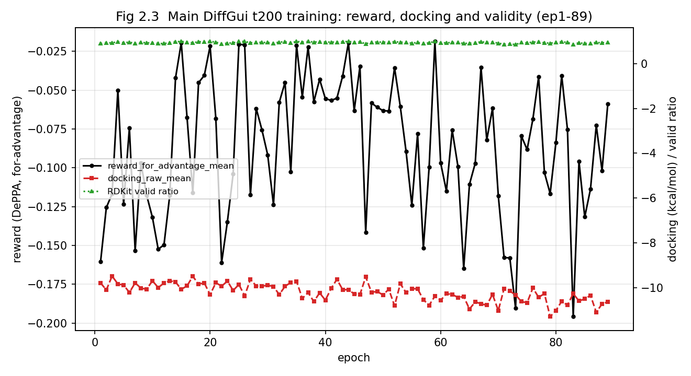
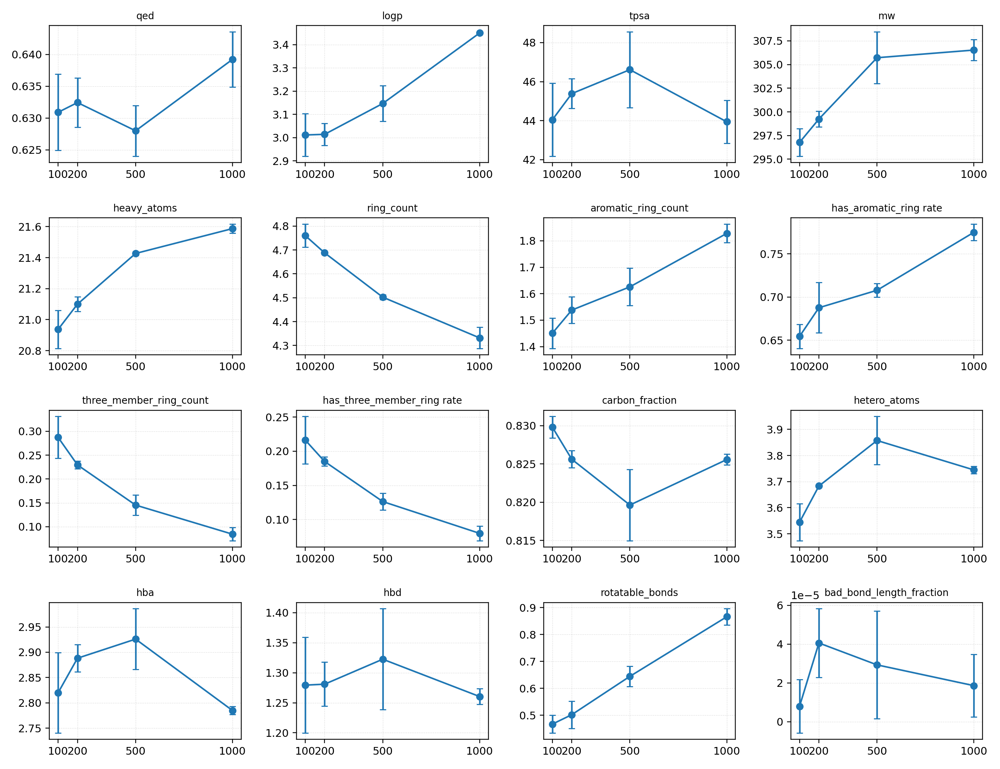
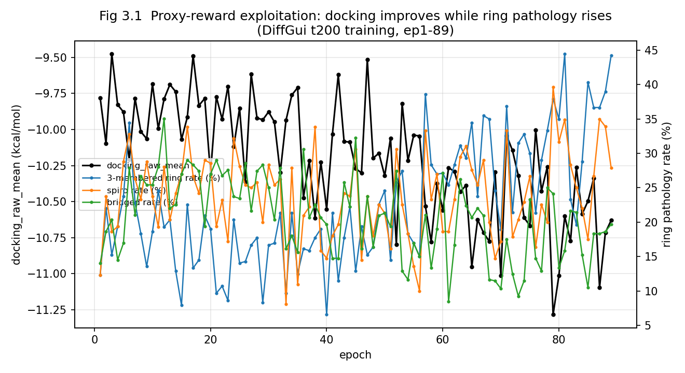
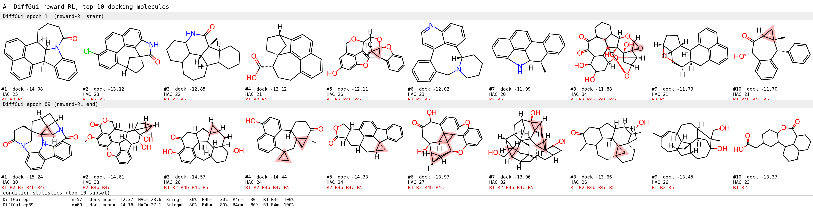
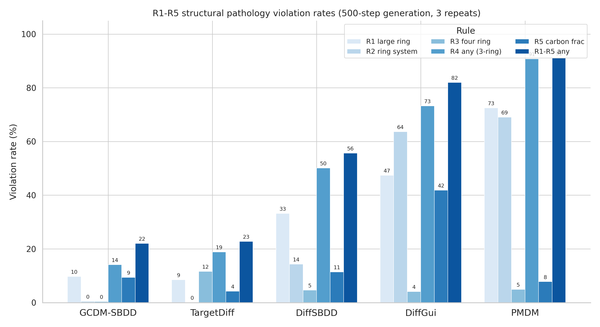
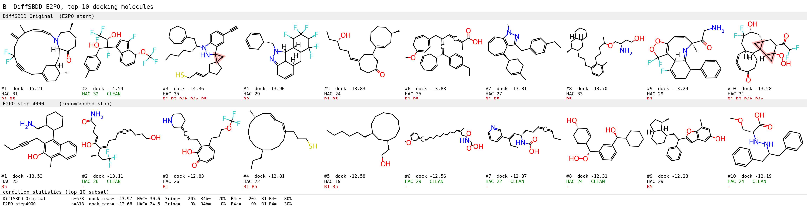
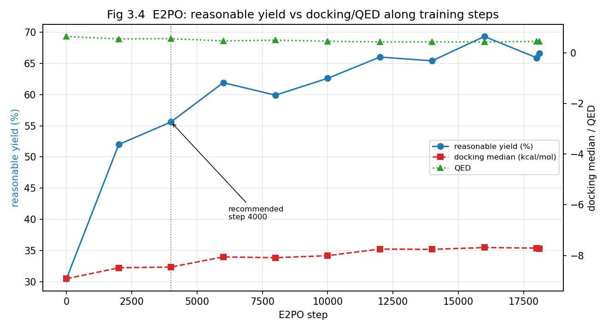

# 基于强化学习与偏好优化的 RE-CmeB 靶点分子生成与评价研究

作者姓名：谢东宸
导师姓名：[待补]
专业学位名称：[待补]
培养院系：[待补]
完成时间：2026 年 [待补] 月

---

# Research on Target-Oriented Molecular Generation and Evaluation for RE-CmeB via Reinforcement Learning and Preference Optimization

By Dongchen Xie
Supervisor: [To be completed]
Major: [To be completed]
School: [To be completed]
Completion time: [To be completed], 2026

---

# 学位论文原创性声明

本人郑重声明：所呈交的学位论文，是本人在导师的指导下，独立进行研究所取得的成果。除文中已经注明引用的内容外，本论文不包含任何其他个人或集体已经发表或撰写过的科研成果。对本文研究作出重要贡献的个人和集体，均已在文中以明确方式标明。本声明的法律责任由本人承担。

学位论文作者签名：
导师签名：
日期：　　　　年　　月　　日

---

# 学位论文使用授权声明

本人完全了解学校有关保留、使用学位论文的规定，同意学校保留或向国家有关部门或机构送交论文的复印件和电子版，允许论文被查阅和借阅；本人授权学校可以将本学位论文的全部或部分编入有关数据库进行检索，可以采用影印、缩印或者其他复制手段保存论文和汇编本学位论文。保密论文在解密后应遵守此规定。

学位论文作者签名：
导师签名：
日期：　　　　年　　月　　日

---

# 摘要

细菌耐药问题给抗感染药物研发带来了持续挑战，围绕耐药相关靶点开展新型小分子候选物发现具有重要意义。RE-CmeB 是本文关注的靶点体系，其口袋结构为基于三维结构的分子设计提供了直接依据。传统虚拟筛选主要依赖已有化合物库，能够在给定化合物空间中快速寻找潜在结合分子，但受限于数据库覆盖范围、候选分子结构新颖性和多目标优化能力。近年来，基于深度学习的三维分子生成模型为从头探索靶点适配化学空间提供了新的技术路线。然而，未经靶点适配的生成模型往往只能反映预训练数据中的通用分布，难以同时满足靶点结合倾向、类药性、结构合理性和候选分子筛选可用性等要求。

针对上述问题，本研究以 RE-CmeB 靶点（PDB ID：8GJL，口袋 C:1101）为对象，开展了两部分工作。第一部分以常规硬指标为口径，建立"生成底座选型—强化学习适配"的流程：首先，围绕 RE-CmeB 口袋建立统一的对接口径（UniDock + Vina，search_mode = fast，exhaustiveness = 16）；随后，在相同口袋条件与统一扩散步数下对五种三维生成模型进行固定生成尝试次数的横评，将 DiffGui 确定为强化学习底座，并完成其主训练（8 卡、全模型微调、t=200、QED/SA/docking 等权奖励），硬指标全面改善：对接均值由 −9.78 提升至最优 −11.28（约 15%），RDKit valid 与 docking success 由 0.8906 升至 0.9531，重复率为 0。

在上述适配完成后，本研究进一步以独立于训练奖励的结构病理口径（R1–R5）对该训练产物作出诊断，确认代理奖励已被模型利用：在对接等硬指标改善的同时，生成分子的环系结构病理同步恶化：三元环率由 12.3% 升至 37.9%，螺环率由 12.3% 升至 39.7%，桥环率由 14.0% 升至 24.1%，而芳香环数下降、重原子数基本不变，说明以对接为代表的代理奖励与结构合理性并不等价（reward hacking）。以 ChEMBL 数据库（仅保留 Small molecule，样本量 1 790 085）作为类药化学空间的外部参照，其 R1–R5 全清比例为 80.94%，优化后的生成模型在该结构规则口径下的结构病理已大幅收敛，明显接近参照水平。第二部分以该诊断结论为起点，改用统一的结构病理口径（R1–R5）重新进行生成底座选型：DiffGui 的 R1–R4 命中率为 73.23%（其中 R2 环系命中 63.63%），而 DiffSBDD 为 50.12%；最终采用结构规则偏好优化（ESRPO），以显式结构规则为优化目标，在合理分子对接中位基本持平（−8.92→−8.46 kcal/mol）的前提下，将合理分子产率由 30.5% 提升至 55.6%（1.82×），R1–R4 命中率由 48.67% 降至 21.27%；同时，合理分子 QED 由 0.647 降至 0.561（属目标之外的维度变化，其性质见正文 §3.3.2.4）。

综上，本研究围绕 RE-CmeB 靶点先后建立了两条生成流程：以硬指标为口径的"选型—适配—诊断"流程，以及以结构病理为口径的"重选—偏好优化"流程。经后者修正后，生成的合理分子产率与结构规则全清情况较硬指标口径显著改善、对接水平基本持平，由此获得了可进入分子动力学模拟与活性验证环节的候选分子集合。由于最终候选分子的独立复筛、对接构象展示和实验验证仍需补充，本文当前结论主要限于计算生成、强化学习训练和对接筛选层面。

关键词：计算机辅助药物设计，RE-CmeB，三维分子生成，强化学习，结构病理诊断，结构规则偏好优化，分子对接

---

# Abstract

Antimicrobial resistance remains a persistent challenge in drug discovery, and the design of novel small molecules against resistance-related targets is of practical importance. RE-CmeB is the target system investigated in this thesis, and its binding pocket provides a structural basis for three-dimensional molecular design. Conventional virtual screening can efficiently search existing compound libraries, but its performance is limited by library coverage, structural novelty, and the ability to optimize multiple molecular properties simultaneously. In recent years, deep learning-based three-dimensional generative models have provided a new route for exploring target-adapted chemical space. However, a pretrained generative model without target-specific adaptation usually reflects the general distribution of its training data and may not satisfy binding affinity, drug-likeness, structural validity, and downstream screening requirements at the same time.

To address this problem, this study conducts two parts of work on the RE-CmeB target (PDB ID: 8GJL, pocket C:1101). The first part establishes a hard-metric-based workflow of backbone selection and reinforcement-learning adaptation. First, a unified UniDock docking protocol was established for the RE-CmeB pocket (Vina scoring, search_mode = fast, exhaustiveness = 16). Next, five three-dimensional generative models were compared under the same pocket condition and diffusion-step setting using a fixed number of generation attempts, and DiffGui was selected as the reinforcement-learning backbone; its main training run (8 GPUs, full fine-tuning, 200 timesteps, with equal-weight QED/SA/docking rewards) was then completed. The hard metrics improved consistently: the mean docking score improved from -9.78 to a best of -11.28 (about 15%), and the RDKit-valid and docking-success ratios rose from 0.8906 to 0.9531 with a duplicate ratio of zero.

After the adaptation, the training output was further diagnosed with a structural-pathology protocol (R1-R5) independent of the training reward, confirming that the proxy reward had been exploited. Ring-system pathology was found to deteriorate alongside the hard-metric gains: the 3-membered-ring rate rose from 12.3% to 37.9%, the spiro rate from 12.3% to 39.7%, and the bridged rate from 14.0% to 24.1%, while the aromatic-ring count decreased and the heavy-atom count remained essentially unchanged, indicating that the docking proxy reward is not equivalent to structural reasonableness (reward hacking). Using the ChEMBL database (small molecules only, n = 1 790 085) as an external reference for drug-like chemical space, its R1-R5 all-clear fraction is 80.94%, and the optimized generative model substantially reduces structural pathology and approaches this reference level. Starting from this diagnosis, the second part re-selected the generative backbone under the unified structural-pathology criterion (R1-R5): DiffGui showed an R1-R4 trigger rate of 73.23% (R2 ring-system triggers 63.63%) versus 50.12% for DiffSBDD. Structure-preference optimization (ESRPO) was then adopted with explicit structural rules as the optimization objective, increasing the reasonable-molecule yield from 30.5% to 55.6% (1.82x) while keeping the reasonable-molecule docking median essentially unchanged (-8.92 to -8.46 kcal/mol); the R1-R4 trigger rate decreased from 48.67% to 21.27%, and this gain was accompanied by a decrease in the reasonable-molecule QED from 0.647 to 0.561.

In summary, this thesis establishes two sequential workflows for target-oriented molecular generation on RE-CmeB: a hard-metric-based selection-adaptation-and-diagnosis workflow, and a structural-pathology-based backbone-reselection-and-preference-optimization workflow. The latter workflow yields a candidate molecular set ready for molecular dynamics simulation and experimental validation: the reasonable-molecule yield and the structural-rule all-clear rate improve markedly while docking remains essentially unchanged. Because final independent re-screening, docking-pose visualization, and experimental validation remain to be completed, the current conclusions are limited to computational generation, reinforcement learning training, and docking-based screening.

Keywords: Computer-aided drug design, RE-CmeB, three-dimensional molecular generation, reinforcement learning, structural-pathology diagnosis, structure-preference optimization, molecular docking

---

# 目录

- [摘要](#摘要)
- [Abstract](#abstract)
- [图例清单](#图例清单)
- [表格清单](#表格清单)
- [中英文缩略词对照表](#中英文缩略词对照表)
- [第 1 章 绪论](#第-1-章-绪论)
  - [1.1 研究背景与问题提出](#11-研究背景与问题提出)
  - [1.2 基于结构的分子生成：现状与缺口](#12-基于结构的分子生成现状与缺口)
  - [1.3 生成模型的靶点适配：强化学习与偏好优化](#13-生成模型的靶点适配强化学习与偏好优化)
  - [1.4 相关理论与技术](#14-相关理论与技术)
    - [1.4.1 分子表示与三维口袋条件](#141-分子表示与三维口袋条件)
    - [1.4.2 扩散模型与口袋条件生成](#142-扩散模型与口袋条件生成)
    - [1.4.3 分子对接与 UniDock](#143-分子对接与-unidock)
    - [1.4.4 强化学习奖励与分子质量评价](#144-强化学习奖励与分子质量评价)
    - [1.4.5 偏好优化](#145-偏好优化)
  - [1.5 选题依据、研究内容与技术路线](#15-选题依据研究内容与技术路线)
- [第 2 章 基于 DiffGui 强化学习的 RE-CmeB 靶点适配与代理奖励诊断](#第-2-章-基于-diffgui-强化学习的-re-cmeb-靶点适配与代理奖励诊断)
  - [2.1 引言](#21-引言)
  - [2.2 材料与方法](#22-材料与方法)
    - [2.2.1 RE-CmeB 受体与统一对接口径设置](#221-re-cmeb-受体与统一对接口径设置)
    - [2.2.2 生成模型横评与底座选择方法](#222-生成模型横评与底座选择方法)
    - [2.2.3 DiffGui 强化学习训练流程](#223-diffgui-强化学习训练流程)
    - [2.2.4 奖励组件设计](#224-奖励组件设计)
    - [2.2.5 实验设计](#225-实验设计)
    - [2.2.6 结构病理口径（R1–R5）](#226-结构病理口径r1r5)
    - [2.2.7 诊断数据与评估口径](#227-诊断数据与评估口径)
  - [2.3 结果与讨论](#23-结果与讨论)
    - [2.3.1 RE-CmeB 生成模型横评](#231-re-cmeb-生成模型横评)
    - [2.3.2 DiffGui 强化学习训练结果](#232-diffgui-强化学习训练结果)
    - [2.3.3 扩散步数对生成质量与成本的影响](#233-扩散步数对生成质量与成本的影响)
    - [2.3.4 训练流程完整性](#234-训练流程完整性)
    - [2.3.5 代理奖励套利诊断](#235-代理奖励套利诊断)
    - [2.3.6 代理奖励局限的分析](#236-代理奖励局限的分析)
  - [2.4 本章小结](#24-本章小结)
- [第 3 章 基于结构病理口径的生成底座重选与结构规则偏好优化](#第-3-章-基于结构病理口径的生成底座重选与结构规则偏好优化)
  - [3.1 引言](#31-引言)
  - [3.2 材料与方法](#32-材料与方法)
    - [3.2.1 结构规则偏好优化（ESRPO）方法](#321-结构规则偏好优化esrpo方法)
    - [3.2.2 候选分子的分子动力学模拟方案](#322-候选分子的分子动力学模拟方案)
    - [3.2.3 候选分子的活性验证实验方案](#323-候选分子的活性验证实验方案)
  - [3.3 结果与讨论](#33-结果与讨论)
    - [3.3.1 换结构病理口径的生成底座重选](#331-换结构病理口径的生成底座重选)
    - [3.3.2 ESRPO 结构规则偏好优化结果](#332-esrpo-结构规则偏好优化结果)
    - [3.3.3 候选分子生成与筛选策略](#333-候选分子生成与筛选策略)
  - [3.4 本章小结](#34-本章小结)
- [全文总结](#全文总结)
- [参考文献](#参考文献)
- [致谢](#致谢)

---

# 图例清单

图 1.1 RE-CmeB 靶点与口袋条件分子生成任务示意图（待绘制）
图 1.2 深度学习分子生成方法分类示意图（待绘制）
图 1.3 扩散模型正向加噪与反向去噪过程示意图（待绘制）
图 1.4 PPO/DDPO 强化学习优化流程示意图（待绘制）
图 1.5 本文技术路线图（待绘制）
图 2.2 DiffGui 强化学习总体流程图（待绘制）
图 2.3 DiffGui 主训练逐 epoch 的奖励、对接与有效性（已嵌入）
图 2.4 DiffGui 不同扩散步数下的关键性质（3 次重复，已嵌入）
图 2.5 代理奖励套利诊断：对接改善与环系病理上升的趋势对照（主训练 ep1–89，已嵌入）
图 2.6 DiffGui 强化学习前后对接最优的 10 个分子（主训练 ep1 / ep79，已嵌入）
图 3.1 五模型结构病理口径（R1–R5）对比（已嵌入）
图 3.2 DiffSBDD ESRPO 前后对接最优的 10 个分子（Original / step 4000，已嵌入）
图 3.3 ESRPO 训练过程中的产率-对接权衡（推荐停留点 step 4000，已嵌入）
图 3.4 RE-CmeB 候选分子筛选漏斗图（待补最终筛选结果）
图 3.5 Top 候选分子与 RE-CmeB 口袋相互作用示意图（待补最终构象图）

# 表格清单

表 1.1 常用分子生成与筛选指标
表 2.1 8GJL/C1101 五模型生成横评结果（T=500，3 次重复）
表 2.2 DiffGui 强化学习奖励组件及其作用
表 2.3 DiffGui 主训练关键 epoch 指标
表 2.4 DiffGui 不同扩散步数的生成质量与计算成本
表 2.5 结构病理规则 R1–R5 及其判据
表 2.6 DiffGui 强化学习训练前后的环系与刚性指标
表 3.1 偏好对匹配质量验证（训练集）
表 3.2 五种生成模型的结构规则命中率与生成有效率
表 3.2b 五种生成模型在合理分子（R1–R5 全清）子集上的对比
表 3.3 ESRPO 优化前后合理分子（R1–R5 全清口径）产率与质量对比（推荐停留点 step 4000）
表 3.4 候选分子筛选流程与保留数（待补）
表 3.5 Top 候选分子综合评分表（待补）
表 3.6 候选分子分子动力学模拟方案与参数
表 3.7 候选分子活性验证实验方案

# 中英文缩略词对照表

| 缩写   | 英文全称                                          | 中文含义               |
| ------ | ------------------------------------------------- | ---------------------- |
| CADD   | Computer-Aided Drug Design                        | 计算机辅助药物设计     |
| RND    | Resistance-Nodulation-Cell Division               | 耐药结节细胞分化家族   |
| RL     | Reinforcement Learning                            | 强化学习               |
| PPO    | Proximal Policy Optimization                      | 近端策略优化           |
| DDPO   | Denoising Diffusion Policy Optimization           | 去噪扩散策略优化       |
| DPO    | Direct Preference Optimization                    | 直接偏好优化           |
| ESRPO  | Endpoint Structural-Rule Preference Optimization   | 终点级结构规则偏好优化 |
| SBDD   | Structure-Based Drug Design                       | 基于结构的药物设计     |
| SMILES | Simplified Molecular Input Line Entry System      | 简化分子线性输入规范   |
| RDKit  | RDKit cheminformatics toolkit                     | 化学信息学工具包       |
| SDF    | Structure-Data File                               | 分子结构数据文件       |
| QED    | Quantitative Estimate of Drug-likeness            | 定量类药性估计         |
| SA     | Synthetic Accessibility                           | 合成可及性             |
| MW     | Molecular Weight                                  | 分子量                 |
| TPSA   | Topological Polar Surface Area                    | 拓扑极性表面积         |
| MMD    | Maximum Mean Discrepancy                          | 最大均值差异           |
| MSE    | Mean Squared Error                                | 均方误差               |
| KL     | Kullback-Leibler Divergence                       | KL 散度                |
| Vina   | AutoDock Vina scoring function                    | 分子对接评分函数       |
| LE     | Ligand Efficiency                                 | 配体效率               |
| MMGBSA | Molecular Mechanics Generalized Born Surface Area | 分子力学广义玻恩表面积 |
| D-MPNN | Directed Message Passing Neural Network           | 有向消息传递神经网络   |
| PDB    | Protein Data Bank                                 | 蛋白质结构数据库       |

---

# 第 1 章 绪论

## 1.1 研究背景与问题提出

抗感染药物研发长期受到耐药性问题的制约。随着临床抗菌药物的广泛使用，细菌可通过靶点突变、酶解修饰、通透性降低和外排泵增强等机制降低药物作用效果。其中，外排泵相关耐药机制能够主动排出多类结构不同的小分子药物，使药物难以在细菌细胞内维持有效浓度。因此，围绕耐药相关外排系统开展抑制剂发现，是抗感染药物研发中的重要方向之一。

外排泵介导的耐药在革兰阴性菌中较为普遍，RND（resistance-nodulation-cell division）超家族是其中一类主要的转运蛋白家族。在空肠弯曲菌（Campylobacter jejuni）中，CmeABC 是一个由三种蛋白组成的多重药物外排系统，其中 CmeB 为位于内膜的 RND 家族转运蛋白；该系统能够外排氟喹诺酮类、大环内酯类与四环素类等多种结构不同的抗菌药物，是该菌耐药性形成的主要机制之一[1]。Zhang 等通过冷冻电镜解析了 CmeB 与环丙沙星复合物的三维结构（PDB ID：8GJL，分辨率 3.44 Å，同源三聚体），揭示了其药物识别与耐药相关机制[2]，为围绕该外排泵的结合口袋开展基于结构的分子设计提供了结构基础。

RE-CmeB 是本文研究的靶点体系（对应 PDB ID：8GJL，口袋标记 C:1101）。与只依据配体二维结构或性质进行筛选的策略相比，基于 RE-CmeB 三维口袋结构开展分子设计能够直接利用靶点空间构象信息，使生成分子在结构上具有更明确的靶点适配目标。本文的任务设定是：以 RE-CmeB 口袋（8GJL/C1101）为条件，生成可能占据该口袋的三维小分子，再以对接、类药性与结构合理性等多重口径加以评价，整体任务框架如图 1.1 所示。为保证不同来源分子的评价结果可比，全文采用统一的对接口径（UniDock + Vina），受体文件、对接盒子与搜索参数在全文保持一致，具体参数见第 2 章（§2.2.1）。

在早期候选药物发现中，传统虚拟筛选通常从已有化合物库中检索可能与靶点结合的小分子。该方法具有流程成熟、可解释性较强和易于与分子对接结合等优点，但候选空间受到数据库覆盖范围限制。对于 RE-CmeB 这类需要探索新型候选分子的靶点，仅依赖已有化合物库可能难以获得结构新颖且综合性质较优的分子。因此，引入分子生成模型以主动探索新的三维分子结构，再结合分子对接、类药性评价与结构合理性审查进行筛选，成为面向此类靶点的一条可行路径。

## 1.2 基于结构的分子生成：现状与缺口

计算机辅助药物设计（Computer-Aided Drug Design，CADD）通过计算模拟和数据建模辅助药物发现流程，能够在实验验证前对候选分子进行快速筛选和优化。常见的 CADD 方法包括分子对接、药效团模型、定量构效关系、分子动力学模拟和自由能计算等。其中，分子对接通过预测小分子与受体口袋的结合构象和结合评分，常用于早期虚拟筛选和先导化合物发现[3]。

分子对接在靶点明确的药物设计任务中具有重要价值。一方面，对接可为候选分子提供与靶点口袋相关的结合倾向评分；另一方面，对接构象能够帮助研究者分析氢键、疏水作用、π-π 堆叠和空间冲突等相互作用模式。对于靶点明确的药物设计任务而言，使用统一的受体、盒子与评分口径，是保证生成分子与候选分子之间评价结果可比的前提。

然而，分子对接并不能单独决定候选分子质量。若只依据 docking score 选择分子，模型或筛选流程可能偏好分子量更大、疏水性更强或结构更复杂的分子，从而造成类药性下降、合成可行性降低或结构病理增加。把 docking 与 QED、SA 等指标简单加权并不必然消除这一偏差。这些指标同样只是分子质量的不同代理量，其组合仍可能被模型针对性利用，该问题将在第 2 章 §2.3.5 以独立口径加以诊断，并在第 3 章以显式结构规则的形式修正。因此，评估生成分子时需要同时报告 ligand efficiency、QED、SA、LogP、TPSA 与环结构统计等多项指标；而独立于优化目标的结构病理口径与 ChEMBL 类药空间参照则提供了另一类视角（见第 2 章 §2.2.6、§2.2.7）。

上述对接与筛选方法主要用于评价和挑选已有分子，难以主动创造结构新颖的候选分子。深度学习生成模型能够从已有化学结构中学习分子分布，并生成新的候选分子。根据分子表示方式不同，分子生成方法大致可分为基于 SMILES 字符串的方法、基于分子图的方法和基于三维结构的方法。基于 SMILES 的方法实现简单、便于与自然语言处理模型结合，但其生成结果需要额外保证语法有效性和化学合理性；基于分子图的方法能够直接表示原子与键关系，更符合分子拓扑结构；基于三维结构的方法进一步将原子坐标和空间构象纳入生成过程，更适合面向蛋白口袋的结构设计任务[4]。三类方法的层次关系与各自特点如图 1.2 所示。

扩散模型近年来在分子生成中受到广泛关注。扩散模型通过正向过程逐步向数据添加噪声，再训练神经网络学习反向去噪过程，从而从噪声中恢复符合数据分布的样本。扩散模型的训练目标是拟合训练数据的分布，其优化对象是去噪误差，模型本身并不包含任何面向具体靶点结合性质的项。对于三维分子生成任务，扩散模型可以同时处理原子类型、原子坐标和键相关信息，适合在连续三维空间中生成分子。相比只在二维拓扑或字符串层面生成分子，三维扩散生成模型更容易与口袋结构、分子对接和空间合理性评价结合。

结构基础分子生成（structure-based drug design，SBDD）进一步要求模型在给定蛋白口袋条件下生成候选配体，是三维分子生成研究中的核心方向之一。近年来，该方向出现了若干具有代表性的生成模型。DiffSBDD 面向 SBDD 任务提出等变扩散模型，将配体原子类型与坐标的联合生成过程置于口袋条件约束之下，建立了三维扩散生成的基本范式[5]；DiffGui 在此基础上引入键扩散与性质引导，以缓解生成分子三维结构不合理与类药性不足的问题[6]；TargetDiff 在等变扩散框架中联合建模原子坐标与类型，并引入亲和力预测以支持目标感知的分子生成[7]；PMDM 采用口袋与配体的双扩散结构，侧重于基于目标口袋的分子生成与先导化合物优化[8]；GCDM-SBDD 将键长、键角与二面角等几何完备信息纳入扩散过程，用于三维分子生成与优化[9]。

上述模型的共同点在于：它们均在大规模蛋白-配体复合物数据上训练，学习到的是跨口袋的平均生成分布。虽然生成过程以口袋结构为条件，但条件仅起到"约束分子落在该口袋内"的作用，模型并未针对某一具体靶点的结合偏好进行优化。这是预训练生成模型应用于具体靶点时普遍面临的适配缺口。

## 1.3 生成模型的靶点适配：强化学习与偏好优化

如前所述，预训练生成模型的训练目标是拟合数据分布，其参数中并不包含任何与具体靶点相关的偏好；而面向特定靶点的药物设计任务恰恰需要模型满足靶点结合、类药性、合成可及性和结构安全等多重目标。因此，在预训练之后对生成模型进行任务适配，是面向靶点的分子生成流程中的关键环节。常见适配路径大致可分为两类。

第一类是强化学习。其做法是将生成过程视为策略，通过任务奖励对生成结果打分并优化策略参数，从而在有限样本之外利用奖励信号引导生成分布。这条路径的特点是：可以把与靶点直接相关的信号（如分子对接评分）作为奖励，使生成分布向高结合倾向的方向移动，因而是适配具体靶点最直接的路径。在扩散模型中引入强化学习时，常用思路是把去噪过程视为策略生成过程，并通过近端策略优化（proximal policy optimization，PPO）[10]或去噪扩散策略优化（denoising diffusion policy optimization，DDPO）[11]等方法更新模型参数，整体优化流程如图 1.4 所示。PPO 通过限制新旧策略的分布差异来控制训练稳定性，DDPO 则将该思想用于扩散模型的策略优化。该路径的适应面较广，但其效果在很大程度上取决于奖励设计是否可靠。

第二类是偏好优化。其做法是用成对比较（相对更优与相对更差的样本）替代标量奖励，直接优化模型对偏好样本的相对似然，从而避免显式设计可微奖励函数，其基本原理见 §1.4.5。

两类路径的适用条件不同：强化学习的效果在很大程度上取决于奖励设计的可靠性，偏好优化则取决于偏好对的构造质量。如何在具体靶点任务中判断并选择适配路径，是本文关注的核心问题。

## 1.4 相关理论与技术

### 1.4.1 分子表示与三维口袋条件

分子可通过 SMILES、分子图和三维坐标等方式表示。SMILES 便于存储和快速计算，常用于去重、相似性检索和日志记录；分子图显式表示原子和键，适合图神经网络建模；三维坐标保留空间构象信息，适合对接、构象分析和口袋条件生成。本文采用的下游分子语义以 RDKit[13]分子对象为核心，生成样本经去 padding、结构重构、RDKit 合法性检查后，再用于 reward 计算、分子对接、描述符统计和 SDF 导出。

在三维分子生成任务中，一个含 $n$ 个原子的分子可形式化表示为

$$
M = (\mathbf{E}, \mathbf{P}, \mathbf{B}) \qquad(1.1)
$$

其中，$\mathbf{E} = (e_1, e_2, \ldots, e_n)$ 表示各原子的元素类型，$e_i$ 取自原子类型集合；$\mathbf{P} = (p_1, p_2, \ldots, p_n) \in \mathbb{R}^{n \times 3}$ 表示各原子的三维坐标；$\mathbf{B} = (b_{ij})_{n \times n}$ 表示原子 $i$ 与 $j$ 之间的化学键类型。式（1.1）说明，三维分子生成需要同时确定离散的原子类型、离散的键类型与连续的原子坐标，这一结构也决定了后文生成模型与评估口径的组织方式。

口袋条件生成要求模型在给定蛋白口袋和参考位点的情况下生成配体。该任务的输入包括蛋白结构、口袋坐标、参考配体或口袋中心等信息，输出为候选分子的原子类型、三维坐标和可重构化学结构。记 $\mathcal{P}$ 为由受体结构确定的口袋条件，则口袋条件生成的目标是建模如下条件分布并从中采样：

$$
p(M \mid \mathcal{P}) \qquad(1.2)
$$

本文将 RE-CmeB 口袋作为生成与筛选目标，使模型输出与具体靶点结构发生关联。

### 1.4.2 扩散模型与口袋条件生成

扩散模型由正向加噪和反向去噪两个过程构成（图 1.3）。在正向过程中，真实数据逐步被扰动为接近高斯噪声的分布；在反向过程中，神经网络学习从噪声状态逐步恢复数据样本。设 $t = 0, 1, \ldots, T$ 为扩散步索引，$x_0$ 为真实样本（在三维分子生成中即式（1.1）中的坐标 $\mathbf{P}$），则正向过程是一个固定的马尔可夫链：

$$
q(x_t \mid x_{t-1}) = \mathcal{N}\!\left(x_t;\ \sqrt{1-\beta_t}\,x_{t-1},\ \beta_t \mathbf{I}\right) \qquad(1.3)
$$

其中，$\beta_t \in (0, 1)$ 为第 $t$ 步的噪声方差系数，$\mathbf{I}$ 为单位矩阵。记 $\bar{\alpha}_t = \prod_{s=1}^{t}(1 - \beta_s)$，由式（1.3）可递推得到任意步 $t$ 处样本的闭式表达：

$$
x_t = \sqrt{\bar{\alpha}_t}\,x_0 + \sqrt{1 - \bar{\alpha}_t}\,\varepsilon, \qquad \varepsilon \sim \mathcal{N}(\mathbf{0}, \mathbf{I}) \qquad(1.4)
$$

式（1.4）表明，当 $t$ 足够大时 $x_t$ 近似服从标准高斯分布，因此反向过程可以从纯噪声出发逐步恢复数据。反向过程同样是马尔可夫链，其转移分布由参数化神经网络给出：

$$
p_\theta(x_{t-1} \mid x_t) = \mathcal{N}\!\left(x_{t-1};\ \mu_\theta(x_t, t, \mathcal{P}),\ \sigma_t^2 \mathbf{I}\right) \qquad(1.5)
$$

其中，$\theta$ 为网络参数，$\mu_\theta$ 为待学习的去噪均值，$\mathcal{P}$ 为式（1.2）中的口袋条件。在实现上，网络通常不直接预测均值，而是预测式（1.4）中注入的噪声 $\varepsilon$，训练目标相应写为去噪误差的均方形式：

$$
\mathcal{L}_{\text{simple}}(\theta) = \mathbb{E}_{t,\,x_0,\,\varepsilon}\left[\ \left\| \varepsilon - \varepsilon_\theta(x_t, t, \mathcal{P}) \right\|^2 \ \right] \qquad(1.6)
$$

其中，$\varepsilon_\theta$ 为噪声预测网络在口袋条件 $\mathcal{P}$ 下对 $x_t$ 所含噪声的估计。需要强调的是，式（1.6）刻画的是对训练数据分布的拟合，而非对某一任务目标的优化：口袋条件 $\mathcal{P}$ 的作用是限定生成分子所处的环境，并不改变这一拟合性质。对于原子类型与化学键等离散变量，扩散过程通常以分类分布而非高斯分布建模，并在 $t$ 足够大时收敛至均匀分布或吸收分布，本文不对该部分的公式展开。

由于分子与蛋白口袋均为三维几何对象，理想的生成模型还应满足旋转平移等变性，即对任意旋转矩阵 $R$ 与平移向量 $\tau$，网络满足

$$
f(R x + \tau) = R\,f(x) + \tau \qquad(1.7)
$$

式（1.7）保证了模型输出对口袋与配体的整体姿态不敏感。DiffSBDD[5] 与 DiffGui[6] 均基于该性质构建等变扩散框架：前者面向基于结构的药物设计任务建立了口袋条件下的等变扩散生成范式，后者进一步引入键扩散与性质引导，以缓解生成分子三维结构不合理与类药性不足的问题。相较于只在二维层面建模的生成方法，等变扩散模型更适合与蛋白口袋、分子对接及三维结构质量评价结合。

### 1.4.3 分子对接与 UniDock

分子对接用于预测小分子与靶点口袋的结合构象和评分。分子对接的目标是在给定口袋条件 $\mathcal{P}$ 下搜索配体 $M$ 的结合构象，并给出结合能估计：

$$
s_{\text{dock}}(M, \mathcal{P}) = \min_{c \in \mathcal{C}(M)} E_{\text{vina}}(c, \mathcal{P}) \qquad(1.8)
$$

其中，$\mathcal{C}(M)$ 为配体 $M$ 的可搜索构象空间，$E_{\text{vina}}$ 为 Vina 经验打分函数[15]，其取值越负表示预测结合越强。本文使用 UniDock[14] 作为主要对接后端，并采用 Vina 评分函数。对接结果主要包括成功状态、对接分数、输出构象文件和失败原因。由于 $s_{\text{dock}}$ 与分子大小、疏水性和构象复杂度存在关联，本文同时报告 ligand efficiency 和分子性质指标，避免只依据对接分数选择候选。

### 1.4.4 强化学习奖励与分子质量评价

本文框架支持的核心奖励和监控信号包括 docking、ligand efficiency、QED、SA、ChEMBL-like classifier、ring pathology、aromatic scaffold 和 chemistry guard。docking reward 提供靶点结合压力；ligand efficiency 用于平衡结合评分与分子尺寸；QED[16] 与 SA[17] 分别反映类药性和合成可及性；ChEMBL-like 信号用于将生成分子拉回更接近类药化学空间的区域；ring pathology 和 chemistry guard 用于监控和抑制明显结构异常。本文第 2 章的强化学习主训练实际启用的奖励为 QED、SA 与 docking 三项，其余组件在本框架中可选，用于监控或留待后续实验。此外，本文在下游筛选与重打分中引入 D-MPNN[18] 类模型作为辅助评价信号，并参考三维有效性检查（PoseBusters）[19]监控生成构象的物理合理性。上述奖励与监控信号均为分子性质的代理量：每一项刻画分子质量的某一个侧面，与"分子是否真正优质"之间存在映射误差；当多个代理量加权为单一标量奖励时，这一误差不会自动抵消。

设第 $i$ 个奖励组件对分子 $M$ 的评分为 $r_i(M)$，各组件经各自的映射函数给出量纲一致的分数。其中 docking 组件按归一化因子 $\eta$ 将原始对接分数映射为以正值为优的分数：

$$
r_{\text{dock}}(M) = \frac{s_{\text{dock}}(M, \mathcal{P})}{\eta} \qquad(1.9)
$$

其中，$s_{\text{dock}}$ 为式（1.8）给出的对接分数，$\eta = -10\ \mathrm{kcal/mol}$ 为归一化因子，可将典型对接分数区间（约 $-12$ 至 $0\ \mathrm{kcal/mol}$）映射至约 $[0, 1.2]$。对于无法重构、无法通过合法性检查或对接失败的分子，各组件写入固定的失败惩罚 $\rho$（本文取 $-1.0$），以保证失败分子获得显式负信号而非缺失值。

多组件奖励按权重加权求和得到总奖励：

$$
R(M) = \sum_{i} \tilde{w}_i\, r_i(M), \qquad \tilde{w}_i = w_i \Big/ \sum_{j} w_j \qquad(1.10)
$$

其中，$w_i$ 为配置文件给出的组件权重，$\tilde{w}_i$ 为归一化后的实际权重。本文第 2 章主训练的配置为 QED、SA 与 docking 三项权重均为 $1.0$，归一化后三者权重相等（各 $1/3$）。

在扩散策略优化中，总奖励并不直接作为梯度权重，而是先经批次内全局标准化转换为优势函数：

$$
\tilde{A}(M) = \mathrm{clip}\!\left(\frac{R(M) - \mu_R}{\sigma_R + \epsilon},\ -5,\ 5\right) \qquad(1.11)
$$

其中，$\mu_R$ 与 $\sigma_R$ 为当前训练批次内总奖励的均值与标准差（分布式训练中跨卡聚合），$\epsilon = 10^{-6}$ 为防止除零的小量，$\mathrm{clip}(\cdot, -5, 5)$ 用于抑制极端优势值。若某分子被判定为失败样本，其优势值将被固定惩罚值覆盖，以避免失败样本的极端奖励扭曲整体统计量。

记去噪策略在第 $t$ 步的转移概率比为

$$
\rho_t(\theta) = \frac{\pi_\theta(z_{t-1} \mid z_t)}{\pi_{\theta_{\text{old}}}(z_{t-1} \mid z_t)} = \exp\!\left(\log \pi_\theta(z_{t-1} \mid z_t) - \log \pi_{\theta_{\text{old}}}(z_{t-1} \mid z_t)\right) \qquad(1.12)
$$

则 PPO 的截断目标为

$$
\mathcal{L}^{\text{CLIP}}(\theta) = \mathbb{E}\left[\max\left(-\tilde{A}\,\rho_t(\theta),\ -\tilde{A}\,\mathrm{clip}\!\left(\rho_t(\theta),\ 1-\epsilon_{\text{clip}},\ 1+\epsilon_{\text{clip}}\right)\right)\right] \qquad(1.13)
$$

其中，$\theta_{\text{old}}$ 为采样该批轨迹时的旧策略参数，$\epsilon_{\text{clip}}$ 为截断范围（本文取 $0.2$）。式（1.13）即 PPO[10] 与 DDPO[11] 应用于扩散模型去噪过程时的策略优化目标：当 $\rho_t$ 偏离 $1$ 超过 $\epsilon_{\text{clip}}$ 时梯度被截断，从而限制单次更新的策略漂移幅度。

常用指标如表 1.1 所示。

表 1.1 常用分子生成与筛选指标

| 指标                    | 含义                          | 本文用途         |
| ----------------------- | ----------------------------- | ---------------- |
| RDKit validity          | RDKit 能否合法解析和 sanitize | 基础有效性门槛   |
| docking success         | 是否成功完成 RE-CmeB 对接     | 靶点评估可用性   |
| docking score           | Vina 对接分数                 | 靶点结合倾向评价 |
| ligand efficiency       | 单位分子大小的结合效率        | 防止大分子刷分   |
| QED                     | 定量类药性估计                | 类药性评价       |
| SA                      | 合成可及性估计                | 合成难度代理指标 |
| LogP                    | 疏水性                        | 监控疏水漂移     |
| TPSA                    | 极性表面积                    | 监控极性变化     |
| descriptor MMD          | 与基准分布的差异              | 监控分布漂移     |
| aromatic ring count     | 芳香环数量                    | 芳香骨架保留     |
| three-member ring count | 三元环数量                    | 结构病理监控     |

### 1.4.5 偏好优化

偏好优化（preference optimization）是一类直接利用成对比较信号对模型进行后训练的方法。其基本设定是：给定同一输入条件下的两个候选输出，由标注方指出其中相对更优的一个，模型的目标是提高相对更优样本的生成概率。与强化学习相比，偏好优化的核心差异在于它不需要显式构造标量奖励函数，而是把"哪个更好"直接编码为优化目标。

直接偏好优化（direct preference optimization，DPO）[20]是该方向的代表性方法。设 $M_w$ 与 $M_l$ 分别表示一对偏好样本中的较优者（winner）与较差者（loser），$\pi_\theta$ 为待优化策略，$\pi_{\text{ref}}$ 为冻结的参考策略，则 DPO 的损失为

$$
\mathcal{L}_{\text{DPO}}(\theta) = -\mathbb{E}\left[\log \sigma\!\left(\beta \log \frac{\pi_\theta(M_w)}{\pi_{\text{ref}}(M_w)} - \beta \log \frac{\pi_\theta(M_l)}{\pi_{\text{ref}}(M_l)}\right)\right] \qquad(1.14)
$$

其中，$\sigma(\cdot)$ 为 Sigmoid 函数，$\beta$ 为控制偏离参考策略程度的温度系数。DPO 通过推导说明，在特定条件下该损失等价于带 KL 约束的奖励最大化，从而避免训练独立奖励模型与在线采样。

对于扩散生成模型，偏好优化还需选择偏好信号的粒度：轨迹级方法对整条去噪轨迹的概率建模，终点级方法只对最终生成分布施加偏好约束。本文第 3 章采用的终点级结构规则偏好优化（endpoint structural-rule preference optimization，ESRPO）属于后者，其偏好信号来自显式结构规则而非对接分数。ESRPO 以去噪误差定义分子级得分：

$$
s_\theta(M) = -\left(w_x \cdot \mathrm{MSE}_x(M) + w_v \cdot \mathrm{MSE}_v(M)\right) \qquad(1.15)
$$

其中，$\mathrm{MSE}_x$ 与 $\mathrm{MSE}_v$ 分别为模型对分子坐标通道与原子特征通道的噪声预测误差，$w_x$ 与 $w_v$ 为两个通道的权重（本文取 $w_x = 1.0$、$w_v = 0.0$，即仅使用坐标去噪通道）。得分越高表示模型对终点分子的去噪越准确。据此定义相对边际

$$
\Delta = \left[s_\theta(M_w) - s_\theta(M_l)\right] - \left[s_{\text{ref}}(M_w) - s_{\text{ref}}(M_l)\right] \qquad(1.16)
$$

并利用冻结的终点奖励 $R(\cdot)$ 经 Softmax 生成软标签

$$
[\,p_w,\ p_l\,] = \mathrm{softmax}\!\left(\tau\left[\,R(M_w),\ R(M_l)\,\right]\right) \qquad(1.17)
$$

其中，$\tau$ 为奖励温度系数，$R(\cdot)$ 为终点奖励。本文第 3 章取 $R(M)=-v(M)$（R1–R4 命中计数，见式（3.1）），而非式（1.10）的 QED/SA/docking 组合，以避免重新引入第 2 章诊断所揭示的对接捷径。最终 ESRPO 损失为

$$
\mathcal{L}_{\text{ESRPO}}(\theta) = \mathbb{E}\left[p_w \cdot \left(-\log\sigma(\beta \Delta)\right) + p_l \cdot \left(-\log\sigma(-\beta \Delta)\right)\right] \qquad(1.18)
$$

其中，$p_w$ 与 $p_l$ 为式（1.17）给出的软标签权重，$\beta$ 为温度系数。与 DPO 使用硬标签（较优者权重为 $1$、较差者为 $0$）不同，ESRPO 用奖励经 Softmax 得到的软标签对两侧样本加权，使偏好强度随奖励差异自适应变化。本文第 3 章的具体实现中，$M_w$ 由结构规则判定为结构合理分子，$M_l$ 为结构病理分子；偏好对的构建方式与训练配置见 §3.2.1。

## 1.5 选题依据、研究内容与技术路线

如上所述，预训练生成模型在大规模复合物数据上学习的是跨口袋的平均分布，其训练目标中并不包含针对具体靶点的结合偏好；因此，把这类模型应用到 RE-CmeB 这一具体靶点时，必须经过任务适配。而适配所依赖的信号（如对接评分）本身也是代理量，适配之后的模型是否真的产生了更优的分子，仍需独立口径的检验。基于这一现状，本文的核心问题是：在面向 RE-CmeB 的口袋条件分子生成中，如何把预训练生成模型适配到靶点任务，并保证训练指标的提升确实对应分子质量的提升。

围绕这一问题，本文由两部分工作构成。第一部分（第 2 章）以常规硬指标为口径，建立从生成底座选型到强化学习适配的完整流程，并以独立于训练奖励的结构病理口径对该适配结果作出诊断；第二部分（第 3 章）以该诊断结论为起点，重新完成生成底座选型与优化范式修正，建立从底座重选到结构规则偏好优化的流程。两部分前后相继：第 2 章的诊断既修正了第 2 章自身的选型结论，也构成了第 3 章的出发点。本文的总体技术路线如图 1.5 所示。

本文主要研究内容如下，其中前两项构成第一部分，后两项构成第二部分。

第一，建立 RE-CmeB 靶点评估基线与生成底座选型。本文统一受体、对接盒子与 UniDock 参数，对生成分子进行对接评价；并在同一靶点任务下比较五个三维生成模型（DiffSBDD、DiffGui、TargetDiff、PMDM 与 GCDM-SBDD），依据有效率、对接分数、类药性与环几何等硬指标确定 DiffGui 作为强化学习底座（对应第 2 章 §2.2.1–§2.3.1）。

第二，构建面向 RE-CmeB 的 DiffGui 强化学习适配流程。本文设计支持多组件的奖励框架，并通过生成质量与计算成本的对照确定强化学习训练的扩散步数；随后以 QED、SA 与 docking 三项等权奖励完成 8 卡强化学习主训练，记录逐 epoch 的奖励、对接分数与有效性，并分析训练流程中的工程问题（对应第 2 章 §2.2.3–§2.3.4）。

第三，诊断代理奖励可靠性并修正优化范式。本文以独立于优化目标的结构病理口径（大环、环系规模、四元环、三元环子规则与碳比例）重新审查强化学习结果，检验指标上升是否伴随分子性质恶化，并引入 ChEMBL 数据库[12]作为类药化学空间的外部参照；进而以同一口径重新完成生成底座选型，并把优化目标由标量代理奖励改为显式结构规则，采用结构规则偏好优化（ESRPO）在合理分子对接基本持平的前提下提升合理分子产率（诊断部分对应第 2 章 §2.2.6–§2.3.5，选型与优化对应第 3 章 §3.2–§3.3.2）。

第四，提出面向最终候选分子的多级筛选流程。本文给出从 RDKit 合法性、去重、统一对接、类药性统计、结构病理过滤到人工构象审查的多级筛选方案，用于形成最终候选分子表与相互作用证据（对应第 3 章 §3.3.3）。

---

# 第 2 章 基于 DiffGui 强化学习的 RE-CmeB 靶点适配与代理奖励诊断

## 2.1 引言

RE-CmeB 靶点分子设计的目标不是生成任意结构合理的小分子，而是获得更可能与 RE-CmeB 口袋相适配、同时具有基础类药性和结构合理性的候选分子。未经靶点适配的三维生成模型可以产生大量新结构，但其生成分布主要由预训练数据和模型先验决定，未必与 RE-CmeB 靶点需求一致。因此，有必要在确定较优生成底座之后，进一步通过强化学习将模型向 RE-CmeB 任务目标适配。

本章采用 DiffGui 作为主要生成底座，围绕 RE-CmeB 靶点建立"对接口径—底座选型—强化学习适配—代理奖励诊断"的流程。与单纯比较模型性能不同，本章的逻辑是先选择较适合当前靶点任务的生成路线，再通过强化学习优化该路线，最后检验该优化是否真的发生在期望的方向上。具体而言，本章首先介绍 RE-CmeB 对接材料、DiffGui 生成流程与强化学习奖励设计；随后报告四部分结果：五模型横评（§2.3.1）、DiffGui 主训练结果（§2.3.2）、扩散步数对生成质量与训练成本的影响（§2.3.3），以及代理奖励套利诊断（§2.3.5）；其间记录训练流程中的工程问题（§2.3.4）。在此基础上，本章分析结论的适用边界，即评价指标与训练奖励同源所带来的自证困难（§2.3.6）。生成分子的结构审查与候选筛选在第 3 章展开（§3.3.1、§3.3.3）。

## 2.2 材料与方法

### 2.2.1 RE-CmeB 受体与统一对接口径设置

本文以 RE-CmeB（PDB ID：8GJL，口袋 C:1101）为靶点体系，受体采用该结构中的 CmeB 蛋白。UniDock 对接盒子设置为 center_x = 207.293、center_y = 212.430、center_z = 172.771，盒子大小为 size_x = size_y = size_z = 20 Å，scoring = vina，search_mode = fast，exhaustiveness = 16。该口径用于训练内奖励计算、生成分子评价与候选筛选。第 2 章的五模型横评采用同一受体与盒子但更低的 exhaustiveness = 8，以保证 1000 次尝试级比较的计算可行性（见 2.3.1 节）。

### 2.2.2 生成模型横评与底座选择方法

强化学习底座的质量直接决定后续 RE-CmeB 靶点适配的起点，因此本研究在开展强化学习前，先对多个口袋条件三维生成模型进行横评。横评纳入五个具有代表性的模型：DiffGui、DiffSBDD、PMDM、GCDM-SBDD 和 TargetDiff。其中 DiffSBDD 和 DiffGui 为本研究重点关注的三维口袋条件扩散生成路线，PMDM、GCDM-SBDD 和 TargetDiff 作为近年来该方向的代表性对照模型，用以覆盖当前口袋条件生成方法谱系，避免因对照模型不足导致的选型偏差。

横评采用统一评价口径：所有模型在相同靶点口袋条件和相同扩散步数下生成等量分子，并在统一 UniDock 对接口径下进行对接评价。采样策略为"生成固定数量尝试即停止"，将 validity rate 作为模型本身的结构合理性评价指标，而非通过反复重采样补偿无效分子，从而如实反映各模型的质量差异。评价指标包括有效分子数与有效率、对接平均分与中位数、强结合分子比例（对接不弱于 −10 kcal/mol 的比例）、QED，以及反映环结构的芳香环率与三元环率。

底座选择遵循三项原则：其一，生成分子应具有较高的结构有效性，以保证可用分子池规模和强化学习采样效率；其二，生成分子应在靶点口袋条件下具有较好的对接倾向，为 docking 奖励提供合理的初始分布；其三，生成分子在类药性和结构多样性上不应出现明显坍塌，避免强化学习在已退化的分布上继续优化。最终底座不依据单一指标排序，而由多指标综合判断。横评的具体结果与底座选择依据见 2.3.1 节。

### 2.2.3 DiffGui 强化学习训练流程

DiffGui 强化学习的训练流程如下。模型首先根据 RE-CmeB 口袋条件生成三维分子样本；随后通过结构重构和 RDKit 检查得到可用于下游评价的分子对象；再计算奖励与监控指标（框架支持 docking、ligand efficiency、QED、SA、ring pathology、aromatic scaffold、chemistry guard 与 ChEMBL-like 等组件，本次主训练实际使用 QED、SA 与 docking）；最后使用 PPO/DDPO 更新生成模型参数。该流程的总体结构如图 2.2 所示。

本文重点分析的 DiffGui 主训练采用 8 GPU 训练，每卡 batch size 为 8，global batch size 为 64，diffusion steps 为 200（步数选择依据见 §2.3.3），学习率为 1e-5，weight decay 为 1e-4，PPO epochs 为 2，采用全模型微调（freeze.mode = none），计划训练 100 epoch（实际完整完成 89 个 epoch）。本次主训练的奖励由 QED、SA 与 docking 等权组成（各 1.0，暂定配置），对接后端为 UniDock（exhaustiveness = 16，search_mode = fast）。

从形式上看，本文的强化学习训练采用 DDPO 式建模，即把扩散模型的去噪过程视为一个有限步马尔可夫决策过程：以扩散步数 $T$ 为回合长度，状态为当前含噪分子与时间步 $(z_t, t)$，动作为一步去噪 $z_{t-1}$，策略即口袋条件下的去噪分布 $\pi_\theta(z_{t-1} \mid z_t, \mathcal{P})$。对一条完整去噪轨迹生成的终点分子 $M$，其奖励按式（1.10）计算、按式（1.11）归一化为优势 $\tilde{A}(M)$，并将该优势分配给轨迹上的每一个去噪步。轨迹级目标为

$$
\mathcal{L}^{\text{DDPO}}(\theta) = \mathbb{E}\left[\ \sum_{t=1}^{T} \max\!\left(-\tilde{A}\,\rho_t(\theta),\ -\tilde{A}\,\mathrm{clip}\!\left(\rho_t(\theta),\ 1-\epsilon,\ 1+\epsilon\right)\right)\right] \qquad(2.1)
$$

其中 $\rho_t(\theta)$ 为式（1.12）定义的逐 timestep 概率比，$\epsilon$ 为裁剪阈值。与式（1.13）的通用 PPO 目标相比，式（2.1）把同一终点奖励的优势分配到轨迹的每一步上，使模型能够在整条去噪链上获得信号，这也是扩散模型强化学习与标准策略梯度方法的主要形式差异。

### 2.2.4 奖励组件设计

DiffGui 强化学习的奖励设计围绕 RE-CmeB 靶点适配和分子质量控制展开。本框架实现并可选的奖励组件及其作用见表 2.2；其中本次主训练实际使用的奖励为 QED、SA 与 docking 三项等权（各 1.0），其余组件用于监控或留待后续实验。

表 2.2 DiffGui 强化学习框架支持的可选奖励组件及其作用

| reward 组件       | 设计目的                     | 主要风险                        |
| ----------------- | ---------------------------- | ------------------------------- |
| docking           | 提供 RE-CmeB 口袋结合倾向    | 可能偏好大分子或疏水分子        |
| ligand_efficiency | 平衡 docking 分数与分子尺寸  | 单独使用时目标组件不稳定        |
| QED               | 提高类药性                   | 可能与 docking 或尺寸目标冲突   |
| SA                | 降低合成难度                 | 单独使用时优化信号不稳定        |
| aromatic_scaffold | 保留合理芳香骨架             | 过强可能限制化学空间            |
| ring_pathology    | 惩罚病理环结构               | 过强可能压制正常环结构          |
| chemistry_guard   | 控制元素比例、碎片和异常键长 | 可能提高过滤率而非直接改善生成  |
| chembl_classifier | 拉回 ChEMBL-like 类药空间    | classifier 偏差可能带来误导     |
| ring_complexity   | 粗粒度控制环复杂度           | 不够针对 DiffGui 的具体坏环问题 |

本次主训练的奖励是三项等权组合：

$$
R(M) = \frac{1}{3}\left[\, r_{\text{dock}}(M) + r_{\text{QED}}(M) + r_{\text{SA}}(M) \,\right] \qquad(2.2)
$$

其中 $r_{\text{dock}}$ 由式（1.9）对 UniDock 打分归一化得到；$r_{\text{QED}}$ 为 RDKit 计算的类药性定量估计（取值 0 至 1，越大越好）；$r_{\text{SA}}$ 为由合成可及性评分经单调映射得到的取值（越易合成取值越高）。三项权重均为 1.0，对应式（1.10）中 $\tilde{w}_i = 1/3$ 的情形。

本文不将单一 reward 最大化作为最终目标，而是将 reward 视为调控生成分布的工具。候选分子最终需要通过独立 docking、类药性、结构病理、去重和人工结构审查共同判断。

### 2.2.5 实验设计

本章实验包括以下四部分，候选分子的生成与筛选实验在第 3 章给出（见 §3.3.3）。

第一，生成底座横评。该部分在同一靶点任务下比较五种三维生成模型的有效率、对接分数、类药性与环几何等硬指标，确定 DiffGui 作为强化学习底座。

第二，扩散步数的影响。该部分在固定生成尝试次数下比较 100、200 与 500 步的生成质量与计算成本，为强化学习训练确定采样步数。

第三，DiffGui 强化学习训练。该部分报告主训练的奖励、对接与有效性结果，并记录训练流程的完整性。

第四，代理奖励套利诊断。该部分以独立于训练奖励的结构病理口径重新检查主训练产物，判断硬指标的改善是否伴随结构质量变化。

### 2.2.6 结构病理口径（R1–R5）

为以独立于训练奖励的口径评价分子结构质量，本章引入五条结构病理规则（表 2.5）。规则的选取遵循两条原则：一是所描述的结构特征在药物化学上具有明确的不利含义；二是这些特征可仅由分子拓扑与元素组成判定，不依赖对接或活性计算，从而保证其与优化目标相互独立。

其中，R1（大环）、R2（环系规模）与 R3（四元环）刻画环系尺寸与张力环的存在。过大环系与稠合环系会带来构象熵损失与合成难度上升；四元环除特定天然产物场景外较少出现在优质类药分子中。R4 面向三元环并细分为三条子规则：R4a 检测三元环上的杂原子取代，R4b 检测三元环的过度连接（同一三元环上连接过多取代基，易形成高张力立体环境），R4c 检测三元环参与的螺环或稠合结构。三元环在药物化学中并非绝对禁忌，但高密度、多连接或与螺环/稠环并存的三元环往往对应构象张力与代谢不稳定风险，因此需要分项监控。

R5（碳比例 > 0.85）刻画元素组成漂移，属于组成护栏而非结构病理：碳比例过高意味着分子缺乏极性基团，容易伴随溶解度与选择性下降。由于其描述的是元素组成而非骨架结构，本章将 R5 作为独立护栏上报，并使其不参与后续偏好对的正负定义（详见 §2.2.6），以避免优化过程通过牺牲组成本身来规避结构规则。

本节采用两个聚合口径：R1–R5 任一命中即判定为结构病理，据此定义"合理分子"（全文统一的评估口径，用于第 2 章诊断与第 3 章的合理分子产率与质量统计）；R1–R4 任一命中则用于构建偏好对的正负样本（优化目标），使 R5 在偏好对中保持中性。需要说明，第 3 章 ESRPO 以 R1–R4 为优化目标，但其报告的"合理分子产率"与"合理分子质量"采用更严格的 R1–R5 全清口径（见 §3.3.2）；两者的用途不同：R1–R4 用于训练判别，R1–R5 用于质量评估。

R1–R5 刻画的是药物化学上具有明确不利含义的结构特征，其作用是识别结构风险倾向；本文使用该口径的方式是相对比较，即比较同一批生成条件、不同模型或不同训练阶段之间的命中率差异，而不是以绝对阈值判定单个分子。该口径在后续的偏好优化中以分子间相对比较的形式使用（见 §3.2.1.2），不改变上述用法。

表 2.5 结构病理规则 R1–R5 及其判据

| 规则 | 判据             | 性质         |
| ---- | ---------------- | ------------ |
| R1   | 大环（≥7 元环） | 结构病理     |
| R2   | 环系规模 > 3     | 结构病理     |
| R3   | 四元环           | 结构病理     |
| R4a  | 三元环含杂原子   | 结构病理     |
| R4b  | 三元环过度连接   | 结构病理     |
| R4c  | 三元环螺环/稠合  | 结构病理     |
| R5   | 碳比例 > 0.85    | 组成漂移护栏 |

### 2.2.7 诊断数据与评估口径

本节的诊断对象为本章 DiffGui 主训练（扩散步数 200）的逐 epoch 产物，以及结构病理口径下的五模型横评结果（500 步、3 次重复；后者在第 3 章用于重新选型，见 §3.3.1）。所有分子均在同一 RE-CmeB 对接口径（UniDock + Vina）下评估，与前文保持一致。

本节采用两种分母口径，并在报告时分别注明：合理分子产率以 1000 次生成尝试为分母，沿用固定生成尝试次数的口径，不因无效生成而回填；规则命中率以 relaxed 分子数为分母，即先对生成构象取最大连通片段再执行 sanitize，仅在成功解析的分子上统计。前者衡量"给定计算预算可获得多少可用分子"，后者衡量"已生成分子中多大比例存在结构问题"，两者回答的问题不同，不可直接相加或相互替代。

本文评价流程统一采用 relaxed 最大片段口径：当生成过程产生多片段结构时，仅取最大片段参与结构规则判定与性质计算。该口径是扩散模型分子生成的常见评估约定，本文在报告结构病理指标时遵循同一约定。

为判断上述指标的绝对水平，本文引入 ChEMBL 数据库作为外部参照系。参照集仅保留官方标记为 Small molecule 的记录，共 1 790 085 个类药分子，在与生成分子完全相同的规则实现下统计其结构规则命中率。参照集由二维 SMILES 派生，而生成分子来自三维构象，但 R1–R5 均基于拓扑与元素组成判定、不依赖三维坐标，因此两套统计在口径上可比。

参照集本身经 chembl_structure_pipeline 标准化处理，其全部 SMILES 均为单片段（多片段分子数为 0，解析失败数为 0），因此 relaxed 最大片段步骤在参照集上为空操作，参照集的 relaxed 分子数等于全量 1 790 085，与生成侧采用同一分母定义。

## 2.3 结果与讨论

### 2.3.1 RE-CmeB 生成模型横评

按 2.2.2 节所述方法，本研究在 8GJL/C1101 靶点下对 DiffGui、DiffSBDD、PMDM、GCDM-SBDD 和 TargetDiff 五个模型进行横评。各模型均在相同口袋条件和 T=500 扩散步数下生成分子，每次重复 1000 次生成尝试、共重复 3 次，并采用统一 UniDock 对接口径（exhaustiveness=8，scoring=vina，盒子 20ų）进行评价。

表 2.1 RE-CmeB（8GJL/C1101）五模型横评（T=500，3 次重复 × 1000 次尝试）

| 模型       | 有效分子/尝试 | 有效率 | 对接均值 | 对接中位 | ≤−10 比例 |   QED | 芳香环率 | 三元环率 |
| ---------- | ------------: | -----: | -------: | -------: | ----------: | ----: | -------: | -------: |
| DiffGui    |     2604/3000 | 86.80% | −10.789 | −10.954 |       0.720 | 0.623 |    0.720 |    0.117 |
| DiffSBDD   |     2007/3000 | 66.90% |  −9.319 |  −9.523 |       0.396 | 0.608 |    0.587 |    0.255 |
| GCDM-SBDD  |     1557/3000 | 51.90% |  −6.617 |  −6.688 |       0.026 | 0.439 |    0.015 |    0.050 |
| PMDM       |     1489/3000 | 49.63% |  −8.717 |  −8.559 |       0.153 | 0.529 |    0.336 |    0.084 |
| TargetDiff |     1361/3000 | 45.37% |  −7.853 |  −7.863 |       0.135 | 0.326 |    0.001 |    0.000 |

注：本表为 3 次重复（每次 1000 次生成尝试，共 3000 次尝试）的汇总结果，各项数值为重复间的均值；对接均为 UniDock（exhaustiveness=8, scoring=vina, 盒子 20ų）；有效率 = 有效分子数 / 生成尝试次数（不回填无效生成）；芳香环率 = 含芳香环分子占比；三元环率 = 含三元环分子占比。所有生成分子 3D 质心均落在 8GJL/C1101 参考配体周围 10Å 半径口袋盒子内。

结果表明，DiffGui 在有效率（86.80%）、对接均值（−10.789）、对接中位（−10.954）、高亲和比例（≤−10 达 72.0%）、QED（0.623）与芳香环率（0.720）上均居首位，因此被确定为本章的强化学习底座。该横评从三个层面支撑选型：第一，3 次重复共 3000 次生成尝试的样本量能够降低小样本偶然性对模型排序的影响；第二，纳入 GCDM-SBDD 与 TargetDiff 等代表性模型，覆盖当前口袋条件生成方法谱系，避免对照模型不足导致的选型偏差；第三，在统一对接口径与相同扩散步数下比较各模型，确保差异来源于模型本身而非评价条件不一致。

### 2.3.2 DiffGui 强化学习训练结果

根据 2.2.5 节的实验设计，本节报告 DiffGui 主训练（8 卡、全模型微调、t=200）的训练结果。表 2.3 给出关键 epoch 的指标，图 2.3 给出逐 epoch 的训练曲线。

表 2.3 DiffGui 主训练关键 epoch 指标

| label           | epoch | reward（for-advantage） | reward_total_scored | docking_raw | RDKit valid | docking success |
| --------------- | ----: | ----------------------: | ------------------: | ----------: | ----------: | --------------: |
| epoch_0001      |     1 |                −0.1605 |              0.7724 |    −9.7812 |      0.8906 |          0.8906 |
| best_reward     |    59 |                −0.0186 |              0.7913 |   −10.3734 |      0.9844 |          0.9844 |
| best_docking    |    79 |                −0.1166 |              0.7974 |   −11.2834 |      0.9062 |          0.9062 |
| last_epoch_0089 |    89 |                −0.0588 |              0.8039 |   −10.6290 |      0.9531 |          0.9531 |

从硬指标看，本次训练是一次成功的靶点适配：对接均值由 −9.78 改善至最优 −11.28（epoch 79），提升约 15%；与单分子质量相关的奖励总分由 0.7724 升至 0.8039；RDKit valid 与 docking success 由 0.8906 升至 0.9531；重复率为 0，说明生成分子既有效又具备多样性。改善并非单调：奖励最佳点为 epoch 59、对接最佳点为 epoch 79，末轮 epoch 89 低于各自最佳点，因此后续选择候选检查点时应以指标峰值而非末轮为准。

### 2.3.3 扩散步数对生成质量与成本的影响

扩散步数是条件生成中的关键超参数：步数越多，去噪链上的累积误差越小，生成质量通常越高；但每多一步都意味着一次网络前向，采样成本近似线性增长。由于强化学习训练需要在迭代过程中反复采样分子并计算奖励，采样成本会被逐轮放大，因此需要先确定一个质量与成本可接受的训练步数。

本节以 DiffGui 为对象考察扩散步数的影响。为控制随机性，实验固定生成尝试次数（每次重复 1000 次尝试）并采用三组固定随机种子（1–7、8–14、15–21），对 100、200 与 500 步三种设置各重复三次，统计生成质量与计算成本，结果如表 2.4 与图 2.4 所示。

表 2.4 DiffGui 不同扩散步数的生成质量与计算成本（1000 次尝试 × 3 次重复）

| 扩散步数      |       墙钟耗时（min） | 单分子 GPU 时间（s） |           sanitize 有效率 |              含三元环比例 |                含芳环比例 |  docking 均值（kcal/mol） |                      QED |
| ------------- | --------------------: | -------------------: | ------------------------: | ------------------------: | ------------------------: | ------------------------: | -----------------------: |
| 100           |           43.2 ± 4.8 |                 17.3 |           82.77% ± 0.64% |           21.63% ± 3.46% |           65.44% ± 1.39% |           −10.73 ± 0.05 |           0.631 ± 0.006 |
| 200 | 82.0 ± 5.8 |       33.5 | 84.57% ± 1.11% | 18.49% ± 0.66% | 68.76% ± 2.92% | −10.71 ± 0.02 | 0.632 ± 0.004 |
| 500           |          195.7 ± 7.6 |                 80.0 |           87.87% ± 0.38% |           12.63% ± 1.24% |           70.79% ± 0.78% |           −10.75 ± 0.07 |           0.628 ± 0.004 |

（表中墙钟耗时为 7 卡并行下完成 1000 次尝试的总耗时；单分子 GPU 时间为按卡数归一化的每分子耗时；所有数值为 3 次重复的均值 ± 样本标准差。）

表 2.4 显示出三个特征。

第一，生成质量随步数上升，但边际收益递减。sanitize 有效率由 100 步的 82.77% 升至 200 步的 84.57%（+1.80 个百分点），再升至 500 步的 87.87%（+3.30 个百分点）。结构指标的变化更为明显：含三元环比例由 21.63% 依次降至 18.49% 与 12.63%，含芳环比例由 65.44% 依次升至 68.76% 与 70.79%。这说明步数不足时，去噪链的累积误差会以张力环富集与芳香性缺失的形式反映在分子结构上。

第二，计算成本近似与步数成正比。100、200、500 步的墙钟耗时分别为 43.2、82.0 与 195.7 分钟，单分子 GPU 时间为 17.3、33.5 与 80.0 秒：步数每增加约一倍，采样成本也约增加一倍。这一线性关系在强化学习场景中的权重被显著放大：扩散模型强化学习需要在每一轮迭代中重新生成大批分子并逐一对接打分，单次采样成本的增加会随迭代轮数累积。

第三，靶点对接与类药性不随步数显著变化。三种步数下的 docking 均值分别为 −10.73、−10.71 与 −10.75 kcal/mol，极差在 0.05 kcal/mol 以内；QED 分别为 0.631、0.632 与 0.628，极差在 0.01 以内。也就是说，步数主要影响生成分子的结构有效性，而不显著影响分子与靶点的结合倾向以及类药性水平。

综合以上三点，本章选择 200 步作为强化学习训练的扩散步数。相较于 100 步，200 步在采样成本仅增加约一倍的前提下把 sanitize 有效率提高 1.80 个百分点，同时使含三元环比例下降 3.14 个百分点、含芳环比例上升 3.32 个百分点，结构质量改善明确；相较于 500 步，200 步的有效率低 3.30 个百分点，但采样成本仅为后者的 42%，考虑到强化学习需要在数十个 epoch 中反复采样，200 步在生成质量与可承受的训练成本之间取得了更合理的折中。进一步增加步数所带来的有效率增益已明显低于其成本增幅，因此本文不采用更高的步数设置。

本章的横评实验（§2.3.1）与第 3 章的生成评价采用 500 步口径，目的是保证五个模型在统一且充足的步数下比较；而本节确定的 200 步用于强化学习训练阶段，以控制迭代成本。两个口径在各自小节中分别标注，不混用。

### 2.3.4 训练流程完整性

本次训练的硬指标改善已如上述，但在流程层面存在一处需要记录的问题。

训练流程在 epoch 90 中断。该训练计划 100 epoch，但在合并 epoch 90 的 SDF 文件时，RDKit 因某分子的手性中心异常抛出 RuntimeError；随后用于跳过异常分子的异常处理引用了当前 RDKit 版本中不存在的异常类，触发 AttributeError，导致 8 个训练进程全部终止。因此本次训练仅完整完成 89 个 epoch，最新可用检查点为 epoch 85，epoch 86–89 有完整统计但无检查点。

该问题属于训练工程层面的记录，不影响上述硬指标改善的结论，但应在后续复现时优先修正流程健壮性。

### 2.3.5 代理奖励套利诊断

本章的 DiffGui 强化学习在硬指标上确有提升：对接均值由 −9.78 改善至最优 −11.28（epoch 79），QED 上升，有效率维持在 0.95 以上。但若以独立于训练奖励的环系口径重新检查同一批分子，可以看到指标上升的同时结构病理同步恶化，如表 2.6 与图 2.5 所示。

表 2.6 本章 DiffGui 主训练前后的环系病理与刚性指标

| 指标                        | epoch 1 |                       epoch 79 | 变化                  |
| --------------------------- | ------: | -----------------------------: | --------------------- |
| 对接均值（kcal/mol）        |  −9.78 | −11.28（全程最优）        | 改善                  |
| 三元环率                    |   12.3% |                          37.9% | +25.6 pp（约 3.1 倍） |
| 螺环率                      |   12.3% |                          39.7% | +27.4 pp              |
| 桥环率                      |   14.0% |                          24.1% | +10.1 pp              |
| 环数均值                    |    3.77 |                           5.10 | +1.33                 |
| 芳香环均值                  |    1.74 |                           1.19 | −0.55                |
| 可旋转键均值                |    0.44 |                           0.57 | +0.13                 |
| 重原子数均值                |    18.2 |                          21.14 | +2.94（明显增加）     |
| R1–R4 结构规则命中率       |   68.4% |                          65.5% | 高位微降              |
| — 其中 R4b 三元环过度连接  |    8.8% |                          37.9% | +29.1 pp              |
| — 其中 R4c 三元环螺环/稠合 |    8.8% |                          37.9% | +29.1 pp              |
| R5 组成护栏命中率           |   33.3% |                          41.4% | +8.1 pp               |

其中三元环率的上升最为突出：由 12.3% 升至 37.9%（训练中峰值 44.4%，出现于 epoch 81），即训练后超过三分之一的分子含有张力环；同时螺环率由 12.3% 升至 39.7%、桥环率由 14.0% 升至 24.1%，芳香环均值由 1.74 降至 1.19。值得注意的是，重原子数由 18.2 增至 21.14、环数由 3.77 增至 5.10，说明模型确实在生成更大、更稠密的环系结构，而这类结构特征恰好可以抬高对接评分。

表 2.6 同时给出两组互补口径：原始环指标（三元环率、螺环率、桥环率）刻画结构变化的方向，R1–R4 规则命中率则给出与 §2.2.6 一致的判据口径。二者结论一致：该训练并未改变 R1（大环）与 R2（环系规模）长期处于高位的命中率（R1–R4 聚合由 68.4% 微降至 65.5%），但三元环相关子规则显著恶化：R4b（三元环过度连接）与 R4c（三元环螺环/稠合）均由 8.8% 升至 37.9%。也就是说，本次训练带来的结构变化实质上是三元环病理的显著富集，而非整体环病理的普遍恶化；R5 组成护栏则由 33.3% 升至 41.4%。

同时，同一批分子在元素组成维度上并未出现漂移：该训练全程的碳比例均值维持在约 0.80–0.82，TPSA 与 LogP 无系统性趋势。因此本章主训练的问题不是组成漂移，而是环系结构病理与几何刚性化。其对接到高分的来源至少有一部分是环系复杂化（三元环、螺环、桥环与环数上升），而非结构质量的真实提升。这也说明，以对接为代表的代理奖励与结构合理性之间并不等价，训练指标的上升可以伴随结构病理的恶化。

图 2.6 给出上述诊断在单分子层面的直观呈现：取主训练前后对接分数最优的 10 个分子作为展示子集。该子集是奖励函数直接指向的区域，因而最能反映优化目标的实际指向。两条件下分子的环系构成存在明显差异——三元环相关子规则（R4b、R4c）的命中数由 3/10 增至 8/10，与表 2.6 的统计结论一致。需要说明，该子集的重原子数由 23.6 升至 27.1，而环系病理与分子尺寸在本训练集内呈正相关（corr(HAC, R1–R4) ≈ +0.64 ~ +0.70），故该图作为统计结论的直观补充，其单分子证据不单独承担因果论证。

### 2.3.6 代理奖励局限的分析

§2.3.5 的诊断表明，本章主训练的指标改善伴随结构病理恶化。这一现象并非偶然，其根源在于：本章用于判定训练效果的指标，与训练所用奖励来自同一套计算过程。训练奖励由 docking、QED 与 SA 加权构成，而评价所用的对接分数同样来自 UniDock 与 Vina 评分函数，类药性指标也与奖励中的 QED 同源。当评价口径与优化目标共享同一套计算过程时，指标的改善既可能来自分子质量的真实提升，也可能来自模型对该口径的针对性利用，二者在数值上无法区分。也就是说，本章能够确认的是"训练口径下指标改善"，而"分子是否真的更优"尚待独立检验。

这一困难并非本文所独有。奖励套利（reward hacking）是生成模型后训练中的普遍风险：当奖励是分子性质的标量代理时，模型倾向于寻找代理指标与真实目标之间的缝隙。已有研究表明，扩散模型在此类优化中可能通过增大分子尺寸、提高疏水性或堆叠张力环等方式抬高代理评分，而这些变化恰恰削弱结构合理性与后续成药性。因此，本章主训练中数值的全面改善，并不能排除模型沿代理口径的缝隙实现"指标达标"的可能。

§2.3.5 的诊断已经回答了第一个层面的事实问题：代理奖励确实被套利，其表现形式是三元环病理的富集，且可被独立于优化目标的口径量化。由此留下一个有待回答的问题：既然标量代理奖励不可靠，应以何种优化目标与优化范式修正这一问题？第 3 章将围绕这一问题展开。

## 2.4 本章小结

本章围绕 RE-CmeB 靶点，建立了基于 DiffGui 强化学习的三维分子生成框架。首先，围绕 RE-CmeB 靶点建立统一对接口径（受体、盒子与 UniDock 参数全文一致），并在统一口袋条件（RE-CmeB/8GJL-C1101）与相同扩散步数（T=500）下对五种三维生成模型进行 1000 次尝试的硬指标横评，DiffGui 在有效率、对接、QED 与芳香环率等指标上均居首位，据此确定为本章的强化学习底座。

在此基础上，本章完成了 DiffGui 主训练（8 卡、全模型微调、t=200、奖励 QED/SA/docking 等权）并分析其结果。硬指标全面改善：对接均值由 −9.78 提升至最优 −11.28（约 15%），与单分子质量相关的指标由 0.7724 升至 0.8039，RDKit valid 与 docking success 由 0.8906 升至 0.9531，重复率为 0。这表明在当前奖励口径下，强化学习能够有效地把预训练生成模型适配到 RE-CmeB 靶点目标上，且最佳检查点分别出现在 epoch 59（奖励）与 epoch 79（对接）。

然而，上述改善是否等价于分子质量的提升，仍需独立口径的检验。本章以独立于训练奖励的结构病理口径（R1–R5）对主训练产物做了复核（§2.3.5）。结果显示：对接分数改善的同时，三元环率由 12.3% 升至 37.9%，螺环率与桥环率同步上升、芳香环率下降，R4b（三元环过度连接）与 R4c（三元环螺环/稠合）命中率均由 8.8% 升至 37.9%，而重原子数由 18.2 增至 21.14。这表明指标上升的来源至少有一部分是环系复杂化与几何刚性化，代理奖励与结构合理性并不等价。

流程层面有一处需要记录：训练在 epoch 90 因 SDF 合并异常中断，实际完整完成 89 个 epoch，最新可用检查点为 epoch 85。该问题不影响上述硬指标结论，但应在复现时优先修正。

综上，本章完成了从生成底座选型、强化学习适配到代理奖励诊断的完整闭环。以硬指标为口径的适配在指标层面确实成立：对接、有效性与类药性均获得改善，并给出了可用的生成底座与检查点；但 §2.3.5 的诊断表明，这一成立不能推广到结构质量：当评价口径与训练奖励同源时，指标的改善无法自证分子质量的提升，其来源中至少有一部分是环系复杂化。第 3 章将从这一前提出发，在可信口径下重新完成生成底座选型，并修正优化范式（§3.3.1、§3.3.2）。

---

# 第 3 章 基于结构病理口径的生成底座重选与结构规则偏好优化

## 3.1 引言

第 2 章在硬指标口径下完成了 RE-CmeB 靶点的生成适配，并通过套利诊断确认：代理奖励已被模型利用，对接分数的改善伴随环系结构病理的显著恶化，硬指标不足以作为选型与优化的依据。该诊断同时留下了两项可直接复用的工具，即独立于训练奖励的结构病理口径（R1–R5，§2.2.6）与配套的评估约定（§2.2.7）。

据此，本章的问题不再是"指标能否提升"，而是"在可信口径下应选择哪个底座、用何种优化范式提升分子质量"。本章的逻辑链为两步：首先，以结构病理口径重新完成生成底座选型（§3.3.1），判断第 2 章基于硬指标选定的 DiffGui 是否仍然成立；其次，把优化目标由标量代理奖励改为显式结构规则，采用终点级结构规则偏好优化（ESRPO）在合理分子对接基本持平的前提下提升合理分子产率（§3.2.1、§3.3.2）。在此基础上，本章给出候选分子的生成与筛选策略（§3.3.3），并设计其后续的分子动力学模拟与活性验证方案（§3.2.2、§3.2.3）。

为判断上述变化的绝对量级，本章沿用第 2 章引入的 ChEMBL 外部参照系（§2.2.7）：以其中 179 万个类药分子的 R1–R5 全清比例作为基准，衡量生成分布与真实类药空间之间的距离。

## 3.2 材料与方法

### 3.2.1 结构规则偏好优化（ESRPO）方法

#### 3.2.1.1 优化路径的选择

第 2 章的优化目标是由 docking、QED 与 SA 加权构成的标量奖励。在诊断出该奖励可被套利后，若仍在强化学习框架内修正，可选路径有三条：继续在线强化学习并以护栏奖励或显式约束限制漂移；改用离线强化学习，在已收集轨迹上估计价值函数；放弃显式奖励，改用成对偏好直接表达"何种分子更可取"。

本章选择第三条路径，原因有两方面。其一是可微性：扩散模型的去噪轨迹到最终分子的映射包含离散重构步骤（原子类型与键的离散化），标量奖励无法端到端反传，在线强化学习只能依赖策略梯度估计，样本效率低、方差大。其二是监督信号的稳定性：偏好优化把监督信号前置并固定，偏好标签来自训练前依据静态规则判定并已确定的分子对，模型无论怎样改变生成分布都不会改变这一对分子的优劣关系，因而从机制上切断了第 2 章所诊断的套利通道。两条路线的机制差异详见 §3.3.2.5。

#### 3.2.1.2 终点级偏好优化语义

本章采用的 ESRPO 属于终点级偏好优化：偏好信号施加在最终生成的分子上，而非整条去噪轨迹上。对一对终点分子（winner 与 loser），在随机采样的一个扩散步上仅对配体加噪、保持口袋条件不变，分别用当前模型与冻结参考模型计算去噪误差，并据此定义分子级得分、相对边际与软标签，其损失形式见 §1.4.5 式（1.15）至式（1.18）。

与标准 DPO 使用硬标签（较优者权重为 1、较差者为 0）不同，ESRPO 以冻结的终点奖励经 Softmax 生成软标签对两侧加权，使偏好强度随奖励差异自适应变化：奖励差距大的分子对提供更强梯度，差距接近者贡献较小权重。本章的终点奖励取连续形式，即 R1–R4 命中计数的负值：

$$
R(M) = -\,v(M) \qquad(3.1)
$$

其中，$v(M)$ 为分子 $M$ 命中 R1–R4 的规则条数。该定义使偏好对的奖励差异随结构病理严重程度连续变化，而不只是"干净/病理"的二值区分；对接分数不参与奖励构造（$w_{\text{dock}} = 0$），以避免重新引入 §2.3.5 所诊断的对接捷径。

#### 3.2.1.3 关键设计决策

决策一：偏好信号取结构规则而非对接分数。

前期对照实验表明，以对接分数构造偏好对会引入显著捷径：在强对接信号配置下，验证集配对准确率虽高达 0.973，但模型实际学到的主要是元素组成捷径（高碳比例、低极性表面积），而非结构合理性；检查以对接分数划分的"优良"分子池可以发现，其中约 69% 仍属于 R1–R4 结构病理分子。因此本章以结构规则作为判别信号：winner 取自 R1–R4 全清的分子，loser 取自至少命中一条 R1–R4 的分子。

决策二：严格条件匹配。

若仅按结构规则随机配对，模型仍可能利用分子量或元素组成等混杂因素区分两侧。为此，本章对偏好对施加四项匹配约束：两侧分子的重原子元素组成在极小残差内一致（匹配后群体均值仍存在约 2.9 Da 的分子量残差，见 §3.2.1.4）、节点数相同、极性表面积之差不超过 30、对接分数之差不超过 1.5。匹配后，两侧的唯一系统性差异即为 R1–R4 结构病理。

决策三：仅训练坐标通道并冻结大部分网络。

训练仅使用坐标去噪通道（$w_x = 1.0$、$w_v = 0.0$），以避免原子特征通道带来的组成捷径；同时冻结编码器与解码器以及等变图神经网络的前 3 个 block，可训练参数约占全模型的 40.4%（406 424 / 1 005 919）。

决策四：R5 作为护栏而非判别标签。

R5 描述元素组成漂移，不参与 winner/loser 定义。经条件匹配后，偏好对两侧的 R5 命中率被拉平（均为 3.29%），使模型无法通过改变元素组成来降低结构规则命中，R5 的后续变化因此可视为独立的组成护栏信号。

#### 3.2.1.4 偏好对数据集与匹配质量

偏好对由 200 000 个候选分子构建，其中 64 467 个（32.23%）因未通过 RDKit 合法性检查（含多片段结构）被剔除，剩余 135 498 个可用候选经匹配后划分为训练、验证与测试集，规模分别为 36 232、3 495 与 3 480 对。偏好对的 good 定义为 R1–R4 命中条数为 0（即结构规则全清），bad 定义为 R1–R4 命中条数不少于 1。

表 3.1 偏好对匹配质量验证（训练集）

| 指标                    |   winner |    loser |               差值 |
| ----------------------- | -------: | -------: | -----------------: |
| R1–R4 平均命中条数     |    0.000 |    1.978 |  1.978（判别信号） |
| R5 命中率               |   0.0329 |   0.0329 |        0（已匹配） |
| 对接分数均值            | −7.1031 | −7.1003 |   0.0028（已抵消） |
| 节点数差                |       — |       — |      0（完全相同） |
| 分子量 / TPSA / LogP 差 |       — |       — | 2.92 / 8.11 / 0.44 |

表 3.1 显示匹配设计意图达成：两侧 R1–R4 平均命中条数分别为 0.000 与 1.978，构成明确判别信号；R5 命中率相同、对接分数均值差不足 0.003，说明组成与对接两个维度上的差异已被抵消；节点数完全相同，分子量与极性表面积仅有小幅差异（群体均值分子量差约 2.92 Da，为匹配允许的残差，不构成系统性判别信号）。因此，偏好对中唯一系统性差异是 R1–R4 结构病理。

#### 3.2.1.5 训练配置与预注册标准

训练配置要点如下：扩散步数网格 500，温度系数 β = 1.0，奖励温度 1.0，学习率 1e-5，每批 2 对分子，梯度裁剪阈值 1.0，每个 batch 随机抽取 1 个扩散步；共训练 1 个 epoch，对应 18 116 次参数更新。为便于选择停留点，本章在训练器中新增按更新步数存盘机制（每 2 000 次更新保存一个检查点）。生成阶段固定使用 1000 次生成尝试、扩散步数 500 与固定随机种子。

为避免事后挑选标准，本章在训练前预先确定放行标准：R1–R4 命中率相对基线（DiffSBDD 原始模型）明确下降，同时有效性、对接分数、元素组成与类药性空间不出现不可接受的回退；若 R1–R4 不下降则停止该方向。评价中合理分子产率以 1000 次生成尝试为分母，结构规则命中率以 relaxed 分子数为分母（口径见 §2.2.7）。

### 3.2.2 候选分子的分子动力学模拟方案

经筛选流程确定候选分子后，其与 RE-CmeB 的结合模式与稳定性需进一步以分子动力学（molecular dynamics，MD）模拟检验。对接给出的是单一构象下的打分，而 MD 能够考察该构象在溶液环境中的时间演化，从而判断结合是否稳定。本节给出该环节的方案设计。

体系构建。

以 UniDock 对接得到的候选分子–RE-CmeB 复合物构象为初始结构，保留口袋 C:1101 及其周边 10 Å 范围内的残基，缺失原子由 PDBFixer 补全，质子化状态按生理 pH 指定。

力场与溶剂。

蛋白采用 ff14SB 力场，配体采用 GAFF2 力场并以 AM1-BCC 方法计算部分电荷；水分子采用 TIP3P 显式溶剂模型，溶质原子距水盒子边缘的最小距离设为 12 Å，并加入 Na⁺/Cl⁻ 维持体系电中性。

模拟流程。

首先以最陡下降法与共轭梯度法完成能量最小化，消除初始结构中的不合理接触；随后在 NVT 系综下将体系由 10 K 逐步升温至 300 K（200 ps）；再于 300 K、1 bar 下以 NPT 系综平衡 10 ns；最后进行 100 ns 的生产模拟。长程静电作用采用 PME 方法处理，范德华作用截断半径取 10 Å，含氢键长以 SHAKE 算法约束，时间步长 2 fs；温度与压力分别由 Langevin 恒温器与 Berendsen 恒压器控制。

轨迹分析。

对平衡后的轨迹计算四项内容：复合物与配体的 RMSD，用于判断构象稳定性；RMSF 与回转半径，用于观察口袋区域的柔性变化；配体–残基氢键占有率与接触频率，用于刻画结合模式；以 MM/PBSA 方法计算结合自由能，并通过逐残基能量分解识别关键残基。

表 3.6 候选分子分子动力学模拟方案与参数

| 环节         | 设置                                                                       |
| ------------ | -------------------------------------------------------------------------- |
| 初始结构     | UniDock 对接构象（候选分子–RE-CmeB 复合物）                               |
| 力场         | 蛋白 ff14SB；配体 GAFF2 + AM1-BCC 电荷                                     |
| 水模型与离子 | TIP3P 显式溶剂，边界距离 12 Å；Na⁺/Cl⁻ 中和                             |
| 模拟流程     | 能量最小化 → NVT 升温 10→300 K（200 ps）→ NPT 平衡 10 ns → 生产 100 ns |
| 静电与截断   | PME；范德华截断 10 Å；SHAKE 约束，步长 2 fs                               |
| 分析内容     | RMSD、RMSF、回转半径、氢键占有率、MM/PBSA 结合自由能与残基分解             |

### 3.2.3 候选分子的活性验证实验方案

MD 模拟提供的是计算层面的结合证据，候选分子是否具有真实的 RE-CmeB 抑制活性最终需由实验判定。本节给出后续活性验证的方案设计，从结合、功能与抗菌增效三个层次依次递进。

材料。

重组 RE-CmeB 蛋白（或含 CmeABC 的外排泵膜囊泡体系）；候选分子经化学合成与 HPLC 纯化（纯度 > 95%）；阳性对照采用已知 CmeB 抑制剂；功能实验底物采用荧光探针（Hoechst 33342 或溴化乙锭）。

结合测定。

以表面等离子共振（SPR）或等温滴定量热（ITC）测定候选分子与 RE-CmeB 的平衡解离常数 $K_d$。SPR 将 RE-CmeB 固定于芯片，候选分子以 2 倍梯度系列稀释进样，由稳态响应拟合 $K_d$；ITC 在 25 ℃ 下滴定，由等温曲线拟合 $K_d$、$\Delta H$ 与化学计量比。若蛋白可及性受限，可采用荧光偏振或微量热泳动作为替代方案。

功能验证。

以荧光底物的累积/外排实验测定候选分子对 RE-CmeB 外排功能的抑制能力：在含 CmeABC 的体系中加入荧光底物与系列浓度的候选分子，监测荧光随时间的变化，计算抑制率并拟合半抑制浓度 IC₅₀。

抗菌增效验证。

将候选分子与 CmeB 底物类抗生素（如环丙沙星、四环素）联用，测定联用前后对空肠弯曲菌的最小抑菌浓度（MIC），以外排泵抑制剂研究中常用的 MIC 降低倍数表征增效作用。

表 3.7 候选分子活性验证实验方案

| 层次 | 方法                                     | 主要输出            | 通过判据                          |
| ---- | ---------------------------------------- | ------------------- | --------------------------------- |
| 结合 | SPR 或 ITC（备选：荧光偏振、微量热泳动） | 平衡解离常数$K_d$ | $K_d$ ≤ 10 μmol/L             |
| 功能 | 荧光底物累积/外排实验                    | 抑制率、IC₅₀      | IC₅₀ 可测，且对应浓度无细胞毒性 |
| 增效 | 与底物类抗生素联用的 MIC 测定            | MIC 降低倍数        | 降低 ≥ 4 倍                      |

上述两节构成候选分子从计算筛选走向实验验证的衔接环节：MD 模拟回答"结合是否稳定"，活性实验回答"抑制是否真实"，二者与 §3.3.3 的筛选流程共同构成完整的候选分子评价链条。

## 3.3 结果与讨论

### 3.3.1 换结构病理口径的生成底座重选

既然硬指标（有效率、对接分数、QED、芳香环率）可被套利，模型选型依据就需要换成独立于优化目标的结构病理口径。表 3.2 与图 3.1 给出了五种三维生成模型在同一靶点任务、统一步数（500 步、3 次重复）下的结构规则命中率，并给出 ChEMBL 参照水平作为对照。

表 3.2 五种生成模型的结构规则命中率与生成有效率（500 步，3 次重复）

| 模型          |   n_valid |        生成有效率 | 对接均值（kcal/mol） | R1 大环 | R2 环系 | R5 碳比例 | R1–R4 | R1–R5 |
| ------------- | --------: | --------------: | -------------------: | ------: | ------: | --------: | -----: | -----: |
| ChEMBL 参照    | 1 790 085 |              — |                   — |   6.19% |   6.33% |     6.76% |  14.22% | 19.06% |
| GCDM-SBDD     |      1557 | 51.90% ± 2.00% |     −6.617 ± 0.009 |   9.70% |   0.45% |     9.38% | 14.13% | 22.03% |
| TargetDiff    |      1361 | 45.37% ± 0.40% |     −7.853 ± 0.050 |   8.52% |   0.07% |     4.26% | 18.88% | 22.78% |
| DiffSBDD      |      2007 | 66.90% ± 0.36% |     −9.319 ± 0.361 |  33.18% |  14.35% |    11.41% | 50.12% | 55.66% |
| DiffGui       |      2604 | 86.80% ± 0.17% |    −10.789 ± 0.072 |  47.39% |  63.63% |    41.86% | 73.23% | 81.99% |
| PMDM          |      1489 | 49.63% ± 1.64% |     −8.717 ± 0.023 |  72.53% |  69.04% |     7.79% | 90.80% | 91.07% |

（n_valid 为 3 次重复（每次 1000 次生成尝试）中可解析分子的合计；生成有效率与对接均值为 3 次重复的均值 ± 样本标准差；结构规则命中率以 relaxed 分子数为分母；对接为 UniDock 打分（exhaustiveness = 8，与第 2 章横评口径一致）。本表与第 2 章表 2.1 评价的是同一批生成产物，均为 500 步、3 次重复 × 1000 次尝试，因此两表的 n_valid、生成有效率与对接均值完全一致；两表的差别仅在评价口径：表 2.1 报告硬指标，本表报告结构规则命中率。把同一批分子的两套口径并列比较，正是本节重新选型的依据。）

表 3.2b 五种生成模型在合理分子（R1–R5 全清）子集上的对比（500 步，3 重复）

| 模型       | 合理分子数¹ | 合理分子产率² | 占 relaxed 分子³ | 合理分子对接中位 | 合理分子对接均值 | 合理分子 QED |
| ---------- | ----------: | ------------: | ---------------: | ---------------: | ---------------: | -----------: |
| DiffGui    |       156.3 |        15.63% |           18.01% |            −8.86 |            −8.74 |        0.692 |
| DiffSBDD   |       296.7 |        29.67% |           44.34% |            −8.92 |            −8.87 |        0.660 |
| GCDM-SBDD  |       404.7 |        40.47% |           78.01% |            −6.48 |            −6.42 |        0.428 |
| PMDM       |        44.3 |         4.43% |            8.96% |            −7.90 |            −7.96 |        0.426 |
| TargetDiff |       350.3 |        35.03% |           77.22% |            −7.67 |            −7.63 |        0.291 |

（¹ 为 3 次重复的均值；² 分母为 3 000 次生成尝试，与表 2.1 同底；³ 分母为该模型的 relaxed 分子数。合理分子判定采用 R1–R5 全部未命中的口径，与 §2.2.6 一致；对接为 UniDock 打分（exhaustiveness = 8，与表 2.1 一致）。)

在硬指标口径下，DiffGui 在有效率、对接分数、QED 与芳香环率上均居首位（详见第 2 章 §2.3.1）；但换用结构病理口径后，DiffGui 的 R1–R4 命中率高达 73.23%，其中 R2 环系命中率达 63.63%，即接近三分之二的分子存在环系结构畸形。相较之下，DiffSBDD 的 R1–R4 命中率为 50.12%。

GCDM-SBDD 与 TargetDiff 的 R1–R4 命中率虽更低（14.13% 与 18.88%），但二者的生成有效率仅为 51.90% 与 45.37%，在固定生成尝试下可用分子池不足一半，采样效率明显偏低；同时其对接均值（−6.617 与 −7.853 kcal/mol）较 DiffSBDD 分别弱 2.70 与 1.47 kcal/mol；在合理分子子集上，二者的对接均值（−6.42 与 −7.63 kcal/mol）仍明显弱于 DiffSBDD 的 −8.87 kcal/mol，结合水平偏低。本章的优化目标虽是改善结构病理，但该目标须以分子具备靶点结合能力为前提：若起点的结合水平过低，结构病理的改善将失去靶点意义。因此，在同时满足可用性与结合水平要求的模型中，DiffSBDD 的结构病理率最低，被选为后续结构规则偏好优化的底座。

与 ChEMBL 参照相比，五种模型的 R1–R5 命中率（22.03% 至 91.07%）均显著高于参照水平 19.06%，说明当前三维生成模型整体上仍与真实类药化学空间存在结构性距离；这一差距在 DiffGui 与 PMDM 上最为突出，分别达到 81.99% 与 91.07%。

该结果同时说明，硬指标中的高芳香环率并不等价于结构合理：DiffGui 的高芳香环率并不能反映其环系结构畸形的严重程度。进一步以对接分数为例：若在全部分子上比较，DiffGui 的对接中位为 −10.954 kcal/mol，明显优于 DiffSBDD 的 −9.523 kcal/mol；但若只在各自生成的合理分子子集上比较，两者分别为 −8.86 与 −8.92 kcal/mol，DiffGui 的全口径优势不仅收窄，甚至转为略劣于 DiffSBDD；同时 DiffGui 的合理分子仅占其 relaxed 分子的 18.01%，而 DiffSBDD 为 44.34%（见表 3.2b）。这说明全口径下的对接优势主要来自"分子池中包含结构病理分子"这一事实，而非合理分子本身的结合质量更高。也正因如此，本章后续所有对接对比均在合理分子子集上进行。

### 3.3.2 ESRPO 结构规则偏好优化结果

#### 3.3.2.1 总体结果

在确定 DiffSBDD 为底座后，本节以显式结构规则为优化目标实施 ESRPO。训练共完成 18 116 次参数更新。本节对推荐停留点 step 4000 执行 1000 次生成尝试、统一 relaxed 导出与 UniDock 对接，结果与基线的对比如表 3.3 所示。

表 3.3 ESRPO 优化前后合理分子（R1–R5 全清口径）产率与质量对比（推荐停留点 step 4000）

| 指标                | Original | step 4000 | 变化               |
| ------------------- | -------: | --------: | ------------------ |
| 合理分子产率        |    30.5% |     55.6% | +25.1 pp（1.82×） |
| 合理分子数          |      304 |       548 | +244               |
| R1–R4 命中率       |   48.67% |    21.27% | −27.40 pp         |
| R1 大环             |   32.45% |    15.04% | −17.41 pp         |
| R2 环系规模         |   12.98% |     0.37% | −12.61 pp         |
| R3 四元环           |    4.72% |     2.08% | −2.64 pp          |
| R4a 三元环含杂原子  |   10.47% |     1.59% | −8.88 pp          |
| R4b 三元环过度连接  |   17.70% |     4.03% | −13.67 pp         |
| R4c 三元环螺环/稠合 |   13.57% |     0.98% | −12.59 pp         |
| R5 碳比例（护栏）   |   14.01% |    15.16% | +1.15 pp           |
| 合理分子对接中位    |   −8.92 |    −8.46 | +0.46（基本持平）  |
| 合理分子 QED        |    0.647 |     0.561 | −0.086            |
| 严格 sanitize 通过率  |    67.5% |     81.0% | +13.5 pp          |

结果表明：在合理分子对接中位基本持平（−8.92 → −8.46 kcal/mol）的前提下，合理分子产率由 30.5% 提升至 55.6%（1.82 倍），R1–R4 命中率由 48.67% 降至 21.27%。逐条来看，改善并非均匀分布：R2（环系规模）由 12.98% 降至 0.37%、R4c（三元环螺环/稠合）由 13.57% 降至 0.98%，对应病理几乎被清除；R4b（三元环过度连接）由 17.70% 降至 4.03%；R1（大环）由 32.45% 降至 15.04%，改善明显但绝对水平仍偏高。护栏维度 R5 在 step 4000 为 14.01% → 15.16%，与基线基本持平；它在偏好对中已被匹配掉、不作为优化目标（见 §3.2.1），因此早期没有改善动力。

图 3.2 给出上述改善在单分子层面的呈现，选样规则与图 2.6 一致（对接分数最优的 10 个分子）。与图 2.6 的病理富集方向相反，该子集在优化后呈同向改善：三元环命中数由 2/10 降至 0/10，R1–R4 命中数由 8/10 降至 3/10，10 个分子中的合理分子由 1 个增至 5 个。该结果表明，结构改善并非以让出对接优势区域为代价——即便在对接分数最优的子集中，结构病理亦同步下降。需要说明，该子集重原子数由 30.6 降至 24.6，而全体口径下重原子数基本不变（21.7 → 20.8），表 3.3 的改善在合理分子子集上测得。

#### 3.3.2.2 停留点的确定

训练过程中每 2000 次参数更新保存一个检查点。由于强化学习与偏好优化均可能出现"训练过头"，本节不以末轮检查点作为最终模型，而是按预先确定的准则选择停留点：要求合理分子的 QED 不低于基线的 85%（即 0.647 × 0.85 = 0.550），在满足该门槛的检查点中选取合理分子产率最高者。按此准则确定的推荐停留点为 step 4000，其合理分子产率 55.6%、合理分子 QED 0.561，两项均满足预设要求。

图 3.3 给出了训练过程中三个关键量的走势。合理分子产率随训练持续上升，至 step 16000 附近可达约 69%；但与此同时，合理分子对接中位由 −8.92 kcal/mol 逐步回退至约 −8.0 kcal/mol。也就是说，延长训练可以在结构病理维度继续获益，代价是对接水平的持续让步。选择 step 4000 而非产率更高的后续检查点，正是为了把这一让步限制在 0.46 kcal/mol 以内，如图 3.3 中标注的推荐停留点所示。

该准则体现了本节的取舍：在目标之外的维度不出现大幅漂移的前提下优先提高合理分子产率。ESRPO 的优化目标是显式结构规则，规则本身不含类药性维度，因此若训练持续进行，模型可能在未受约束的维度上持续漂移。设置 QED 门槛正是为了避免这种"训练过头"：它并非把 QED 当作优化目标，而是将其作为一个护栏指标，用于在结构病理改善与目标外维度漂移之间确定停点（相关讨论见 §3.3.2.4）。

#### 3.3.2.3 与基线和外部参照的口径对比

为确认上述改善并非来自评估口径差异，本节在同一脚本、同一分母下比较三组结果：DiffSBDD 模型基准（3000 次尝试，对应表 2.1/表 3.2 口径）、ESRPO 起点 Original（1000 次）与推荐停留点 step 4000（1000 次）。三者的合理分子产率分别为 28.7%、30.5% 与 55.6%，合理分子对接中位分别为 −8.78、−8.92 与 −8.46 kcal/mol（其中 DiffSBDD 基准的 28.7% 与 −8.78 来自 3000 次尝试口径，Original 与 step 4000 为本章 1000 次固定种子采样，三者口径一致，说明产率提升并非来自样本量或分母差异）。需说明的是，表 3.3 的 Original 与表 3.2 的 DiffSBDD 行分别来自两个独立采样批次（1000 次与 3000 次尝试），两者的逐条命中率存在 0.1–2.6 pp 的差异（例如 R1–R4 分别为 48.67% 与 50.12%，R1–R5 分别为 55.01% 与 55.66%），该差异在采样噪声范围内；两表的分母定义相同，均为 relaxed 分子数。

与 ChEMBL 参照系的对比可以进一步界定优化的边界。合理分子的 R1–R5 命中率由基线的 55.01% 降至 step 4000 的 32.03%，尚未达到 ChEMBL 参照水平（19.06%）。在 R1–R4 口径（不含组成护栏）下，同一趋势得到一致结果：命中率由基线的 48.67% 降至 21.27%，参照水平为 14.22%，相对参照的倍数由 3.42 倍降至 1.50 倍；以 R1–R5 口径计，该倍数由 2.89 倍降至 1.68 倍。两个口径给出同一结论，说明该差距不依赖于是否纳入组成护栏。逐条对比可见，优化后部分规则已优于参照：R2（环系规模）由 12.98% 降至 0.37%（参照 6.33%）、R3（四元环）降至 2.08%（参照 2.26%）；但 R5（碳比例）为 15.16%，反而高于参照的 6.76%，说明组成维度的护栏在推荐停留点尚未改善。这种"部分规则超过参照、部分规则落后"的形态，恰好印证了第 1 章提出的观点：生成分布与真实类药空间的距离是多维的，单一指标的改善不足以代表整体质量。

#### 3.3.2.4 放行标准核对

按 §3.2.1 预先确定的放行标准逐条核对：R1–R4 命中率由 48.67% 降至 21.27%，主指标明确达标；RDKit 严格 sanitize 通过率由 67.5% 升至 81.0%，有效性改善；合理分子对接中位仅回退 0.46 kcal/mol，处于可接受范围（本章定位为"改善不合理结构，为此适当牺牲对接打分"）；组成护栏 R5 在推荐停留点基本持平（+1.15 pp）；合理分子 QED 由 0.647 降至 0.561。

#### 3.3.2.5 与在线强化学习路线的对比

上述结果可以与第 2 章的在线强化学习路线作一对比。两条路线的差别不在于优化算法的强弱，而在于监督信号的来源与稳定性。

第 2 章的奖励由模型当前产出的分子实时计算：每轮采样得到的分子经对接、QED 与 SA 打分后构成奖励，模型据此更新，更新后的模型又产生新的分子与新的奖励。奖励与模型之间存在双向耦合：模型可以通过改变生成分布来改变奖励取值，而奖励又反过来驱动分布继续变化。当代理指标与真实目标之间存在缝隙时，这一耦合就为套利提供了通道：第 2 章观察到的三元环病理富集（12.3% → 37.9%）正是模型沿着"抬高对接分数"这一缝隙移动的结果，而对接到分在此期间确实持续改善，指标与质量因此同向背离。

本章的偏好优化则把监督信号前置并固定：winner 与 loser 由训练前依据 R1–R4 规则判定，并经元素组成、节点数、极性表面积与对接分数的严格匹配。这一对标签在训练开始前就已确定，模型无论怎样改变生成分布，都无法改变"哪一个是 winner"这一事实。换言之，监督信号不随训练动态变化：模型只能在"使去噪误差给出的偏好顺序与既定标签一致"这一方向上被优化，而不能通过制造某种分子去"换取"更高的奖励。这正是 ESRPO 能够规避 reward hacking 的机制性原因，也解释了为何在偏好对中只有结构病理一个系统性差异时，优化结果表现为结构病理的下降，而非新病理的涌现。

据此，对本章开头的优化范式选择问题可以给出本路线下的回答：要避免代理奖励被套利，仅在原有奖励上增补条款或加大约束并不足以保证方向正确，更根本的做法是把"什么更好"这一判断从事后的标量打分改为事前的成对比较，使监督信号独立于模型自身的输出分布。

该路线的有效性取决于偏好对判据的设计：判据覆盖的结构风险维度，决定了模型能够改善的方向。本章 R1–R5 覆盖环系与元素组成维度，优化结果也相应集中体现在这些维度上；这一对应关系在 §3.3.2.4 关于 QED 变化的讨论中已有体现。

综上，ESRPO 在预注册的主指标上通过了放行标准：以显式结构规则为优化目标，可在合理分子对接基本持平的前提下把合理分子产率提升至 1.82 倍，并大幅降低环系结构病理。目标之外的维度上，对接中位回退 0.46 kcal/mol、QED 下降 13.3%，两者性质不同：前者是本章方法明确接受的取舍，后者是评价口径未覆盖维度的暴露。本章通过停留点选择（step 4000）把两者的漂移限制在预设门槛内，并在 §3.4 讨论其边界。

### 3.3.3 候选分子生成与筛选策略

综合第 2 章强化学习结果与上述 ESRPO 结果，本文建议将最终候选筛选分为八步：第一，保留 RDKit valid 且 sanitize 成功的分子；第二，使用 canonical SMILES 去重；第三，在统一 RE-CmeB 对接口径下进行 docking；第四，计算 ligand efficiency 以控制分子大小影响；第五，统计 QED、SA、LogP、MW 和 TPSA 等类药性指标；第六，过滤明显环病理、碎片和异常键长；第七，使用 ChEMBL-like classifier 或 D-MPNN 进行辅助重打分；第八，人工审查 top 候选分子的三维构象和相互作用模式。各步的筛选内容、保留数与判定依据见表 3.4，对应的筛选漏斗如图 3.4 所示。

表 3.4 候选分子筛选流程与保留数

| 步骤 | 筛选内容                              | 保留数 | 备注                             |
| ---- | ------------------------------------- | -----: | -------------------------------- |
| 1    | 生成分子总数                          | [待补] | 建议最终模型采样 500-1000 个分子 |
| 2    | RDKit valid / sanitize success        | [待补] | 排除不可解析结构                 |
| 3    | 去重后分子                            | [待补] | canonical SMILES 去重            |
| 4    | docking success                       | [待补] | 统一 RE-CmeB 对接口径            |
| 5    | docking / LE top-N                    | [待补] | 防止大分子刷分                   |
| 6    | QED / SA / LogP / TPSA 过滤           | [待补] | 类药性筛选                       |
| 7    | ring pathology / chemistry guard 过滤 | [待补] | 结构安全审查                     |
| 8    | 最终候选分子                          | [待补] | 用于构象展示和人工审查           |

表 3.5 Top 候选分子综合评分表

| rank | molecule ID | docking score | ligand efficiency |    QED |     SA |   LogP |     MW |   TPSA | ring note | 结论   |
| ---: | ----------- | ------------: | ----------------: | -----: | -----: | -----: | -----: | -----: | --------- | ------ |
|    1 | [待补]      |        [待补] |            [待补] | [待补] | [待补] | [待补] | [待补] | [待补] | [待补]    | [待补] |
|    2 | [待补]      |        [待补] |            [待补] | [待补] | [待补] | [待补] | [待补] | [待补] | [待补]    | [待补] |
|    3 | [待补]      |        [待补] |            [待补] | [待补] | [待补] | [待补] | [待补] | [待补] | [待补]    | [待补] |

经上述流程确定的候选分子，将按 §3.2.2 与 §3.2.3 的方案继续开展分子动力学模拟与活性验证，以衔接计算设计与实验评价两个层面。筛选漏斗（图 3.4）、top 分子评分表（表 3.5）与相互作用图（图 3.5）共同构成该流程的输出形式。

## 3.4 本章小结

本章在第 2 章套利诊断的结论之上，完成了三项工作。

第一，以可信口径重新完成生成底座选型。在统一步数、固定生成尝试次数的条件下比较五种三维生成模型，DiffGui 的 R1–R4 命中率高达 73.23%（其中 R2 环系命中 63.63%），而 DiffSBDD 为 50.12%；DiffGui 在全口径下的对接中位（−10.954 kcal/mol）明显优于 DiffSBDD（−9.523），但在合理分子子集上两者分别为 −8.86 与 −8.92 kcal/mol、前者优势不再，且 DiffGui 的合理分子仅占其 relaxed 分子的 18.01%（DiffSBDD 为 44.34%）。据此，本章把优化底座由 DiffGui 换成 DiffSBDD。

第二，以显式结构规则为优化目标实施结构规则偏好优化。ESRPO 的关键设计在于以结构规则而非对接分数构造偏好对，并通过元素组成、节点数、极性表面积与对接分数的严格匹配抵消混杂因素，使偏好对中的唯一系统性差异为 R1–R4 结构病理。在推荐停留点 step 4000，合理分子产率由 30.5% 提升至 55.6%（1.82 倍），R1–R4 命中率由 48.67% 降至 21.27%，合理分子对接中位基本持平（−8.92 → −8.46 kcal/mol）；目标之外，合理分子 QED 由 0.647 降至 0.561。

第三，给出了候选分子从计算筛选走向实验验证的衔接方案。本章设计了候选分子的分子动力学模拟方案（体系构建、力场与溶剂、模拟流程、轨迹分析与通过判据）与活性验证方案（结合测定、功能验证与抗菌增效验证三个层次），使计算设计的结果能够在后续工作中得到结合稳定性与真实活性的检验。

本章最终获得的是可用于后续验证的候选分子集合：经结构病理口径重选底座并以显式结构规则为优化目标后，推荐停留点下合理分子产率由 30.5% 提升至 55.6%（1.82 倍），R1–R4 命中率由 48.67% 降至 21.27%，合理分子对接中位基本持平（−8.92 → −8.46 kcal/mol）。这一结果说明，当硬指标与训练奖励同源、无法自证分子质量时，把优化目标改为独立于奖励的显式结构规则，是使生成分布实际向可用分子方向移动的可行途径。需要指出的是，本章报告的改善是在 R1–R5 口径内测得的，目标之外的 QED 下降（0.647 → 0.561）提示更换口径只是把未被覆盖的维度暴露出来；候选分子是否真的更优，最终仍需依赖三维构象的物理有效性、合成可行性与实验活性验证。

本章全部结果基于单一口袋（8GJL）、单一训练随机种子与固定生成种子，尚未给出多 seed 方差估计；ESRPO 也仅在 DiffSBDD 上验证，其向其他生成底座的推广性有待后续工作检验。此外，本章报告的改善是在 R1–R5 这一口径内测得的；该口径未覆盖的维度（合理分子对接与 QED）的变化已一并如实报告，对结果的判断需要结合三者。

---

# 全文总结

本文围绕 RE-CmeB 靶点适配分子生成问题，先后开展了两部分工作，各自构成一条完整的流程。第一部分（第 2 章）建立"生成底座选型—强化学习适配—代理奖励诊断"流程：以硬指标横评选定 DiffGui，完成 PPO/DDPO 强化学习适配，再以独立于训练奖励的结构病理口径诊断该适配结果。第二部分（第 3 章）以该诊断结论为起点，建立"底座重选—结构规则偏好优化"流程：以同一口径重新选定 DiffSBDD 作为底座，并采用结构规则偏好优化（ESRPO）修正优化目标。两部分之间并非并列关系：第 2 章的诊断对第 2 章自身的选型结论作出了修正，也构成了第 3 章的出发点。全文以 UniDock 对接与多指标分子质量评价为筛选依据。与传统虚拟筛选只在已有化合物库中搜索候选分子不同，本文尝试通过三维生成模型主动探索新的候选结构，并将生成分布向 RE-CmeB 任务目标调整，同时回答训练指标的提升是否等价于分子质量的提升。

第一章综述了 RE-CmeB 靶点分子设计需求、计算机辅助药物设计、深度学习分子生成、扩散模型和强化学习在分子生成中的应用，明确了本文的研究问题：预训练生成模型的训练目标是拟合数据分布，其参数中不含针对具体靶点的结合偏好，因此把这类模型应用到 RE-CmeB 这一具体靶点时必须经过任务适配；而适配所依赖的奖励信号本身是代理量，适配之后的模型是否真的产生了更优分子，仍需独立口径的检验。

第二章建立了 RE-CmeB 对接口径，并通过统一口袋条件下的五模型硬指标横评确定 DiffGui 作为强化学习底座；随后完成 DiffGui 主训练（8 卡、全模型微调、t=200），其硬指标全面改善（对接均值由 −9.78 提升至最优 −11.28，RDKit valid 与 docking success 由 0.8906 升至 0.9531，重复率为 0）。该章进一步以独立于训练奖励的结构病理口径（R1–R5）诊断训练产物：在硬指标改善的同时，环系结构病理同步恶化：三元环率由 12.3% 升至 37.9%，螺环率由 12.3% 升至 39.7%，桥环率由 14.0% 升至 24.1%，而芳香环数由 1.74 降至 1.19、重原子数由 18.2 增至 21.14，说明以对接为代表的代理奖励与结构合理性并不等价（reward hacking），硬指标不足以支撑选型与优化。

第三章以该诊断结论为起点，改用统一的结构病理口径（R1–R5）重新进行生成底座选型：DiffGui 的 R1–R4 命中率为 73.23%（其中 R2 环系命中 63.63%），DiffSBDD 为 50.12%，后者成为优化底座。以 ChEMBL 数据库作为类药化学空间的外部参照，其 R1–R5 全清比例为 80.94%（仅保留 Small molecule，样本量 1 790 085），优化后的生成模型在该结构规则口径下的结构病理已大幅收敛，明显接近参照水平。最终采用结构规则偏好优化（ESRPO），以显式结构规则为优化目标，在合理分子对接中位基本持平（−8.92→−8.46 kcal/mol）的前提下，将合理分子产率由 30.5% 提升至 55.6%（1.82×），R1–R4 命中率由 48.67% 降至 21.27%；同时，合理分子 QED 由 0.647 降至 0.561。

## 本文创新点

1、建立了面向 RE-CmeB 靶点的统一对接口径与跨模型硬指标横评方法。本文统一受体、对接盒子与 UniDock 参数，在五个代表性三维生成模型上完成了固定生成尝试次数的可复现比较，形成了生成分子可直接对照的评估基线，并据此完成生成底座选型。

2、建立了独立于训练奖励的结构病理诊断口径（R1–R5）与外部参照系，并据此揭示了代理奖励被套利的机制。本文以可仅由拓扑与元素组成判定的五条结构规则作为诊断口径，引入 ChEMBL 数据库（仅保留 Small molecule，1 790 085 个类药分子）作为类药化学空间的外部参照，由此发现 DiffGui 强化学习适配中"硬指标改善与环系结构病理恶化并存"的现象，说明以对接为代表的标量代理奖励与结构合理性并不等价。

3、以显式结构规则替代标量代理奖励完成结构规则偏好优化（ESRPO），获得了面向 RE-CmeB 的可用候选分子集合。在推荐停留点，合理分子产率由 30.5% 提升至 55.6%（1.82 倍），R1–R4 命中率由 48.67% 降至 21.27%，而合理分子对接中位基本持平（−8.92 → −8.46 kcal/mol），可直接进入分子动力学模拟与活性验证环节。

4、提出了面向最终候选分子的多级筛选流程。本文给出从 RDKit 合法性、去重、统一对接、类药性统计、结构病理过滤到人工构象审查的八步筛选方案，为生成分子的复评与候选展示提供了明确路径。

## 未来展望

1、扩展结构评价维度与验证手段。本文的结构病理口径 R1–R5 覆盖环系与元素组成维度，后续可进一步纳入立体化学、键长键角几何有效性与合成可行性等判据；同时可结合三维构象有效性检查、strain energy 与 MMGBSA 等手段，对生成分子的三维几何质量与结合稳定性作更全面的评估。

2、完成候选分子的独立复筛与展示。后续可对 ESRPO 推荐停留点进行等量离线采样、独立对接与结构审查，确定最终候选模型，按本文 §3.2.2 的方案开展分子动力学模拟以检验结合稳定性，并建立候选分子筛选漏斗与 top-N 综合评分表，绘制代表性候选分子与 RE-CmeB 口袋的相互作用图。

3、补充多 seed 与统计稳定性实验。本文结果基于单一口袋（8GJL）与单一训练随机种子，后续可通过多 seed 重复实验给出方差估计，进一步确认结论的稳健性；ESRPO 也仅在 DiffSBDD 上验证，其向其他生成底座的推广性有待检验。

4、开展实验层面验证。本文结果基于计算生成与对接评价，后续可在条件允许时按本文 §3.2.3 的方案，对优选候选分子依次开展结合测定、外排功能抑制与抗菌增效实验，以确认其是否具有真实的 RE-CmeB 抑制活性。

---

# 参考文献

[1] Lin J, Michel L O, Zhang Q. CmeABC functions as a multidrug efflux system in Campylobacter jejuni[J]. Antimicrobial Agents and Chemotherapy, 2002, 46(7): 2124-2131.
[2] Zhang Z, Lizer N, Wu Z, et al. Cryo-electron microscopy structures of a Campylobacter multidrug efflux pump reveal a novel mechanism of drug recognition and resistance[J]. Microbiology Spectrum, 2023, 11(4): e0119723.
[3] Sliwoski G, Kothiwale S, Meiler J, et al. Computational methods in drug discovery[J]. Pharmacological Reviews, 2014, 66(1): 334-395.
[4] Du Y, Jamasb A R, Guo J, et al. Machine learning-aided generative molecular design[J]. Nature Machine Intelligence, 2024, 6(6): 589-604.
[5] Schneuing A, Harris C, Du Y, et al. Structure-based drug design with equivariant diffusion models[J]. Nature Computational Science, 2024, 4(12): 899-909.
[6] Hu Q, Sun C, He H, et al. Target-aware 3D molecular generation based on guided equivariant diffusion[J]. Nature Communications, 2025, 16(1): 7928.
[7] Guan J, Qian W W, Peng X, et al. 3D equivariant diffusion for target-aware molecule generation and affinity prediction[C]//International Conference on Learning Representations (ICLR). 2023.
[8] Huang L, Xu T, Yu Y, et al. A dual diffusion model enables 3D molecule generation and lead optimization based on target pockets[J]. Nature Communications, 2024, 15(1): 2657.
[9] Morehead A, Cheng J. Geometry-complete diffusion for 3D molecule generation and optimization[J]. Communications Chemistry, 2024, 7(1): 150.
[10] Schulman J, Wolski F, Dhariwal P, et al. Proximal policy optimization algorithms[J/OL]. arXiv preprint arXiv:1707.06347, 2017.
[11] Black K, Janner M, Du Y, et al. Training diffusion models with reinforcement learning[C]//International Conference on Learning Representations (ICLR). 2024.
[12] Zdrazil B, Felix E, Hunter F, et al. The ChEMBL database in 2023: a drug discovery platform spanning multiple bioactivity data types and time periods[J]. Nucleic Acids Research, 2024, 52(D1): D1180-D1192.
[13] RDKit: open-source cheminformatics[EB/OL]. https://www.rdkit.org.
[14] Yu Y, Cai C, Wang J, et al. Uni-Dock: GPU-accelerated docking enables ultralarge virtual screening[J]. Journal of Chemical Theory and Computation, 2023, 19(11): 3336-3345.
[15] Trott O, Olson A J. AutoDock Vina: improving the speed and accuracy of docking with a new scoring function, efficient optimization, and multithreading[J]. Journal of Computational Chemistry, 2010, 31(2): 455-461.
[16] Bickerton G R, Paolini G V, Besnard J, et al. Quantifying the chemical beauty of drugs[J]. Nature Chemistry, 2012, 4(2): 90-98.
[17] Ertl P, Schuffenhauer A. Estimation of synthetic accessibility score of drug-like molecules based on molecular complexity and fragment contributions[J]. Journal of Cheminformatics, 2009, 1(1): 8.
[18] Yang K, Swanson K, Jin W, et al. Analyzing learned molecular representations for property prediction[J]. Journal of Chemical Information and Modeling, 2019, 59(8): 3370-3388.
[19] Buttenschoen M, Morris G M, Deane C M. PoseBusters: AI-based docking methods fail to generate physically valid poses or generalise to novel sequences[J]. Chemical Science, 2024, 15(9): 3130-3139.
[20] Rafailov R, Sharma A, Mitchell E, et al. Direct preference optimization: your language model is secretly a reward model[C]//Advances in Neural Information Processing Systems (NeurIPS). 2023.

---

# 个人简历

[待补]

---

# 致谢

本研究工作是在导师的指导和课题组同学的帮助下完成的。在课题推进过程中，感谢导师在研究方向、实验设计和论文写作方面给予的指导；感谢课题组成员在模型运行、数据整理、结果讨论和技术排查中的支持。
