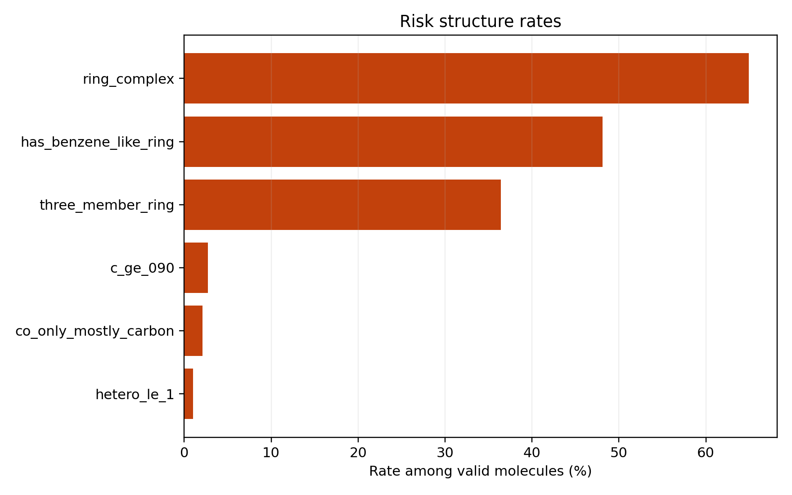
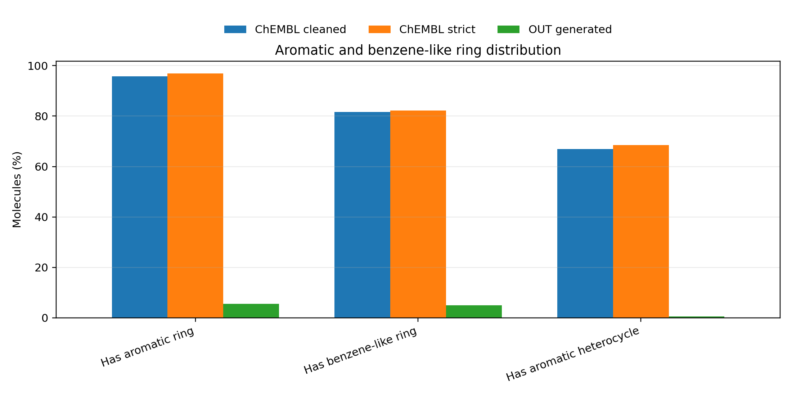
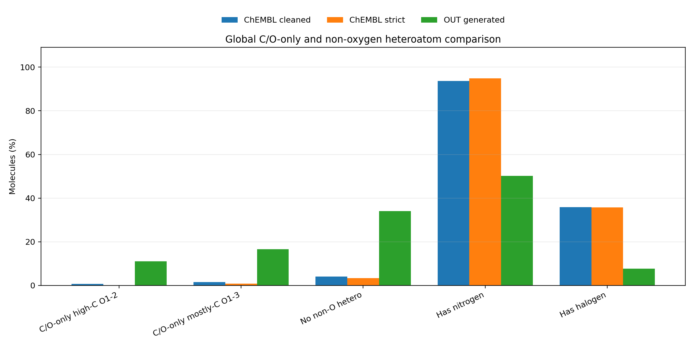

# 260527 每日总结

## 前提

今天的主线是把 260526 暴露出的 reward hacking 变成可量化、可训练、可回归测试的系统工程：更新项目文档、构建更明确的 ChEMBL classifier v0.1 样本、诊断芳香环/杂原子缺失、清理 RLPF 外部依赖，并启动 7GPU dock+classifier 训练。

## 干了什么

- 构建 reward hacking 诊断集，统计高碳、三元环、复杂环、芳香缺失等漏洞。
- 生成 `100K` 正样本和 `70K` hard negative 的 classifier v0.1 候选训练集。
- 用 GPU 训练 v0.1 classifier，并输出 per-category negative recall。
- 将 RLPF 核心运行时搬入 `ddpo/`，补充 DataProto 和 no-RLPF 回归测试。

## 关键结论

1. 生成分子的漏洞不是个别坏例，而是分布级偏移：高碳、C/O-only、三元环、复杂环、芳香缺失都非常明显。
2. v0.1 classifier 数据集比 260526 更合理：正样本严格分层，负样本来自明确失败模式。
3. 仅 classifier 高精度不等于 reward 好用，因为后续测试显示它会在 RL 中变成稀疏/饱和信号。
4. 工程上完成 RLPF 依赖内化和回归测试，为后续 DDPO 改造减少外部耦合。

## 结果与数据

| 项目 | 数值 | 解释 |
|---|---:|---|
| reward hacking 诊断分子 | `267,128` | 生成分子结构标签池 |
| OUT valid strict drug-like core | `0.280` | 生成分子中严格药物样通过率低 |
| OUT 三元环比例 | `0.519` | 结构漏洞非常严重 |
| OUT `C>=0.90` | `17.5%` | ChEMBL baseline 约 `1.5%` |
| OUT `hetero<=1` | `10.8%` | ChEMBL baseline 约 `0.4%` |
| OUT benzene-like ring | `4.97%` | strict ChEMBL `82.26%` |
| classifier v0.1 正样本 | `100,000` | strict ChEMBL pool，Murcko scaffold cap=10 |
| classifier v0.1 负样本 | `70,000` | 多标签 hard negatives |
| classifier v0.1 总量 | `170,000` | 显式正负样本清单 |
| v0.1 数据集 split | train `136,000`, val `17,000`, test `17,000` | 全部 featurize 成功 |
| v0.1 GPU 训练 | best epoch `21`, early stop `36`, `2.3 min` | GPU0 训练 |
| v0.1 test | acc `0.9945`, ROC-AUC `0.9998`, F1 `0.9953` | 分类器本身很强 |
| high_reward_bad recall | `0.9886` | 仍有约 `1.14%` 危险 false positive |
| RLPF 迁移 smoke | `33s`, 生成 4，valid 1 | 跑通 |
| phase3 smoke | `47s`, 生成 4，valid 3 | docking/classifier 字段正常 |

## 分析结果

今天最重要的进展不是“训练出一个高准确率 classifier”，而是把 reward loophole 从模糊直觉拆成了可枚举标签：`three_member_ring`、`ring_complex`、`aromatic_deficient_bad_topology`、`co_only_mostly_carbon`、`non_oxygen_hetero_loss`、`high_carbon_low_hetero`、`high_reward_bad`。这让后续 reward 设计有了可解释靶点。

但是 classifier 的风险也已出现：只要正类定义太宽，复杂但合法的 ChEMBL 分子会让模型学到“复杂也可以是好”；只要 reward 映射太硬，PPO 只会看到大量同样的 -1。后面 260528 的训练复盘证实了这个风险。

## 图表与文件

- 项目文档更新：[260527-1](../work_records/26-5/260527/260527-1%20%20项目文档更新——反映高维特征分类器奖励新体系.md)
- reward hacking 诊断入口：[260527-2](../work_records/26-5/260527/260527-2.md)
- classifier 样本选择总纲：[260527-3](../work_records/26-5/260527/260527-3.md)
- GPU 训练与 v0.1 结果：[260527-4](../work_records/26-5/260527/260527-4.md)
- RLPF 迁移方案：[260527-5](../work_records/26-5/260527/260527-5.md)
- RLPF 搬迁总结：[260527-6](../work_records/26-5/260527/260527-6.md)
- 提交与测试记录：[260527-7](../work_records/26-5/260527/260527-7%20%20提交.md)
- RLPF/reference 去跟踪：[260527-8](../work_records/26-5/260527/260527-8.md)
- phase3 回归保护：[260527-9](../work_records/26-5/260527/260527-9.md)
- 260407 SDF classifier 测试报告：[report.md](../analysis/classifier_test_260407_sdf_20260527/report.md)
- classifier 概率图：
- 风险 flag 图：
- 样本选择 dry-run：[selection_dryrun_report.md](../analysis/dataset_selection_dryrun_20260527/selection_dryrun_report.md)
- 最终样本集报告：[selected_dataset_report.md](../analysis/final_classifier_dataset_selection_20260527/selected_dataset_report.md)
- 正样本分布图：
- 芳香/苯环诊断：[aromatic_benzene_report.md](../analysis/aromatic_benzene_diagnosis_20260527/aromatic_benzene_report.md)
- 芳香对比图：
- C/O-only 诊断：[co_only_composition_report.md](../analysis/hetero_composition_diagnosis_20260527/co_only_composition_report.md)
- C/O-only 对比图：

## 下一步

下一步不应直接把 v0.1 classifier 大权重塞进 PPO，而应先测试它在基础 DiffSBDD 分子上的概率分布、reward 映射是否饱和，并额外分析 high_reward_bad false positives。
