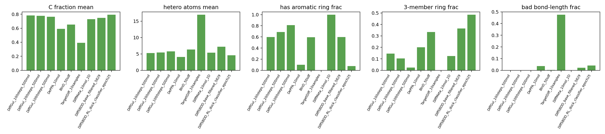

# 260531 每日总结

## 前提

今天没有 `work_records` 日志，但有完整的 `analysis/model_strategy_20260531/` 证据包。核心任务是把前几天参考项目和生成结果统一成策略判断：DiffGui 在质量上明显强，DePPA 在速度上最现实，DiffSBDD 的 RL 主要把模型推向 reward 漏洞。

## 干了什么

- 聚合 DiffGui 100/200/1000 steps 的 500 分子生成质量和速度数据。
- 汇总 DePPA、BInD、TargetDiff、DiffMeta、DiffSBDD base、DiffSBDD RL 的统一性质指标。
- 对 DiffSBDD base/RL 与 DiffGui/DePPA 的芳香、三元环、元素组成、键长和速度做策略分析。

## 关键结论

1. DiffGui 100/200/1000 steps 都能得到 500/500 RDKit valid，但步数越多，芳香性、三元环、SA 和杂原子更好。
2. DiffGui 直接做 RL 主底座成本很高：1000 steps 6 卡生成 500 个约 3.88 小时。
3. DePPA 是最现实的新 base 候选：速度快，和 DiffSBDD 同属连续坐标扩散路径，工程适配成本较低。
4. DiffSBDD RL 不是没优化，而是优化到了错误结构方向：aromatic ring 明显下降，three-member ring 上升，高碳/低非氧杂原子增加。

## 结果与数据

### DiffGui 步数质量-速度

| 指标 | 100 steps | 200 steps | 1000 steps |
|---|---:|---:|---:|
| 规模 | 500 | 500 | 500 |
| RDKit valid | 500/500 | 500/500 | 500/500 |
| QED mean | 0.583 | 0.587 | 0.592 |
| SA mean | 4.19 | 3.93 | 3.56 |
| carbon fraction | 0.782 | 0.776 | 0.763 |
| hetero atoms | 5.25 | 5.43 | 5.78 |
| has aromatic ring | 59.6% | 68.8% | 81.0% |
| aromatic heterocycle | 40.6% | 45.8% | 52.8% |
| three-member ring | 14.6% | 10.4% | 2.4% |
| bad bond-length frac | 0.07% | 0.08% | 0.03% |
| 6卡 wall s/mol | 3.19 | 6.85 | 27.92 |

### 其他模型速度

| 模型 | steps | 规模 | 时间 |
|---|---:|---:|---:|
| DePPA | 500 | 10 mol | 23.67s, `2.37s/mol` |
| BInD | 1000 | 50 SDF | 634.41s, `12.69s/mol` |
| TargetDiff | 500 | 10 samples | 192.88s，仅 1 个 SDF |
| DiffMeta | 500 | 10 mol | 32.98s |

### DiffSBDD base vs RL

| 指标 | DiffSBDD base | DiffSBDD RL epoch25 | 方向 |
|---|---:|---:|---|
| carbon fraction | 0.748 | 0.794 | 变高 |
| hetero atoms | 7.20 | 4.56 | 下降 |
| has aromatic ring | 59.89% | 7.52% | 严重下降 |
| aromatic heterocycle | 22.34% | 0.80% | 几乎消失 |
| three-member ring | 36.42% | 48.54% | 变坏 |
| bad bond-length frac | 2.18% | 4.12% | 变坏 |

## 分析结果

这一天的策略结论非常关键：当前问题不能再被理解为“reward 还不够强”。真正的问题是基础生成分布和结构先验偏弱，RL 在坏先验上做局部搜索，自然会稳定钻 docking/classifier 的漏洞。

DiffGui 的结果证明显式 atom/bond/geometry 训练确实能提高分子结构质量，但速度太慢；DePPA 虽然仍非显式 bond diffusion，但速度和工程链路更接近当前项目。因此最合理的路线是三线并行：短期 DiffSBDD 小改 + RL 护栏，中期 DePPA adapter 评估，长期 x/h/e edge diffusion。

## 图表与文件

- 证据包 README：[README.md](../analysis/model_strategy_20260531/README.md)
- 深度策略分析：[strategy_deep_analysis.md](../analysis/model_strategy_20260531/strategy_deep_analysis.md)
- 质量汇总 CSV：[model_generation_quality_summary.csv](../analysis/model_strategy_20260531/model_generation_quality_summary.csv)
- 速度汇总 CSV：[generation_timing_summary.csv](../analysis/model_strategy_20260531/generation_timing_summary.csv)
- RL 关键 epoch：[diffsbdd_rl_training_key_epochs.csv](../analysis/model_strategy_20260531/diffsbdd_rl_training_key_epochs.csv)
- 分子级指标：[molecule_level_metrics.csv](../analysis/model_strategy_20260531/molecule_level_metrics.csv)
- 有效率图：
- 质量指标图：
- DiffGui 速度曲线：

## 下一步

下一步应进入数据链验证：CrossDocked edge/halfedge 数据构建、oracle reconstruction、OpenBabel/EDM/true-bond 消融。只有先确认真键数据链可靠，才能判断后续 bond predictor 或 edge diffusion 是否值得做。
