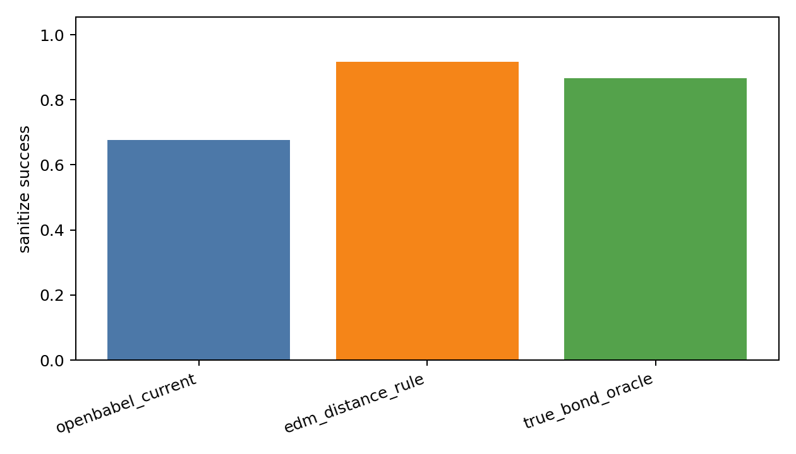
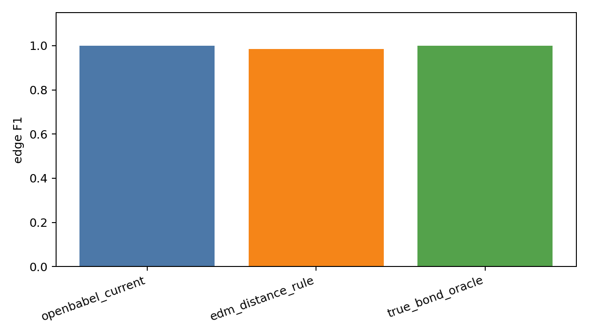

# 260601 每日总结

## 前提

前几天的横评已经确认：DiffSBDD 的核心短板集中在成键、键长、原子类型分布和几何合理性上。今天的目标不是先改模型，而是先建立可靠的数据链和评价基线：如果 true bond / halfedge 数据本身不可靠，后续 bond predictor 或 edge diffusion 都没有意义。

## 干了什么

- 下载并预处理 CrossDocked pocket10 数据，建立 `processed_edge_noH_full` 数据缓存。
- 为 DiffSBDD 数据加载流程补充 `ligand_halfedge_index / ligand_halfedge_type`。
- 做 true-bond oracle reconstruction，验证真实键标签能否反构建分子。
- 做真实坐标下 OpenBabel / EDM / true-bond oracle 的成键消融。
- 做同批 DiffSBDD 生成点云的 OpenBabel vs EDM 重建质量对比。
- 将 molecule reconstruction 拆成可切换 backend，准备后续接 local / DiffGui / MolSnapper bond predictor。
- 构建 local bond predictor 的 train/val/test 数据报告。

## 结果与数据

### CrossDocked 预处理

| 项 | 数值 |
|---|---:|
| 原始 split | train `100000`, test `100` |
| 自动 val | `300` |
| 处理后 train | `99929` |
| val/test | `300 / 100` |
| 18 核预处理耗时 | 约 `5分46秒` |
| `train.npz` | 约 `4.2G` |
| ligand atoms | `2,359,129` |
| directed bond entries | `5,063,798` |

### edge oracle 5000

| 指标 | 数值 |
|---|---:|
| samples | 5000 |
| oracle sanitize | `4334/5000` |
| total halfedges | `1,526,163` |
| total real bonds | `126,892` |
| no-bond fraction | `0.916856` |
| bad bond length rate | `0.7135%` |

### 真实坐标重建消融 5000

| method | sanitize | edge F1 | bad bond length | fragments | 解释 |
|---|---:|---:|---:|---:|---|
| OpenBabel current | 0.677 | 1.000 | 0.005 | 1.000 | 连边 pair 几乎对，但键阶/芳香语义有问题 |
| EDM distance rule | 0.917 | 0.984 | 0.001 | 1.521 | sanitize 高但碎片多，missed bond 多 |
| true-bond oracle | 0.867 | 1.000 | 0.008 | 1.000 | 图结构上限，但缺 charge/H/aromatic semantic 会影响 sanitize |

### 生成点云重建消融 500

| method | sanitize | bad bond length | fragments | aromatic rings | seconds/mol |
|---|---:|---:|---:|---:|---:|
| OpenBabel | 0.746 | 0.177 | 1.288 | 0.284 | 0.0024 |
| EDM | 0.162 | 0.033 | 3.564 | 0.010 | 0.0016 |

### local bond predictor 数据链

| split | analyzed | sanitize | bad length | no-bond | halfedge mismatch | bond mismatch |
|---|---:|---:|---:|---:|---:|---:|
| train | 10000 | 0.8652 | 0.00726 | 0.9172 | 0 | 0 |
| val | 300 | 0.8767 | 0.00659 | 0.9154 | 0 | 0 |
| test | 100 | 0.8900 | 0.00581 | 0.9184 | 0 | 0 |

真实键型比例：single `52.38%`，double `8.21%`，triple `0.22%`，aromatic `39.19%`。

## 图表与文件

- CrossDocked 预处理日志：[process_crossdock_18core.log](../analysis/crossdock_preprocess_20260601/process_crossdock_18core.log)
- edge oracle 报告：[edge_data_oracle_report.md](../analysis/edge_data_oracle_crossdock_20260601/edge_data_oracle_report.md)
- oracle bond type 图：
- oracle bond length 图：
- 真实坐标重建消融：[reconstruction_ablation_report.md](../analysis/reconstruction_ablation_crossdock_20260601/reconstruction_ablation_report.md)
- sanitize 图：
- edge F1 图：
- 生成点云重建报告：[generated_reconstruction_ablation_report.md](../analysis/generated_reconstruction_ablation_20260601_n500/generated_reconstruction_ablation_report.md)
- 生成点云 bad bond 图：
- local predictor 数据报告：[local_bond_predictor_data_report.md](../analysis/local_bond_predictor_data_20260601/local_bond_predictor_data_report.md)
- halfedge 类别图：
- oracle sanitize split 图：
- 当天记录目录：[work_records/26-6/260601](../work_records/26-6/260601/)

## 分析结果

今天给出了后续 edge diffusion 的基础事实：

1. `halfedge_index/type` 数据链可靠，mismatch 为 0，可以作为训练目标。
2. no-bond 约 91.5%-91.8%，类别极不均衡，训练时必须给 no-bond 降权或使用 focal/分层策略。
3. OpenBabel 在真实坐标上 edge pair F1 高，但 sanitize 只有 0.677，说明主要错在键阶/芳香/价态语义，不是完全不会连边。
4. EDM 规则不能直接替代 OpenBabel，因为它在生成点云上造成大量碎片。
5. true-bond oracle sanitize 只有 0.867 不是数据链失败，而是 charge/H/aromatic/stereo 语义缺失，后续需要 semantic sidecar。

这一天的结论是：成键问题可以被拆成“数据标签、语义重建、预测器、decoder、扩散变量”几个解耦模块，不能一上来直接把 OpenBabel 换掉。

## 下一步

下一步应做 semantic-aware oracle reconstruction，补齐 charge/H/aromatic/stereo 语义，确认 true bond + true atom + true coordinate 能 100% 对齐原 SDF。然后再训练和评估 bond predictor。

