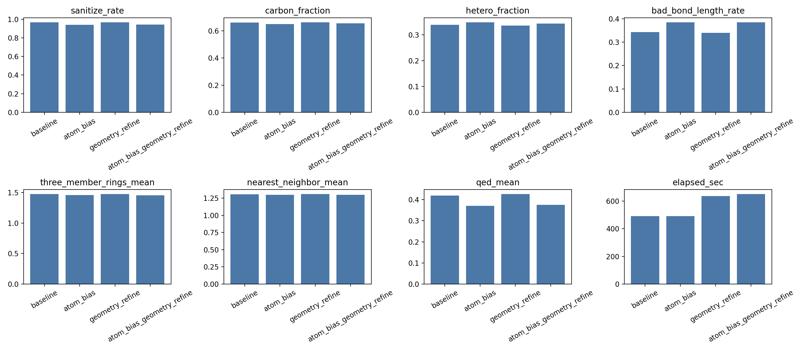
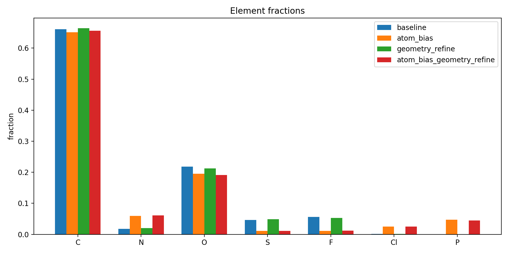
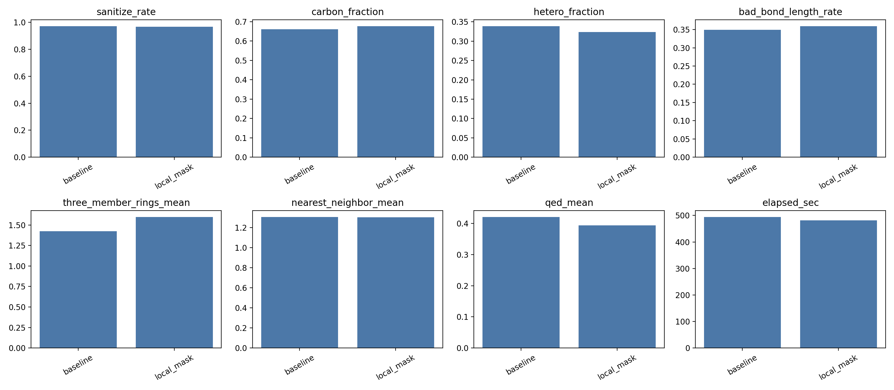
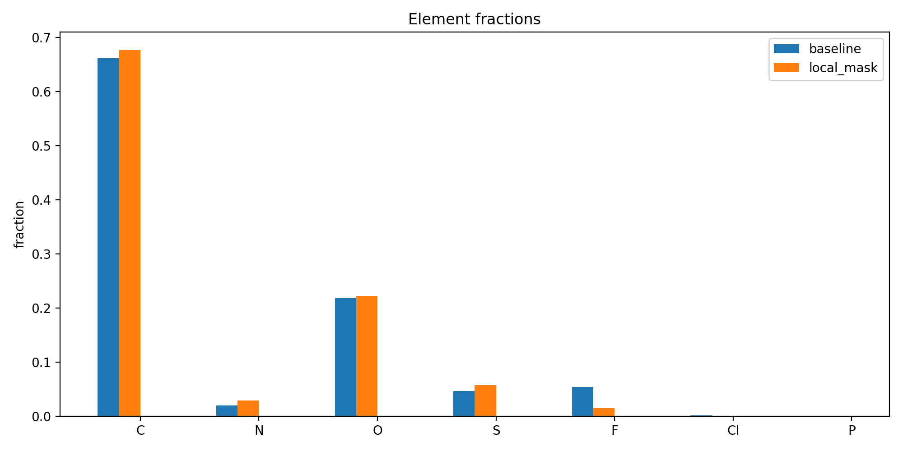
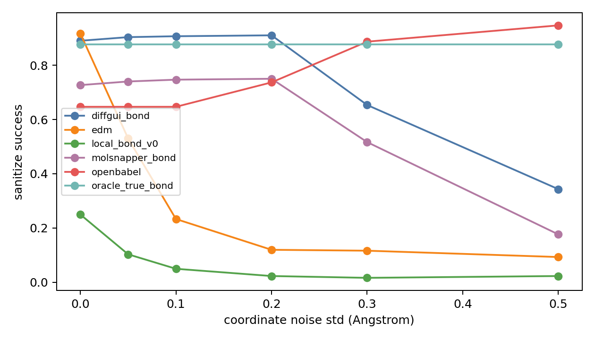

# 260602 每日总结

## 前提

260601 已经证明 CrossDocked halfedge 数据链可靠，但也发现 oracle reconstruction 缺少语义字段、OpenBabel/EDM 各有明显缺陷。今天的目标是：一边尝试轻量改善 DiffSBDD 点云质量，一边把 edge/bond 数据链推进到可训练小闭环。

## 干了什么

- 训练本地 bond predictor v0，并把它接入 reconstruction benchmark。
- 做 clean CrossDocked / noise robustness / generated point cloud 的成键预测诊断。
- 实现 final-only geometry refine 与 atom prior/logits bias，并跑 1000 分子 GPU ablation。
- 实现 local atom mask，限制 F/Cl/Br/I 出现在不合理局部环境。
- 修复 oracle SDF 与 Schrodinger 兼容问题，生成 original vs repaired 配对 SDF。
- 构建 semantic-aware oracle reconstruction，用 sidecar 记录 charge/H/aromatic/stereo。
- 实现 edge denoiser 最小闭环，并升级为仿 DiffGui/MolSnapper 的 node-edge denoiser。

## 结果与数据

### final-only geometry refine + atom bias，1000/group

| group | sanitize | bad bond | 3-rings/mol | QED | C fraction | sec/mol |
|---|---:|---:|---:|---:|---:|---:|
| baseline | 0.968 | 0.343 | 1.474 | 0.419 | 0.661 | 0.492 |
| atom_bias | 0.939 | 0.385 | 1.460 | 0.371 | 0.651 | 0.492 |
| geometry_refine | 0.968 | 0.340 | 1.477 | 0.427 | 0.664 | 0.636 |
| combined | 0.942 | 0.384 | 1.453 | 0.375 | 0.656 | 0.652 |

atom bias 虽然降低 C fraction，但引入 P/Cl 等副作用，且 bad bond 和 QED 变差；geometry refine 当前强度太弱，基本不能改变主要质量指标。

### local atom mask，1000/group

| group | sanitize | bad bond | QED | 3-rings/mol | F fraction |
|---|---:|---:|---:|---:|---:|
| baseline | 0.971 | 0.349 | 0.420 | 1.423 | 0.0535 |
| local_mask | 0.968 | 0.359 | 0.394 | 1.597 | 0.0148 |

local mask 能明显减少 F，但没有提高整体分子质量，不能默认进入主路径。

### semantic-aware oracle

| metric | default | semantic-aware | 变化 |
|---|---:|---:|---:|
| no-stereo SMILES match | 870/1000 | 1000/1000 | +130 |
| formal charge vector | 989/1000 | 1000/1000 | +11 |
| aromatic atom vector | 881/1000 | 1000/1000 | +119 |
| bond type map | 881/1000 | 1000/1000 | +119 |
| repair none | 870/1000 | 1000/1000 | +130 |

### edge denoiser node-edge n32

| metric | value |
|---|---:|
| device | cuda |
| max molecules | 32 |
| epochs | 80 |
| final train_loss | 0.004457 |
| final eval_loss | 0.025489 |
| final accuracy | 0.992624 |
| final balanced_accuracy | 0.922260 |
| final real_bond_recall | 0.909091 |
| final no_bond_recall | 1.000000 |
| recall_single | 0.945607 |
| recall_double | 0.787879 |
| recall_triple | 1.000000 |
| recall_aromatic | 0.877814 |
| best balanced_accuracy | 0.955569 |

## 图表与文件

- final refine ablation CSV：[metrics.csv](../analysis/final_refine_ablation_20260602_n1000_gpu/metrics.csv)
- final refine 质量图：
- final refine 元素图：
- local atom mask CSV：[metrics.csv](../analysis/local_atom_mask_ablation_20260602_n1000_gpu/metrics.csv)
- local atom mask 质量图：
- local atom mask 元素图：
- bond predictor 诊断报告：[bond_predictor_diagnostics_report.md](../analysis/bond_predictor_diagnostics_20260602_n300/bond_predictor_diagnostics_report.md)
- noise sanitize 图：
- generated geometry 图：
- semantic oracle 报告：[semantic_oracle_reconstruction_audit_report.md](../analysis/semantic_oracle_reconstruction_20260602_n1000/semantic_oracle_reconstruction_audit_report.md)
- semantic match 图：
- node-edge denoiser 报告：[edge_denoiser_overfit_report.md](../analysis/edge_denoiser_nodeedge_20260602_n32_gpu/edge_denoiser_overfit_report.md)
- node-edge 曲线：
- 当天记录目录：[work_records/26-6/260602](../work_records/26-6/260602/)

## 分析结果

今天把两件事基本验证清楚：

1. 轻改里的 atom bias / final geometry refine / local atom mask 在当前参数下不能直接提高生成质量，只能保留为 ablation 工具。它们可以改变某些局部统计，但对 sanitize、三元环、bad bond 和 QED 没有正向证据。
2. edge 数据链是强信号。semantic-aware oracle 达到 100% 语义对齐，node-edge denoiser 在小样本上能学到真实键，说明“键预测任务本身可学”，不是数据链写错。

因此从今天开始，主线应从“后处理投机修补”转向“有监督 edge/bond 学习”，但仍要保持和普通 DiffSBDD + RL 解耦。

## 下一步

下一步应扩大 node-edge denoiser 到 1000 分子 train/val，加入 t 分层评估和 predicted-edge reconstruction，确认它不是单纯 overfit，也能在噪声时间步上恢复键。

