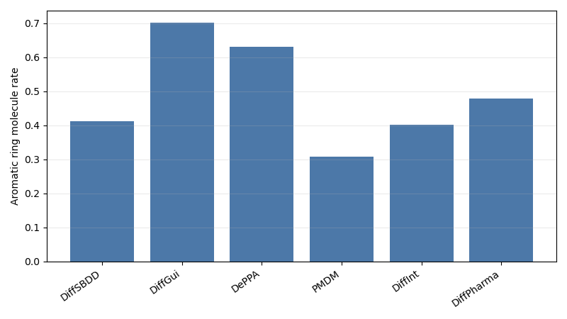
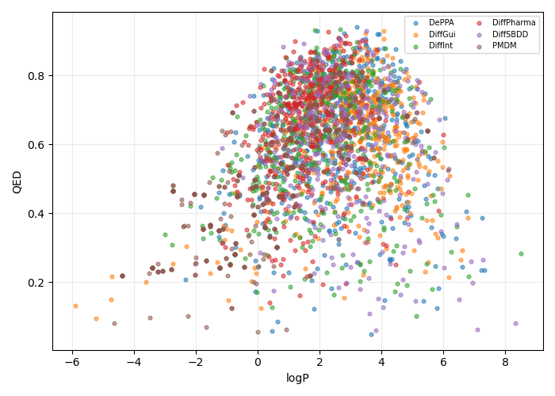

# 260603 每日总结

## 前提

260602 已经证明 semantic oracle 和 node-edge edge denoiser 的小样本闭环可行，但还不知道泛化、t 噪声鲁棒性、重建质量，以及 DiffSBDD 与现代模型在 C1101 口袋上的真实差距。今天的目标是扩大验证，并做正式的同靶点多模型横评。

## 干了什么

- 将 node-edge edge denoiser 扩到 1000 分子 train/val。
- 做 t 分层评估、预测键重建和 C 组 edge denoiser ablation。
- 对 generated 点云做 edge denoiser 重建与苯环诊断。
- 重新跑 DiffSBDD 小改四组：baseline、atom prior/mask、geometry refine、combined。
- 构建 `x/h/e` edge diffusion 最小模型骨架并做小样本 overfit。
- 对 8GJL/C1101 口袋做 500 steps、500 分子、7 卡横评：先三模型，再扩展到六模型。

## 结果与数据

### node-edge denoiser 1000 分子 train/val

| metric | value |
|---|---:|
| train / val molecules | 800 / 200 |
| wall time | 约 180.8s |
| eval accuracy | 0.994855 |
| balanced accuracy | 0.956287 |
| real-bond recall | 0.938899 |
| recall_single | 0.931624 |
| recall_double | 0.890661 |
| recall_triple | 1.000000 |
| recall_aromatic | 0.959152 |

### t 分层评估

| t | accuracy | balanced acc | real-bond F1 |
|---:|---:|---:|---:|
| 0 | 0.9998 | 0.9968 | 0.9976 |
| 50 | 0.9995 | 0.9922 | 0.9935 |
| 100 | 0.9993 | 0.9909 | 0.9912 |
| 250 | 0.9982 | 0.9809 | 0.9788 |
| 500 | 0.9954 | 0.9613 | 0.9456 |
| 750 | 0.9926 | 0.9367 | 0.9121 |
| 950 | 0.9906 | 0.9217 | 0.8882 |
| 999 | 0.9902 | 0.9148 | 0.8837 |

### DiffSBDD 轻改四组，1000/group, t=100

| group | sanitize | bad bond | 3-rings | benzene-like | C | N | O | QED |
|---|---:|---:|---:|---:|---:|---:|---:|---:|
| baseline | 0.658 | 0.046 | 0.235 | 0.379 | 0.739 | 0.093 | 0.121 | 0.407 |
| atom prior/mask | 0.656 | 0.047 | 0.241 | 0.375 | 0.740 | 0.098 | 0.130 | 0.392 |
| geometry refine | 0.658 | 0.046 | 0.234 | 0.377 | 0.739 | 0.093 | 0.121 | 0.406 |
| combined | 0.657 | 0.046 | 0.243 | 0.375 | 0.739 | 0.098 | 0.130 | 0.392 |

结论：当前轻改参数没有改善质量，不能默认进入生成路径。

### x/h/e 小样本 overfit，n128 uniform prior

| metric | value |
|---|---:|
| eval edge accuracy | 0.985316 |
| real-bond F1 | 0.825392 |
| atom accuracy | 0.983535 |
| pos RMSE | 0.024327 Å |
| bond pair set match | 1.000 |
| bond type map match | 0.125 |
| semantic sanitize | 0.563 |

### 六模型 8GJL/C1101 500 steps 横评

| 模型 | wall s/mol | sanitize | unique valid | bad bond frac | aromatic mol rate | 3-ring mol rate | QED |
|---|---:|---:|---:|---:|---:|---:|---:|
| DiffSBDD | 0.301 | 0.666 | 1.000 | 0.00287 | 0.412 | 0.154 | 0.604 |
| DiffGui | 13.268 | 1.000 | 0.996 | 0.000065 | 0.702 | 0.134 | 0.616 |
| DePPA | 0.323 | 0.982 | 1.000 | 0.00252 | 0.630 | 0.238 | 0.621 |
| PMDM | 1.606 | 1.000 | 0.406 | 0.00219 | 0.308 | 0.106 | 0.528 |
| DiffInt | 0.304 | 1.000 | 1.000 | 0.00000 | 0.402 | 0.355 | 0.609 |
| DiffPharma | 1.441 | 1.000 | 0.986 | 0.00000 | 0.479 | 0.772 | 0.655 |

## 图表与文件

- edge denoiser 1000 曲线：
- t 分层报告：[edge_denoiser_eval_report.md](../analysis/edge_denoiser_eval_20260603_n1000_val_tgrid_reconstruct_gpu_v3/edge_denoiser_eval_report.md)
- t 分层曲线：
- 轻改报告：[refinement_ablation_report.md](../analysis/refinement_ablation_20260603_n1000_t100/refinement_ablation_report.md)
- 轻改质量图：
- xhe overfit 报告：[edge_diffusion_overfit_report.md](../analysis/edge_diffusion_xhe_overfit_20260603_n128_uniform_gpu/edge_diffusion_overfit_report.md)
- xhe overfit 曲线：
- 六模型 summary：[model_summary.csv](../analysis/8gjl_c1101_benchmark_20260603_500mol_500steps/evaluation/six_models/model_summary.csv)
- sanitize 图：
- aromatic 图：
- QED vs LogP 图：
- 当天记录目录：[work_records/26-6/260603](../work_records/26-6/260603/)

## 分析结果

今天的结论非常明确：

1. node-edge edge denoiser 在 clean CrossDocked 坐标上不是玩具，1000 分子 train/val 能泛化，且 t=500 仍有 real-bond F1 0.946。
2. 但 edge denoiser 与完整生成还有距离：预测键重建的 exact halfedge / bond type 语义仍是瓶颈。
3. 小改线当前被阶段性证伪：atom prior/mask 和 geometry refine 参数不能改善 sanitize、bad bond、三元环和 QED。
4. 横评给出路线优先级：DiffGui 是质量上限但慢；DePPA 是速度和质量综合最现实参考；DiffSBDD docking 潜力不差但基础合法性弱；DiffInt/DiffPharma 的 interaction 思路可借，但三元环/碎片风险必须护栏。

## 下一步

下一步应补 docking 横评，把六模型生成质量和 UniDock 分数关联起来；同时把 x/h/e 分支从独立小模型推进到 DiffSBDD 主体内的可选 `diffusion_mode=xhe`。

