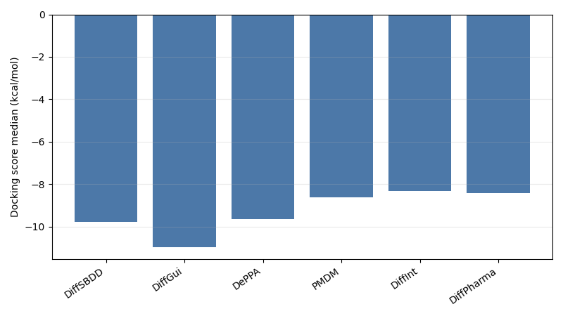
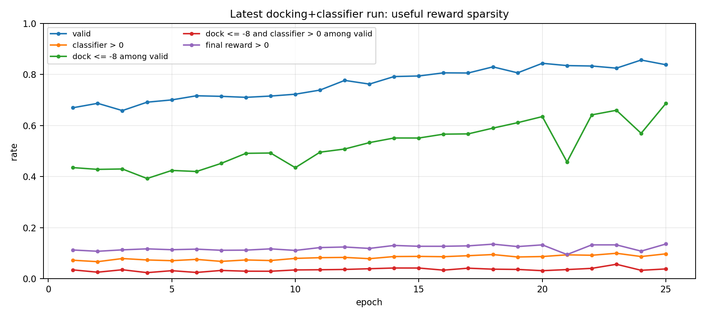
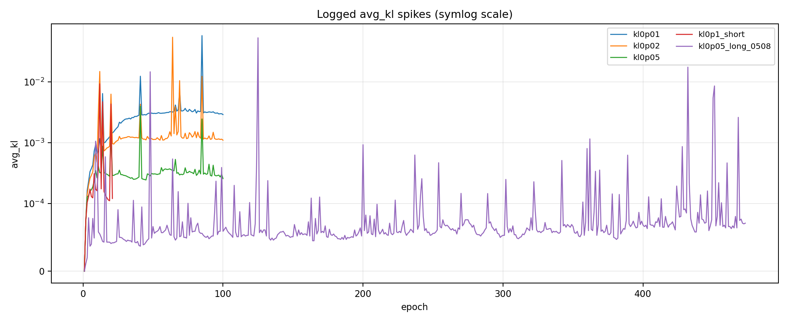
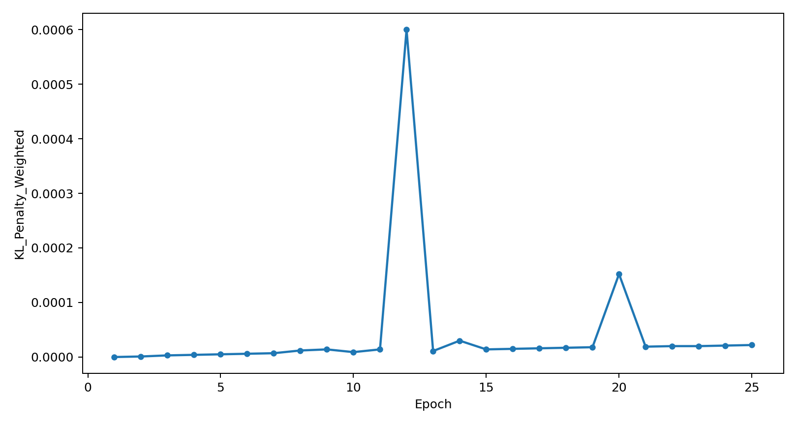
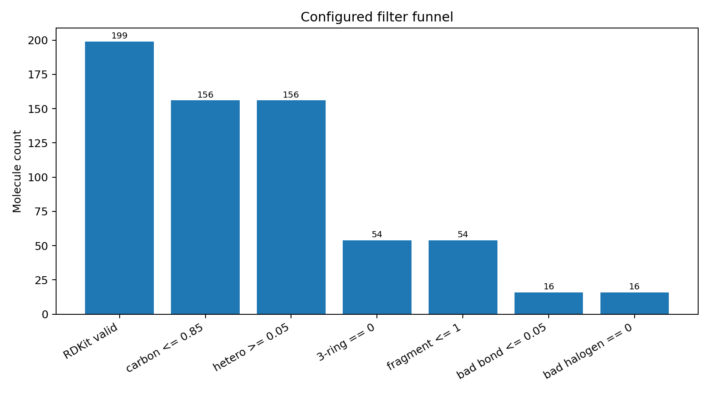
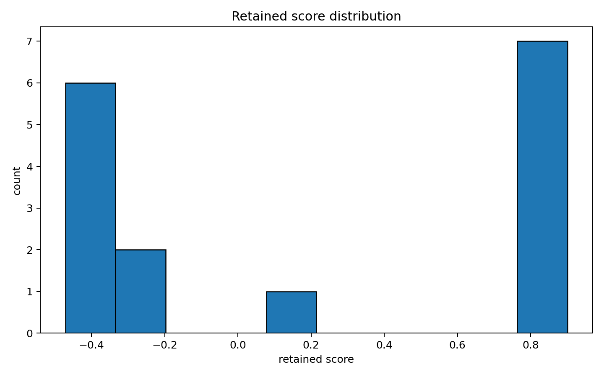

# 260604 每日总结

## 前提

260603 横评显示 DiffSBDD 速度和 docking 潜力都还在，但 sanitize、芳香组织和结构合法性明显弱于 DiffGui/DePPA。今天一方面补 docking 证据，另一方面正式把项目拆成小改线、大改线、强化学习线，并推进 RL 的 KL/好分子池/化学护栏与 xhe 监督训练。

## 干了什么

- 对六模型 8GJL/C1101 输出做 UniDock fast docking 横评。
- 更新项目介绍文档为三条主线：小改、大改 xhe、强化学习。
- 分析近期 RL 高碳漂移和奖励稀疏问题。
- 对历史 KL 跳跃做诊断，并新增 `analytic_current_ref` 和 DePPA-style K3 模式。
- 设计/实现 ChemistryGuardReward、GoodMoleculePool 和磁盘 trajectory replay 方案。
- 审计 GoodMoleculePool 10 epoch 过滤效果。
- 实现 edge diffusion sampler smoke、多卡 DDP 训练入口和 DiffSBDD-xhe 字段传递/edge loss。
- 在 20k CrossDocked 子集上跑六卡 xhe 监督训练。

## 结果与数据

### 六模型 UniDock

| 模型 | median | best 5% mean | <= -10 | <= -12 | positive count |
|---|---:|---:|---:|---:|---:|
| DiffSBDD | -9.774 | -12.770 | 0.450 | 0.044 | 4 |
| DiffGui | -10.983 | -14.055 | 0.720 | 0.250 | 0 |
| DePPA | -9.645 | -12.795 | 0.412 | 0.068 | 0 |
| PMDM | -8.618 | -11.336 | 0.188 | 0.002 | 0 |
| DiffInt | -8.315 | -11.171 | 0.108 | 0.004 | 0 |
| DiffPharma | -8.416 | -10.956 | 0.068 | 0.006 | 0 |

### RL 高碳与奖励稀疏

| 指标 | 起点 | 末轮/最新 | 解释 |
|---|---:|---:|---|
| carbon_fraction | 0.6546 | 0.7937 | 明显高碳化 |
| hetero_atom_mean | 7.49 | 4.56 | 杂原子减少 |
| TPSA | 104.17 | 60.97 | 极性下降 |
| classifier 正分占全部 | - | 9.71% | 有效奖励稀疏 |
| valid 内 docking<=-8 且 classifier>0 | - | 3.79% | 可学习好样本很少 |
| 当前正式 KL | - | `kl_coef=0` | 无预训练约束 |

### KL / logprob 改造

| 模式 | 含义 | 状态 |
|---|---|---|
| `analytic_ref_current` | 旧版 KL(ref || current) | 保留兼容 |
| `analytic_current_ref` | 新增 KL(current || ref) | 推荐默认方向 |
| `pretrained_logprob_k3` | DePPA/Schulman style K3 近似 KL | 可选对照 |

验证：相关 pytest `19 passed`，`launch/smoke.sh` 通过。

### GoodMoleculePool 10 epoch 审计

| 指标 | 数值 |
|---|---:|
| 总生成 | 320 |
| RDKit valid | 199, 62.19% |
| manifest retained | 16 |
| final retained | 16 |
| 通过所有 guard / 总分子 | 5.00% |
| 通过所有 guard / valid | 8.04% |
| retained score max | 0.9007 |
| retained score mean | 0.1869 |
| retained 中 score > 0 | 8/16 |
| retained aromatic ring > 0 | 0/16 |

主要失败：three-member ring >0 为 66.83%，bad bond length >0.05 为 69.35%，carbon >0.85 为 21.61%。

### DiffSBDD-xhe 20k 六卡监督训练

| run | 结果 |
|---|---|
| `1epoch_b4` | 成功，global_step 834 |
| `3epoch_b4` | OOM，GPU3 已分配 9.20 GiB，再申请 68 MiB 失败 |
| `3epoch_b2` | 成功，耗时 1411.52s |

验证集 edge 指标：

| run | edge acc | real-bond acc | binary F1 |
|---|---:|---:|---:|
| baseline random edge | 0.7073 | 0.0279 | 0.0657 |
| 1epoch_b4 | 0.8666 | 0.5915 | 0.5147 |
| 3epoch_b2_last | 0.8855 | 0.5795 | 0.5417 |
| 3epoch_b2_best | 0.8800 | 0.5766 | 0.5301 |

## 图表与文件

- UniDock summary：[docking_model_summary.csv](../analysis/8gjl_c1101_benchmark_20260603_500mol_500steps/docking/unidock_fast_8gjl_c1101/summary/docking_model_summary.csv)
- docking median 图：
- best 5% 图：
- RL 高碳报告：[report.md](../analysis/rl_high_carbon_sparse_reward_20260604/report.md)
- descriptor 趋势图：
- reward 稀疏图：
- KL 跳跃趋势：
- KL0p02 趋势：
- logprob 模式实验图：
- GoodMoleculePool summary：[summary.json](../analysis/good_pool_audit_20260604_174051/summary.json)
- GoodMoleculePool 漏斗：
- retained 分数图：
- xhe 20k edge metrics：[combined_edge_metrics.csv](../analysis/diffsbdd_xhe_supervised_20260604_20k_6gpu/combined_edge_metrics.csv)
- xhe val 指标图：
- 当天记录目录：[work_records/26-6/260604](../work_records/26-6/260604/)

## 分析结果

今天有三个重要判断：

1. DiffSBDD docking 并没有完全崩。它 median -9.774，<= -10 比例 45%，说明当前底座有靶点优化潜力；真正短板是化学合法性和结构稳定性。
2. RL 线的核心问题是 reward 稀疏 + 缺少护栏 + KL 默认未启用。GoodMoleculePool 链路可用，但通过率很低，且 retained 分子没有芳香环，说明 pool 不能只看总分，必须加 ring/aromatic/geometry guard。
3. xhe 线已经证明 edge head 能从原 DiffSBDD checkpoint warm-start 后学到真实键信号；瓶颈从数据链变成工程显存和单次 denoiser 前向。

## 下一步

下一步应修 xhe 的双 EGNN 前向，改成一次 denoiser 同时输出 `x/h/e`；同时给正式训练增加本地 CSV 指标日志。RL 线则应用 `analytic_current_ref` 或 K3 做 KL 对照，并把 ChemistryGuardReward + GoodMoleculePool 作为解耦组件跑短 ablation。

