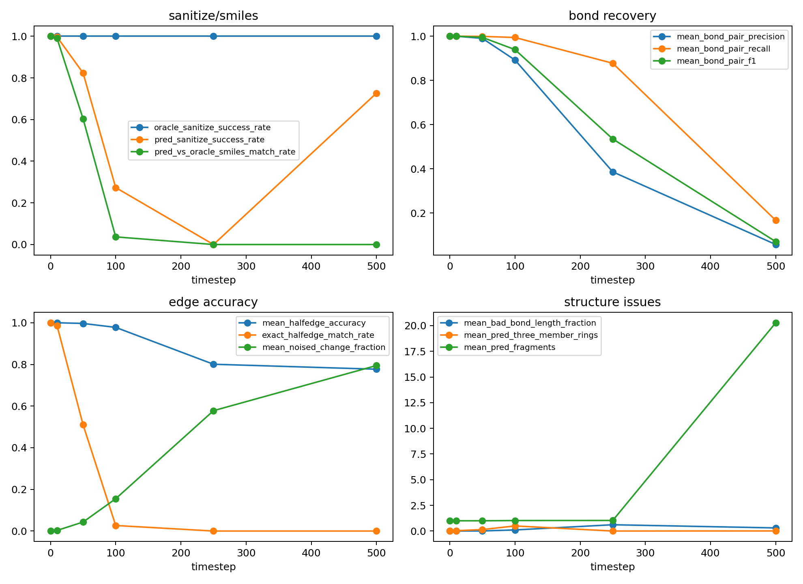
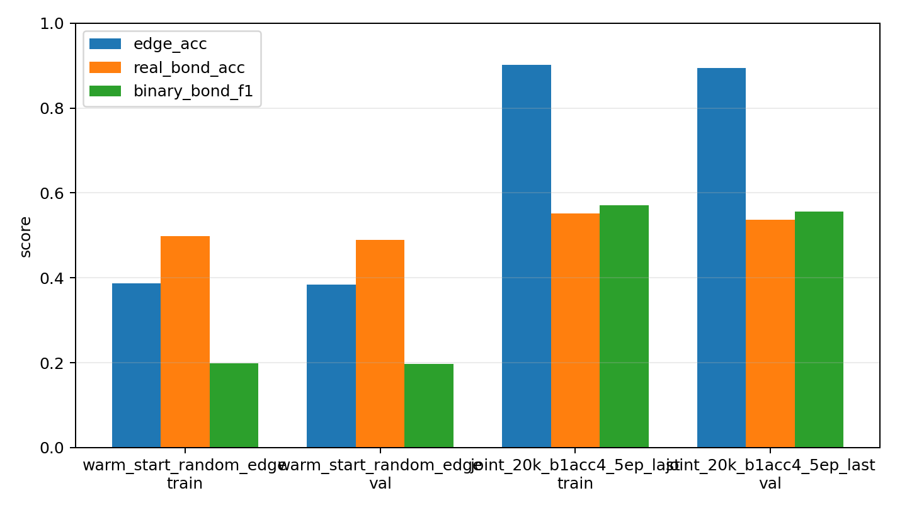

# 260605 每日总结

## 前提

260604 的 xhe 监督训练说明 edge head 能学，但 batch4 多 epoch OOM，原因指向 `x/h` 和 `edge_forward_smoke` 双 EGNN 前向。今天的目标是把 xhe 线做成更接近真正 joint denoiser 的可训练版本，同时启动更正式的训练和显存安全测试。

## 干了什么

- 修复 DiffSBDD-xhe 单次 denoiser 前向：一次 dynamics 同时输出 `net_out_lig/net_out_pocket/edge_logits`。
- 做 predicted-edge reconstruction smoke，测试训练后的 edge head 能否反构建 RDKit 分子。
- 加入 xhe 联合消息传递和采样接口，让 `e_t` embedding 进入 EGNN message passing。
- 整理 xhe 训练结果和与原始 DiffSBDD 的公平对照设计。
- 从原始 DiffSBDD checkpoint warm-start 启动全量 xhe 训练。
- 构建 `pocket1000` 和 `pocket750` capped CrossDocked edge 缓存，控制 outlier pocket OOM。
- 实现本地 CSVLogger 和训练进度打印规则。
- 测试 pocket750 下 b4acc2 / b8acc1 显存安全性。

## 结果与数据

### 单次 denoiser 前向修复

| 测试 | 修复前 | 修复后 |
|---|---:|---:|
| batch4 / 3epoch / 6GPU | OOM, 205.71s | 成功, 495.42s |
| global_step | 未完成 | 2502 |
| checkpoint | 无完成 ckpt | `last.ckpt`, best epoch 0 |

验证集 edge 指标：

| run | edge acc | real-bond acc | binary F1 |
|---|---:|---:|---:|
| baseline random edge | 0.7073 | 0.0279 | 0.0657 |
| old batch2 / 3epoch | 0.8855 | 0.5795 | 0.5417 |
| new batch4 / 3epoch single-forward | 0.8806 | 0.5802 | 0.5366 |

### predicted-edge reconstruction

| timestep | sanitize | SMILES match | bond pair F1 | halfedge acc | bad bond length | pred bonds | target bonds | 3-ring |
|---:|---:|---:|---:|---:|---:|---:|---:|---:|
| 0 | 1.0000 | 1.0000 | 1.0000 | 1.0000 | 0.0002 | 24.997 | 24.997 | 0.033 |
| 10 | 0.9967 | 0.9900 | 1.0000 | 0.9999 | 0.0002 | 24.997 | 24.997 | 0.033 |
| 50 | 0.8233 | 0.6033 | 0.9946 | 0.9966 | 0.0099 | 25.227 | 24.997 | 0.143 |
| 100 | 0.2733 | 0.0367 | 0.9394 | 0.9776 | 0.1075 | 27.880 | 24.997 | 0.497 |
| 250 | 0.0000 | 0.0000 | 0.5349 | 0.8007 | 0.6130 | 57.193 | 24.997 | 0.000 |
| 500 | 0.7267 | 0.0000 | 0.0703 | 0.7769 | 0.3029 | 10.853 | 24.997 | 0.010 |

### joint 20k / 6GPU / 5 epoch

| 项 | 数值 |
|---|---:|
| train / val | 20000 / 300 |
| GPU | 6 |
| batch size | 1 |
| accumulate grad | 4 |
| epoch | 5 |
| 耗时 | 2021.82s，约 33.7min |
| 原始 DiffSBDD checkpoint | epoch 999, global_step 1,562,000 |

edge val：

| model | edge acc | real-bond acc | binary F1 |
|---|---:|---:|---:|
| warm_start_random_edge | 0.3835 | 0.4893 | 0.1976 |
| joint_20k_b1acc4_5ep_last | 0.8948 | 0.5369 | 0.5568 |

### pocket capped 数据

| cache | train kept | train removed | val kept | kept pocket max | kept total max |
|---|---:|---:|---:|---:|---:|
| pocket1000 | 99504/99929 | 425, 0.425% | 300/300 | 999 | 1052 |
| pocket750 | 98501/99929 | 1428, 1.43% | 296/300 | 750 | 791 |

### pocket750 batch 显存测试

| 配置 | 是否能跑 | 峰值观察 | 结论 |
|---|---|---:|---|
| b4acc2 | 完整 1 epoch | 9809/10240 MB | 能跑但几乎无余量，不推荐长训 |
| b8acc1 | 启动并跑过 100 batch | 9793/10240 MB | 显存贴满，手动停止，不推荐 |
| b2acc4 | 未在本记录重跑 | 预计更安全 | 推荐 50 epoch 默认 |

## 图表与文件

- single-forward xhe 记录：[260605-01](../work_records/26-6/260605/260605-01%20DiffSBDD-xhe单次denoiser前向修复.md)
- predicted-edge reconstruction 记录：[260605-02](../work_records/26-6/260605/260605-02%20DiffSBDD-xhe预测边重建测试.md)
- predicted reconstruction 报告：[predicted_edge_reconstruction_report.md](../analysis/diffsbdd_xhe_predicted_reconstruction_20260605_val/predicted_edge_reconstruction_report.md)
- predicted reconstruction 图：
- xhe joint edge metrics：[edge_metrics_summary.csv](../analysis/diffsbdd_xhe_joint_20260605_20k_6gpu/eval_edge_metrics_last/edge_metrics_summary.csv)
- xhe edge bars：
- pocket1000 split summary：[split_summary.csv](../data/crossdocked_raw/processed_edge_noH_10class_full_pocket1000/cap_report/split_summary.csv)
- pocket750 split summary：[split_summary.csv](../data/crossdocked_raw/processed_edge_noH_10class_full_pocket750/cap_report/split_summary.csv)
- pocket750 memtest log：[train_xhe_from_original_10class_full_pocket750_8gpu_b4acc2_memtest_1ep.log](../analysis/formal_xh_xhe_comparison_20260605_full_8gpu/train_xhe_from_original_10class_full_pocket750_8gpu_b4acc2_memtest_1ep.log)
- b2acc4 metrics CSV：[metrics.csv](../analysis/formal_xh_xhe_comparison_20260605_full_8gpu/lightning/diffsbdd-xhe-from-original-full-pocket1000-8gpu-260605-b2acc4-50ep/metrics/metrics.csv)
- 当天记录目录：[work_records/26-6/260605](../work_records/26-6/260605/)

## 分析结果

今天的核心结论是：

1. xhe OOM 的主要原因已经定位并修复：双 EGNN 前向改成单次 forward 后，batch4/3epoch 能跑完，edge 指标没有明显变差。
2. 当前 xhe 还不是成熟完整 edge diffusion。低噪声 `t=0/10/50` 能很好修边，但高噪声 `t=100/250/500` 仍会多连键、少连键或碎片化，说明需要真正的 `e_t -> e_{t-1}` sampler、更长训练和 t 分层 loss。
3. pocket graph 大小是显存关键因素。pocket1000 删除样本极少但仍有大图压力；pocket750 删除 1.43% train 样本，最大 total nodes 降到 791，更适合 10GB 卡。
4. b4/b8 per-GPU batch 在 10GB RTX 3080 上不安全，正式长训应选 `pocket750 b2acc4` 或继续压缩 pocket/edge graph，而不是盲目加 batch。
5. 本地日志规则已补上，后续正式训练必须有 `metrics/metrics.csv` 和 rank-0 进度输出，不能依赖 WandB。

## 下一步

下一步最稳的正式训练方案是从原始 DiffSBDD checkpoint warm-start，用 `pocket750 batch_size=2 accumulate_grad_batches=4` 跑 50 epoch，保留 5 epoch checkpoint 和 best checkpoint；同时开发真正的 edge sampler，并在验证集上持续看 edge acc、real-bond acc、sanitize、predicted-edge reconstruction，而不是只看 loss。

