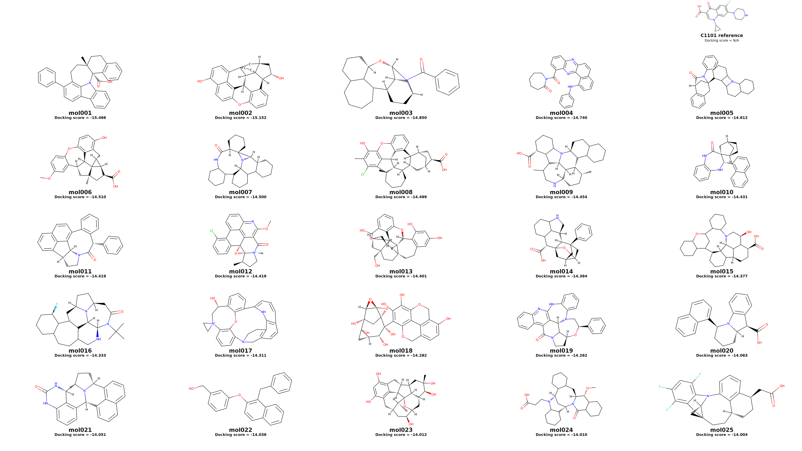
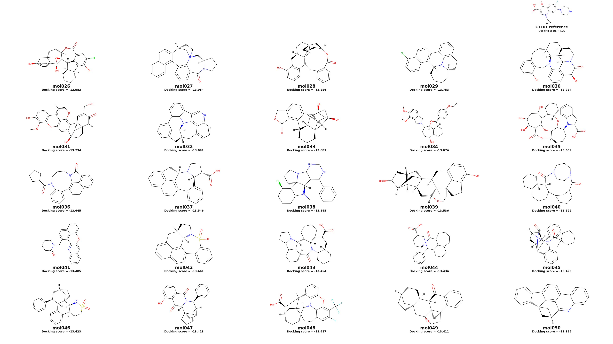
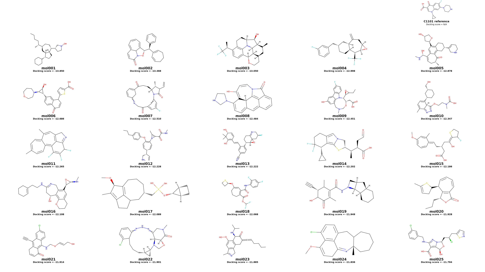
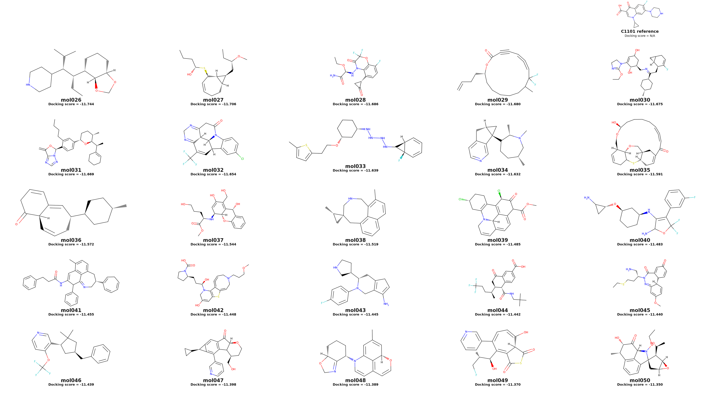

# benchmark 第一批 PB-valid 分子 Top50 二维图

## 任务原因

从 benchmark5 的第一批 1000 次生成（formal `rep1`）中，对 DiffGui 和 DiffSBDD 分别筛选“RDKit 合法且 PB-valid”的分子，再按 docking score 从低到高取 top50，复用既有第一版 2D 分页布局生成可追溯图片与 SDF。

## 数据与筛选口径

筛选链固定为：`rep1 的 1000 次尝试 -> sanitize-valid -> pb_valid=True -> docking score 升序 -> 每个模型前 50`。

- 合法分子来源：formal rep1 的 `successful_docked_outputs.sdf`；这些 docking 输入来自对应 `filtered_sanitize_valid` 集合，脚本再次逐分子执行 RDKit sanitize 检查。
- PB-valid 来源：formal PoseBusters 逐分子 CSV，按 `source_index` 与 SDF 严格对齐。
- 排名指标：`DockingScore`，越负越好。
- 没有额外执行结构去重；实际入选结果中两个模型均为 50/50 个唯一 canonical isomeric SMILES。

## 结果

| 模型 | 生成尝试 | 合法 | 合法率 | PB-valid | PB-valid/合法 | PB-valid/尝试 | top1 | top50 截止分数 |
|---|---:|---:|---:|---:|---:|---:|---:|---:|
| DiffGui | 1000 | 886 | 88.6% | 846 | 95.49% | 84.6% | -15.466 | -13.395 |
| DiffSBDD | 1000 | 673 | 67.3% | 446 | 66.27% | 44.6% | -13.850 | -11.350 |

### DiffGui top50

### DiffSBDD top50

## 实现与输出

- 可复现脚本：[make_rep1_pbvalid_top50_2d.py](../../../analysis/benchmark/benchmark5/make_rep1_pbvalid_top50_2d.py)
- 总输出目录：[rep1_pbvalid_top50_2d_20260714](../../../analysis/benchmark/benchmark5/rep1_pbvalid_top50_2d_20260714/)
- 汇总表：[selection_summary.csv](../../../analysis/benchmark/benchmark5/rep1_pbvalid_top50_2d_20260714/selection_summary.csv)
- 100 个入选分子的逐条记录：[top50_molecule_selection.csv](../../../analysis/benchmark/benchmark5/rep1_pbvalid_top50_2d_20260714/top50_molecule_selection.csv)
- DiffGui 3D 对接姿势：[diffgui_rep1_pbvalid_top50.sdf](../../../analysis/benchmark/benchmark5/rep1_pbvalid_top50_2d_20260714/diffgui/diffgui_rep1_pbvalid_top50.sdf)
- DiffSBDD 3D 对接姿势：[diffsbdd_rep1_pbvalid_top50.sdf](../../../analysis/benchmark/benchmark5/rep1_pbvalid_top50_2d_20260714/diffsbdd/diffsbdd_rep1_pbvalid_top50.sdf)
- 每个模型均输出 2 张 6000x3375 高清 PNG、2 张 3600x2025 预览 PNG，以及 50 行图片位置到原始分子的 mapping CSV。
- 输出目录的 `scripts_used/` 保存了本次脚本、原始布局脚本和复用说明快照。

右上角展示 C1101 晶体参考配体。formal benchmark 中没有该参考配体的同协议重对接结果，因此明确显示 `Docking score = N/A`，没有混用其他实验的分数。

## 验证

- `conda run -n dif python -m py_compile analysis/benchmark/benchmark5/make_rep1_pbvalid_top50_2d.py`：通过。
- 实际运行耗时 22.1 秒，4 个页面全部完成。
- 两个模型的 SDF 均为 50 条、mapping 均为 50 行；rank 连续为 1-50。
- 100 条入选记录的 `pb_valid` 和 docking score 均与原 PoseBusters CSV 逐条一致。
- 4 张预览图已逐张目视检查，无结构、名称或分数截断及重叠。

## 剩余边界

- 本次使用已有 PoseBusters 结果，没有重新运行 PoseBusters。
- 参考配体仅用于结构对照；若需要显示可比较的参考 docking score，应另做与 formal benchmark 完全相同协议的 C1101 重对接。
