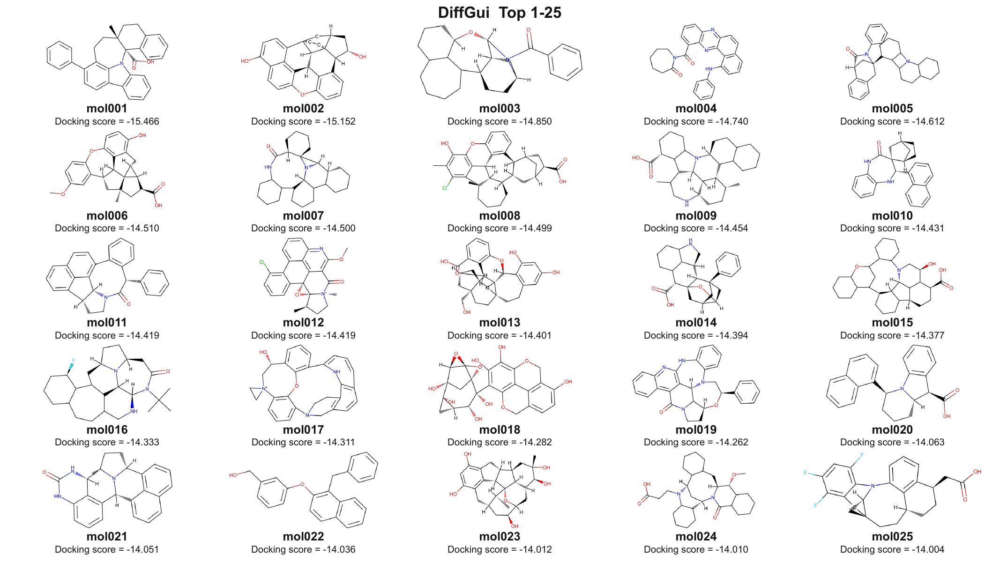
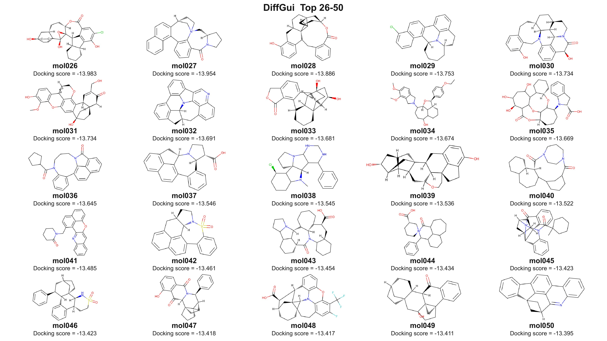
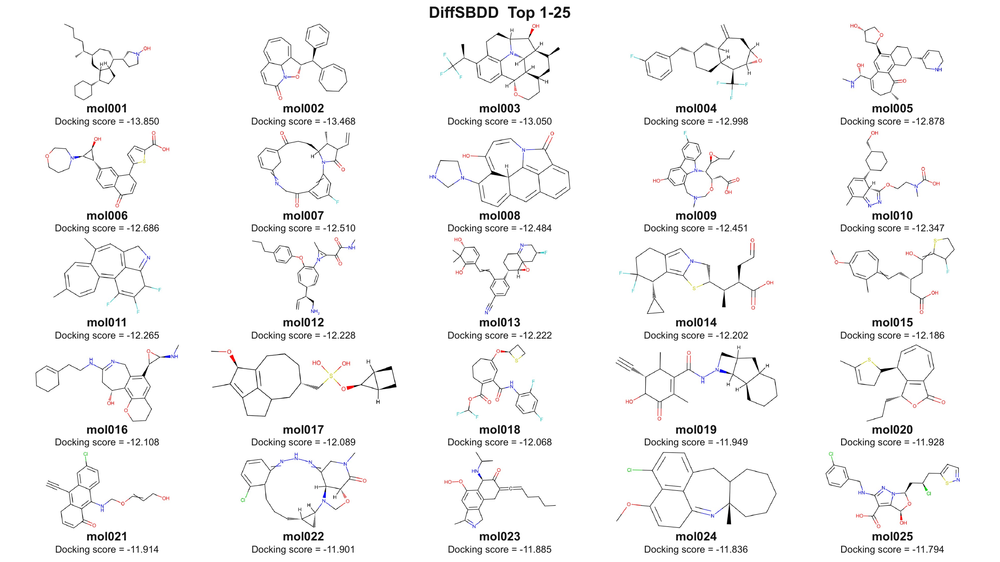
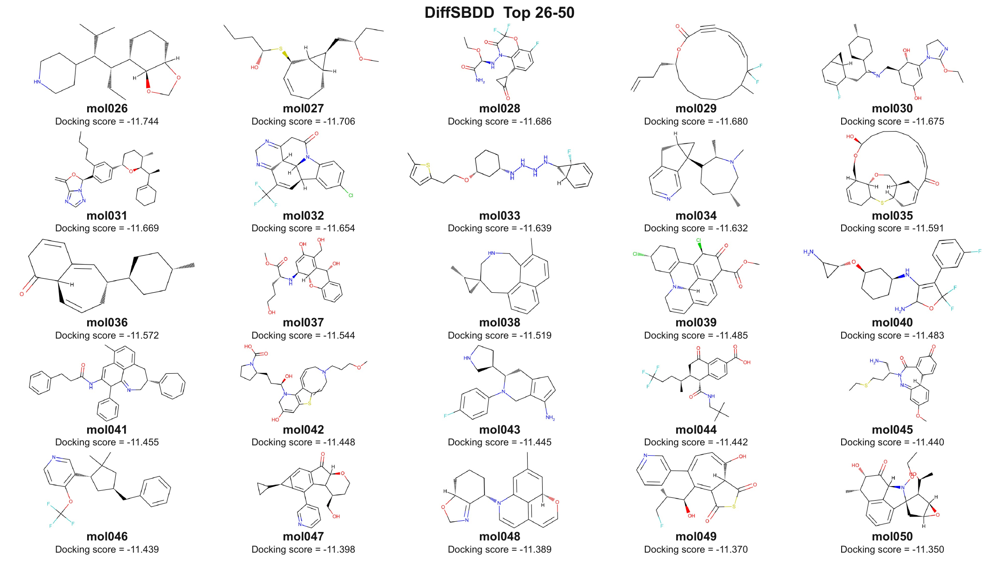

# 原始结构 PB-valid Top50 可编辑 PPT

## 任务背景

将 benchmark 第一批 1000 个生成尝试中同时满足 RDKit 合法和 PB-valid 的 DiffGui、DiffSBDD 分子，分别按 docking score 取 Top50，制作只展示分子本身的 PPT。分子必须来自 LigPrep 前的原始 SDF，不能使用 LigPrep 后结构；PPT 必须由独立可编辑对象组成，不能把整页作为一张图片。

## 数据与筛选结果

| 模型 | 原始 sanitize-valid 记录 | PB-valid Top50 | 原始结构身份核对 |
|---|---:|---:|---:|
| DiffGui | 886 | 50 | 50/50 一致 |
| DiffSBDD | 673 | 50 | 50/50 一致 |
| 合计 | 1559 | 100 | 100/100 一致 |

身份核对使用 canonical isomeric SMILES，将 Top50 选择记录逐一映射回 LigPrep 前的原始 sanitize-valid SDF。映射和 docking score 见 [original_structure_asset_mapping.csv](../../../analysis/benchmark/benchmark5/rep1_pbvalid_top50_editable_ppt_20260714/original_structure_asset_mapping.csv)，汇总见 [asset_export_summary.json](../../../analysis/benchmark/benchmark5/rep1_pbvalid_top50_editable_ppt_20260714/asset_export_summary.json)。

## 实现

- `export_rep1_pbvalid_top50_original_pngs.py`：从原始 SDF 按 Top50 的 source index 回取结构，核对身份，生成 100 张独立高分辨率二维结构图，并导出两个原始结构 Top50 SDF。
- `make_rep1_pbvalid_top50_editable_ppt.py`：生成 4 页 16:9 PPTX，每页 25 个独立分子图片对象、25 个分子名文本框、25 个 docking score 文本框和 1 个标题文本框。
- 字体规则：所有文本 run 显式设置 Latin/数字为 Arial、East Asian 为 Microsoft YaHei；PowerPoint theme 同步设置相同默认字体；RDKit 原子标签使用 Arial。
- 页面内容：DiffGui Top 1-25、DiffGui Top 26-50、DiffSBDD Top 1-25、DiffSBDD Top 26-50，不加入筛选流程汇报页。

## 验证结果

| 检查项 | 结果 |
|---|---|
| Python 语法检查 | 两个脚本均通过 `py_compile` |
| PPTX ZIP 完整性 | 通过，无压缩数据错误 |
| LibreOffice 打开与 PDF 导出 | 成功，PDF 共 4 页 |
| PPT 对象数 | 每页 25 图片 + 51 文本框 = 76 个独立对象 |
| 字体 XML | 204/204 文本 run：Latin=Arial，East Asian=Microsoft YaHei |
| 原始结构身份 | 100/100 canonical isomeric SMILES 匹配 |
| 视觉 QA | 4 页均无明显裁切、重叠或文字越界，结构与标签清晰 |

## 页面预览

## 主要输出

- [可编辑 PPTX](../../../analysis/benchmark/benchmark5/rep1_pbvalid_top50_editable_ppt_20260714/DiffGui_DiffSBDD_rep1_PBvalid_top50_original_editable.pptx)
- [DiffGui 原始结构 Top50 SDF](../../../analysis/benchmark/benchmark5/rep1_pbvalid_top50_editable_ppt_20260714/diffgui_rep1_pbvalid_top50_original_pre_ligprep.sdf)
- [DiffSBDD 原始结构 Top50 SDF](../../../analysis/benchmark/benchmark5/rep1_pbvalid_top50_editable_ppt_20260714/diffsbdd_rep1_pbvalid_top50_original_pre_ligprep.sdf)
- [PPT 渲染 QA PDF](../../../analysis/benchmark/benchmark5/rep1_pbvalid_top50_editable_ppt_20260714/DiffGui_DiffSBDD_rep1_PBvalid_top50_original_editable.pdf)

## 剩余风险

二维结构图本身以独立 PNG 图片对象嵌入，名称、分数和标题均为可编辑文本；分子化学键不是 PowerPoint 原生矢量线条，因此不能在 PowerPoint 内逐键编辑。该设计保留了单个分子的独立移动、缩放、替换和删除能力，并避免整页图片化。
