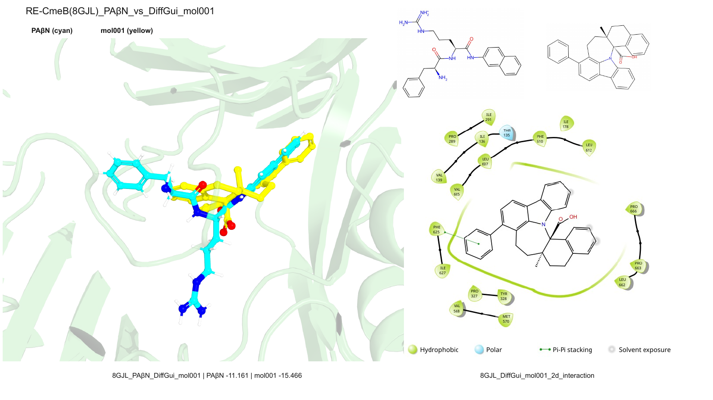
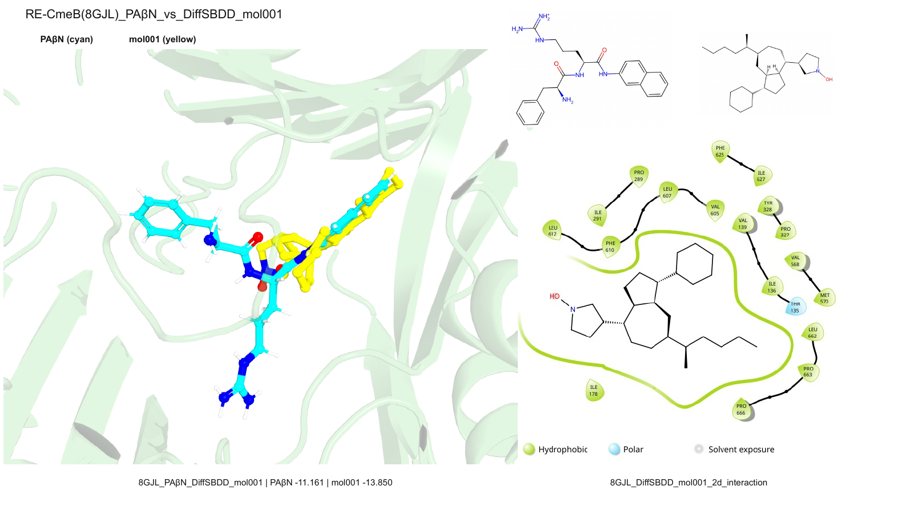

# Top50 对接相互作用 PPT 与交付包

## 任务目的

在原有 DiffGui / DiffSBDD PB-valid Top50 可编辑 PPT 后追加两页对接比较：使用真实对接到 RE-CmeB（8GJL）的 PAβN 作为参考，与各模型 Top1 分子叠合；PyMOL 生成 3D 对接图，Schrödinger 生成各模型 Top1 的 2D interaction 图。同时提供包含蛋白、PAβN、两个 Top1 的 PyMOL 会话，以及包含蛋白和两模型各 Top50 的 Maestro 文件。

## 使用对象

| 对象 | 源记录 | Docking score | 用途 |
|---|---|---:|---|
| PAβN | `ligand_000008_out.sdf` | -11.161 | 8GJL 参考对接配体，PyMOL 青色 |
| DiffGui mol001 | `diffgui_000762_out.sdf` | -15.466 | PB-valid Top1，PyMOL 黄色 |
| DiffSBDD mol001 | `diffsbdd_000207_out.sdf` | -13.850 | PB-valid Top1，PyMOL 黄色 |

## 生成内容

- 最终 PPT 共 6 页：前 4 页保持原始 Top50 二维结构；第 5 页为 PAβN vs DiffGui mol001；第 6 页为 PAβN vs DiffSBDD mol001。
- 两张 3D 图均保留完整 protein cartoon，仅通过 `turn z 32`、`turn x -16`、`turn y 12` 和 `zoom 3.5` 优化视角，没有删除配体附近 cartoon。
- 右侧 2D interaction 分别对应 DiffGui mol001 和 DiffSBDD mol001，不再使用 PAβN interaction 替代候选结果。
- 总 PSE 包含 `receptor`、`pabn`、`diffgui_top1`、`diffsbdd_top1` 四个独立对象。
- Maestro `.maegz` 共 101 个 entry：1 个 8GJL/RE-CmeB 蛋白 + DiffGui Top50 + DiffSBDD Top50。

## 页面预览

## 验证结果

| 检查项 | 结果 |
|---|---|
| 最终 PPT 页数 | 6 |
| 新增页对象 | 每页 4 个独立图片对象、5 个可编辑文本框 |
| 字体 XML | 214/214 text run：Latin=Arial，East Asian=Microsoft YaHei |
| PPTX ZIP 完整性 | 通过 |
| LibreOffice 渲染 | 6 页 PDF 成功；新增页无裁切、重叠 |
| 2D interaction 拓扑 | PAβN、DiffGui、DiffSBDD 三张图哈希不同，候选拓扑与 SDF 一致 |
| Maestro entries | 101 |
| 交付 ZIP | 35 MB，`unzip -t` 无错误 |

## 主要输出

- [完整交付目录](../../../analysis/benchmark/benchmark5/rep1_pbvalid_top50_editable_ppt_20260714/DiffGui_DiffSBDD_Top50_PPT_PyMOL_Schrodinger_package_20260716/README.md)
- [完整 ZIP](../../../analysis/benchmark/benchmark5/rep1_pbvalid_top50_editable_ppt_20260714/DiffGui_DiffSBDD_Top50_PPT_PyMOL_Schrodinger_package_20260716.zip)
- [最终可编辑 PPT](../../../analysis/benchmark/benchmark5/rep1_pbvalid_top50_editable_ppt_20260714/DiffGui_DiffSBDD_rep1_PBvalid_top50_original_editable_with_top1_interactions.pptx)
- [101-entry Maestro 文件](../../../analysis/benchmark/benchmark5/rep1_pbvalid_top50_editable_ppt_20260714/top1_docking_interactions_20260716/8GJL_DiffGui_DiffSBDD_PBvalid_Top50_poseviewer.maegz)
- [总 PyMOL PSE](../../../analysis/benchmark/benchmark5/rep1_pbvalid_top50_editable_ppt_20260714/top1_docking_interactions_20260716/8GJL_PABN_DiffGui_DiffSBDD_top1_master.pse)

## 剩余说明

PPT 中 3D 图、二维结构图和 interaction 图均为独立图片对象，标题与说明文字可直接编辑；分子内部原子/化学键不是 PowerPoint 原生形状。完整结构编辑应使用交付包中的 PSE、SDF 或 MAEGZ。
